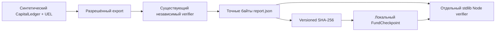

# Blockchain 01 — локальная фиксация версии синтетического отчёта

База: exact HEAD Draft PR #39 `f9d7353033f21b75887e0f3d1f61a9fbb740d95f`, ветка `feat/foundation-09-3-collective-custody`. GitHub подтвердил открытый Draft, совпадающий HEAD и success CI 44344081762 / 44344065552. Новая ветка независима от Living Deeds #43; изменения туда не переносятся.

**Назначение:** разрешённая копия отчёта сравнивается с конкретной локальной on-chain точкой, пока BLAGO не работает. Результат MATCH подтверждает версию файла. Достоверность операций, полномочия людей, актуальность выбранной точки и независимость операторов этим не доказываются.

## Аудит и переиспользование

Прочитаны AGENTS.md, BLAGO_VISION.md и BLAGO_ECONOMIC_CONSTITUTION.md из точной базы. Они сохраняют добровольность, приватность и различие заявления/подтверждения. Доработок application runtime или экономических правил нет.

- `tools/capital_custody_lab.py:21`, `source_fixture(8)` создаёт новые синтетические Identity/Help/Asset/CapitalLedger/UEL данные, проводит канонические поступления 6 млн и 4 млн RUB и их подтверждения. Это существующий сценарий, не новый финансовый lifecycle.
- `tools/governance_lab.py:48`, `proof_export()` получает разрешённый governor export: историю CapitalLedger, UEL headers/leaves, signed checkpoint и binding. Незадействованные UEL payload не раскрываются.
- `tools/independent_capital_verifier.py:230`, `verify_bundle()` проверяет подписи, порядок, повторное исполнение, проекцию и связь с UEL. Результат остаётся `source_truth_proven=false`; pins поступают от синтетического производителя, независимое pinning не заявлено.
- Новый `tools/blockchain01_export.py` только оборачивает эти результаты в отчёт. Он не принимает существующую БД или пользовательский ввод, не сохраняет private keys, не перезаписывает выходной файл. Временные stores и checkpoint-процессы закрываются до завершения producer.



## Формат отчёта и отпечатка

Отчёт — UTF-8 JSON без BOM, создаваемый Python `json.dumps(sort_keys=True, indent=2, ensure_ascii=False) + "\n"`. Поля: format=`blago-synthetic-fund-report-1`, synthetic_only=true, fund, participants=8, proof, producer_pins, verified, pin_provenance. Валюта и суммы в минимальных целых единицах находятся в канонической истории/проверенной проекции. Исходный отчёт показывает 1 000 000 000 копеек подтверждённых поступлений.

Отпечаток **не пересериализует JSON**:

```text
B = все байты файла, включая пробелы и последний LF
D = ASCII("BLAGO/FUND-REPORT-CHECKPOINT/1") || 0x00
P = D || uint64_be(len(B)) || B
digest = SHA-256(P)                 # ровно 32 байта
```

Версия 1 включена в domain prefix. Другая версия требует нового префикса и отдельной спецификации. Это SHA-256, не Ethereum Keccak. Номер точки не является частью digest: он связывается с ним записью контракта. Изменение суммы, whitespace, CRLF или BOM меняет digest. Не нормализовать файл после публикации. Максимум 20 MiB для клиента.

Фиксированный hash-only пример в `tools/blockchain01/hash-vector.json`:

```text
{"format":"blago-synthetic-fund-report-1","synthetic_only":true,"amount_minor":100}\n
digest = 0x6bfe4971e300fc08c035b6312a4a6a6d0f251fabde531f532b273a57ce2d6328
```

Здесь `\n` означает один настоящий LF; это вектор framing, а не полный proof export. Node и независимый Python reference test вычисляют один и тот же результат.

## Контракт

`tools/blockchain01/contracts/FundCheckpoint.sol`, Solidity 0.8.30, optimizer OFF, EVM Paris. Сборка standard JSON, ABI/selectors/runtime bytecode закреплены в artifact.json; `node compile.mjs --check` проверяет воспроизводимость. [Solidity ABI](https://docs.soliditylang.org/en/latest/abi-spec.html), [compiler JSON interface](https://docs.soliditylang.org/en/v0.8.30/using-the-compiler.html).

Один экземпляр представляет один синтетический фонд. Хранит publisher, last и mapping number→bytes32; identity фонда задаётся разрешённым отчётом и отдельно закреплённым адресом экземпляра. `record(number,digest)` требует msg.sender==publisher, number>last, digest!=0. Номер 0 не используется, пропуски разрешены. Запись не имеет setter/delete/upgrade; отклонённая транзакция не меняет last или прошлые точки. Нет token, payable/withdraw, переводов, внешних вызовов или управления CapitalLedger.

Publisher стенда: `0xf39fd6e51aad88f6f4ce6ab8827279cfffb92266`, первый development account. Его контролирует оператор локального Ganache; mnemonic общеизвестная тестовая, все аккаунты локально разблокированы. Это **не** ключ реального фонда и не человеческое согласие. Любой локальный клиент с доступом к development RPC может использовать разблокированный publisher. Тест account1 демонстрирует только проверку msg.sender контракта.

## Независимый клиент

`node tools/blockchain01/verify.mjs REPORT CONTRACT NUMBER --rpc http://127.0.0.1:18545/ --genesis GENESIS_HASH`

Клиент использует только Node standard library и закреплённый artifact.json. `npm install`, BLAGO, SQLite, API, secrets или producer не нужны. RPC только literal loopback HTTP; redirects запрещены. Только read methods: chainId, genesis, code, eth_call. Проверяются chainId=31337, genesis (если передан), точный runtime bytecode и ожидаемый тестовый publisher. Genesis/address/code/publisher должны быть сверены отдельно; chainId сам по себе не доказывает идентичность сети.

| Результат | Exit | Значение |
|---|---:|---|
| MATCH | 0 | Файл совпадает с данной точкой в выбранной локальной сети |
| MISMATCH | 1 | Доступная точка содержит другой digest |
| UNKNOWN | 2 | Невозможно проверить: сеть, missing point, неверная сеть/код/publisher, неверные параметры/файл |

Чтение файла и ошибки сети никогда не превращаются в MISMATCH или MATCH. Команда не вызывает semantic verifier отчёта: повреждённая сумма должна дать MISMATCH; проверка подписей/операций делается отдельно существующим verifier. Проверка старого номера не утверждает, что это последняя версия.

## Приёмка и доказательства

Сценарии автоматизированы `lab.mjs`; реальные, mined EVM транзакции, без mock blockchain. Производитель отчёта — отдельный Python-процесс — заканчивает работу **до** старта сети. BLAGO HTTP-сервер не запускается вообще. Затем verifier копируется в отдельный каталог из трёх файлов без BLAGO и node_modules, и запускается новым Node-процессом с минимальным окружением.

| Сценарий | Ожидание | Проверяемое доказательство |
|---|---|---|
| S1 исходный отчёт / BLAGO OFF | MATCH, exit0 | evidence.scenarios[S1], producer exit_status=0, standalone verifier hashes |
| S2 изменена одна сумма на 1 копейку | MISMATCH, exit1 | changed-report.json, имя поля, два SHA файлов |
| S3 account1 публикует точку2 | REVERT | tx_hash и mined receipt_status=0; last остаётся1 |
| S4 publisher перезаписывает точку1 | REVERT | tx_hash и mined receipt_status=0; digest точки1 прежний |
| S5a точки999 нет | UNKNOWN, exit2 | POINT_ABSENT |
| S5b локальный RPC недоступен | UNKNOWN, exit2 | NETWORK_UNAVAILABLE; действующая сеть доступна по другому порту |

Фактические SHA/адрес/tx/версии и результаты сохраняются в `evidence.json`; команды и независимая сверка — [runbook](blockchain01/RUNBOOK.md). Результаты зафиксированного clean-checkout прогона будут приложены к PR. Unit tests и EVM integration не являются независимым аудитом.

## Ограничения и решение

GO допустим только для изолированной синтетической проверки версии отчёта. Production, реальные отчёты/средства/участники, публичные якоря, xBLAGO, автоматическое распределение, независимая федерация — NO-GO. Соответствие digest не подтверждает наличие денег, согласие людей, полноту реальных событий или честность producer. Канонические Identity, Help, Asset, CapitalLedger/UEL и privacy/recovery остаются неизменны; новых миграций нет.

Ganache — однооператорская одноразовая локальная сеть, не независимый консенсус. RPC может лгать, а оператор — пересоздать сеть или удержать новые точки. Этот клиент не является Ethereum light client и не доказывает заголовки блоков. Потеря сети/контракта означает UNKNOWN; сохранённый hash не заменяет сеть. Персональные сведения и даже их предсказуемые хеши нельзя автоматически публиковать на основании этого стенда.

Изолированные dev-зависимости: Ganache 7.9.2, solc 0.8.30, ethers 6.15.0, package-lock с integrity. Application requirements не менялись. Anvil 1.7.1 был опробован, но на Mac не стартовал без системной libusb; вместо изменения ОС выбран локальный JS-инструментарий. Эти dev dependencies не одобрены для публичного сервиса. [Ganache configuration](https://archive.trufflesuite.com/docs/ganache/reference/cli-options/).
