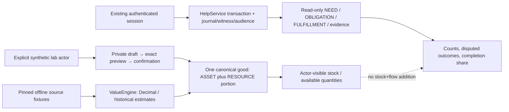

# Collective Calculator 01 — Foundation 09

Draft, PR1 минимального ядра. **GO: изолированные synthetic расчёты и дальнейшая разработка. NO-GO: реальные участники, долговечный пользовательский реестр и публичная коллективная статистика.** BTC здесь исключительно размерность расчёта: ни обеспечение, ни обещание курса, ни покупка, хранение или передача BTC.

Exact base [PR26](https://github.com/xBLAGO/space/pull/26): `34ed8a6c47eb7c90f7eaa5a6807bb1eee78f97a8`; base CI42684126141 SUCCESS перепроверен. Source `cae6337157fa55d6a5cb4bb9e25fce9712f1975e`, [Draft PR27](https://github.com/xBLAGO/space/pull/27), ветка `feat/collective-calculator-01`. Финальный documentation HEAD/CI указан в PR. Все данные новые синтетические; production/secrets/webhook/site/deployment не изменены, merge не выполнялся.

## Аудит и безопасная граница

| Существующее | Фактический код | Решение |
|---|---|---|
| Foundation02 NEED/RESOURCE/ASSET | `src/xblago/integrations/web.py:188` legacy `blago_needs`, `blago_resources`, `blago_assets`, `blago_resource_offers`; отдельные методы/Web UI | Сохранить без изменений; не импортировать неоднозначные права, дубли и финансовые маршруты |
| Help01 | `domain/help_service.py`: `tx`, `prepare`, `commit`, `emit`; requests/offers/events/audience | Единственный источник published NEED, accepted obligation и mutual completion для новой read projection |
| Identity/auth | Help `tx` → IdentityRuntime `session_row` в той же транзакции | Read API принимает existing session token; внутренний user ID не полномочие |
| Privacy/recovery | Help fingerprint/holds + PrivacyControl, retained journal/witness; `core/data_lifecycle.py:29` retirement/scrub | Каждый read заново проверяет controls; не копировать Help text/owners в постоянный калькулятор |
| G09 | `core/context_fencing.py`, долговременный revision/epoch и атомарная история | Не изменяются; новый модуль не читает memory/history и не вызывает LLM |
| Integration02 | manifests, explicit offline migrations; `migrate_help` frozen-baseline limitation | Новых app migrations нет; старые checksums/schema/dependencies неизменны |

Это не второй production реестр: `LabRegistry` доступен лишь как явно созданный synthetic in-memory объект; ни один Web/Bot/Mini App handler его не создаёт. Его principals — случайные локальные идентификаторы fixture, **не** альтернативная регистрация BLAGO. Goods fixture principals и Help participants пока не объединены в постоянную identity-backed community; демо проверяет два scoped read models, не единый production census. Пользовательская идентичность переиспользуется только в существующем защищённом Help read path. Нельзя передавать real IDs/данные в LabRegistry.

Разделение PR выбрано из-за риска: новый долговечный stock registry потребовал бы новой privacy policy, consent revocation journal, retention, Context fencing hooks и ledger-aware migration dispatcher. Имитировать их новым файлом SQLite было бы ослаблением #26. Этот PR содержит работающий valuation/registry/accounting core; следующий PR должен расширить **существующие** asset/resource модели после однозначного mapping и privacy review, а не создавать параллельный Help lifecycle.

## Архитектура и модели

| Сущность | Реализация / граница |
|---|---|
| ASSET | `goods` один ID, synthetic owner FK, version/status/timestamps, quantity/unit/right/audience/conditions |
| RESOURCE | Доступная часть той же ASSET row, не дополнительное имущество. `available <= quantity`; только при `share_consent=true` |
| NEED | Read reference на existing Help ID/version; только текущая авторизованная аудитория; нового состояния/таблицы нет |
| OBLIGATION | Derived from accepted Help; ACTIVE / FULFILLED / CONTESTED, не публикация потребности |
| FULFILLMENT | COUNTERPARTY_CONFIRMED только при Help COMPLETED; DISPUTED снимает confirmed count. Нет придуманных количеств |
| VALUATION | Frozen dataclass + append-only API rows, source quotes, algorithm, original price; revaluation separate link |
| EVIDENCE | Quote provenance + Help event IDs/version/action и текущий уровень. SELF_DECLARED для inventory; independent verification — интерфейс/следующий этап, не заявлена |

[Проверяемая lab schema](calculator01/lab-evidence.json) содержит точный SQL/checksum. Таблицы: principals, goods, challenges, events, valuations, denials, metadata. Они создаются только в `:memory:`; не являются migration production SQLite. Целостность/FK проверены тестом. Export включает лишь собственные rows/events/valuations; он диагностический, не переносимые полномочия и не разрешённый restore package.

Никаких адресов/биографии/свободных персональных заметок в lab body: только ограниченный category code, qty/unit, ownership/use/disposal claim, audience PRIVATE/LAB_COMMUNITY и conditions ON_REQUEST/SCHEDULE_REQUIRED. Право OWNER/USE/DISPOSAL — **заявление**, не доказательство собственности. Зарегистрированное имущество не становится общим, доступность не передаёт право собственности. Количества разных единиц не складываются; автоматической conversion g↔kg/minute↔hour в этом PR нет.

## Расчёты

`BTC estimate = original local price / median(local currency per 1 BTC)`.

- Поддерживаемое подмножество ISO4217: RUB/USD/EUR/GBP/CNY/CHF —2 minor decimals; JPY —0. Другие коды/float/exponent notation/negative/NaN запрещены. Это не полный currency catalogue.
- Цена относится ко **всему зарегистрированному лоту**, не к одной штуке. Деление на qty для flow не производится.
- Decimal context90, суммы bounded lab; итог каждой оценки HALF_EVEN до8 знаков BTC (сatoshi как разрешение чисел, не перевод). Мелкая ненулевая оценка может округлиться до0: это не «бесплатно».
- 2–8 различных configured source IDs с pinned provenance; max quote age300s относительно effective time, future/stale/missing sources запрещены; spread `(max-min)/min <= 0.02`. Ровно2% допускается. Median детерминированна и нечувствительна к порядку источников.
- Pins/разные имена fixture **не доказывают независимость реальных поставщиков**. Нет сети, бирж, подписанных live feeds, fallback к stale quote или усреднения конфликта.
- Historical price/currency/time/quotes/algorithm сохраняются. Переоценка отдельна, с `supersedes`; исходная цена/валюта неизменны. Новый quantity lot не использует старую оценку.
- `balance(at=...)` — **текущее** разрешённое состояние stock с valuation, известной к указанной дате; не исторический snapshot доступности/собственности. Выбор учитывает effective_at и assessed_at.

Stock показывает canonical object count, quantities/available-self-declared по category/unit, известную subtotal BTC и число оценённых/неоценённых записей. Одна canonical row не удваивается как asset+resource. Дубликаты физических объектов под разными IDs/owners и достоверность титула пока не проверяются. Это subtotal зарегистрированных прав/заявлений, **не чистое богатство или суммарное имущество общества**.

Help projection отдельно возвращает published/unmet/completed/disputed counts и долю mutually completed среди **видимых текущих** запросов. Retired/withdrawn/draft не denominator; dispute меняет результат. Это не долговечная статистика общественного благополучия и не обещание полноты.

Pure `quantity_coverage(required, fulfilled, unit)` считает partial/remaining/share и отклоняет overfulfillment, но не выдаёт подтверждение выполнения. Help01 не содержит mutually confirmed measurement/category/price: реальный дефицит по категориям, подтверждённая доступность, накопленный BTC flow и общий wellbeing score возвращаются UNKNOWN/null. Нельзя умножать guessed hours на guessed price. Stock, need и cumulative flow никогда не складываются в одно «богатство».

## API и интерфейс

Минимальный API здесь **Python domain API**, не новые HTTP endpoints. `ValueEngine.evaluate`; `LabRegistry.draft/prepare/commit/revoke/erase/export_own/balance`; `HelpAccountingView.read(existing_session_token)`. В lab каждое расширение прав/availability/audience требует exact body/version preview, actor-bound TTL challenge и буквальное подтверждение. Модель/агент не получают challenge и не вызывают mutations. Replay возвращает ту же receipt без нового event, stale competing version отклоняется. Отзыв/удаление не требует нового согласия на публикацию.

UI production и chat естественность не изменяются. Предлагаемый следующий read-first интерфейс: сообщение → необязательное предложение черновика → краткая карточка точного qty/right/audience/availability → отдельное подтверждение. «У меня велосипед» не равно согласию делиться. «Готов делиться» ещё не передача/обязательство. «Сколько компьютеров доступно?» отвечает только по audience-qualified сведениям с SELF_DECLARED/UNKNOWN labels. Не нужен новый dashboard/финансовое меню.

## Проверки, запуск, решение

[Runbook](calculator01/RUNBOOK.md), [threat model](calculator01/THREAT_MODEL.md), [readiness](calculator01/READINESS_MATRIX.md), [gate evidence](calculator01/gates.json). Команды запускают только новые synthetic fixtures. Demo11 checks показывает два компьютера (один доступен), велосипед без согласия на доступность, subtotal0.01100000 BTC на синтетическом курсе, отзыв и полный Help → dispute → withdrawal. Это не текущая рыночная цена.

44 новых unit/integration/negative tests: currencies/precision/rounding/history/revaluation/provenance/staleness/conflict, canonical IDs/stock-flow/quantity/privacy/consent/replay/version conflict/rollback/export/delete/re-registration, existing Help authentication/audience/live disputes/witness loss/old backup denial. Последовательные competing prepares проверены; отдельный shared cross-worker stock registry **не реализован**, не считать это multiprocess доказательством. Inherited Help/G09 crash/concurrency tests остаются в полном regression.

Локальный full regression начальной source-редакции:514/514 за528.038s (472 прежних+42 новых). После исправления clock/type: final focused44/44 за23.319s; полный final source CI:516/516 за82.164s, Docker и calculator11 PASS. Точный итог/source CI и Docker фиксируются в [test-results.json](calculator01/test-results.json) и PR. Новые application migrations/dependencies/LLM calls/HTTP routes —0. Финальный CI проверяет exact HEAD, не merge commit.

Следующие небольшие PR: (1) reviewed mapping legacy assets/resources + durable consent/denials/retention/fencing/recovery и ledger-aware migration dispatcher; (2) согласованные количественные Help measurements с participant confirmations, без второй state machine; (3) actor-audience API и chat card; (4) независимое подтверждение прав/физических дублей, quote provenance и aggregate privacy review. До этого real-user accounting NO-GO.

G04 остаётся UNKNOWN, G09 — прежний scoped synthetic PASS, G11 — FAIL (synthetic-only). Успех Calculator CI не закрывает Foundation05.4/06.1 host/provider/physical/operator блокеры и не разрешает пилот.
