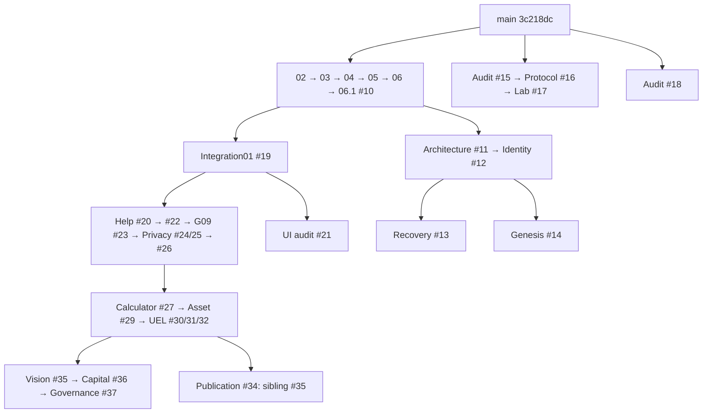

# BLAGO — Dependency & Readiness Matrix

Дата проверки: 18 ноября 2026. Статус: Draft, audit / architecture / planning only.
База этой документации: `3c218dc5757879c26b3aec520af3636b2d702715` (`main`). Проверенный исследовательский runtime: PR #37 `4706a60e7ec675ed1ae16b9c9cd551cde291cfd3`. Данные — только синтетические. Код, схемы, production и release gates не изменены.

Доказательства различаются: **CODE** — прочитанный код, **LOCAL** — исполненный в этом аудите тест, **CI** — проверенный существующий запуск Actions, **DESIGN** — предложение, **UNKNOWN / NOT EXECUTED** — доказательства отсутствуют. Проверка выполнена повторным анализом исходников и GitHub; независимый внешний аудитор и независимые операторы не участвовали.

## Полный срез PR

Точные коммиты/файлы находятся в [git_inventory.json](master_audit/git_inventory.json); все ветки, включая без PR, в [github_snapshot.json](master_audit/github_snapshot.json). API вернул меньше 100 элементов на обеих страницах, поэтому срез полон для доступных публичных PR/веток. Объекты закрытого #8 и #28 дополнительно получены read-only fetch.

| PR | State | Base ref / SHA | Exact head | Title |
|---|---|---|---|---|
| [#2](https://github.com/xBLAGO/space/pull/2) | open Draft | main / `3c218dc5757879c26b3aec520af3636b2d702715` | `4bc48f2a6b23f198ca88a022e4bad0f03f709e8a` | Foundation 02: Unified BLAGO Web/PWA + Telegram Mini App |
| [#3](https://github.com/xBLAGO/space/pull/3) | open | feat/foundation-04-semantic-memory / `25dcb0fae420b27916629b1686f07f6f96e5c446` | `af94ac93dde649747b1a89104000f92f75ecb7fc` | Foundation 04.2: безопасное обновление и удаление персональной памяти |
| [#4](https://github.com/xBLAGO/space/pull/4) | open Draft | fix/foundation-04-memory-pilot / `af94ac93dde649747b1a89104000f92f75ecb7fc` | `8820d7852f0db6c4fc5101f9e281211ba7b6b074` | Foundation 05.1: Identity Store audit and compatible offline migration |
| [#5](https://github.com/xBLAGO/space/pull/5) | open Draft | feat/foundation-05-identity-store / `8820d7852f0db6c4fc5101f9e281211ba7b6b074` | `8b63b8795490a11ad2b5a709b9a258033b7d6381` | Foundation 05.2: secure identity, WebAuthn and session runtime |
| [#6](https://github.com/xBLAGO/space/pull/6) | open Draft | feat/foundation-05-secure-identity-runtime / `8b63b8795490a11ad2b5a709b9a258033b7d6381` | `224ad9d2a1775a8372354af35d542f433cb8bdde` | Foundation 05.3: backup-safe revocations, privacy and minimal analytics |
| [#7](https://github.com/xBLAGO/space/pull/7) | open Draft | feat/foundation-05-privacy-recovery / `224ad9d2a1775a8372354af35d542f433cb8bdde` | `8634e94a6dddd2b8cfff415b112f6b895eb0f4ae` | Foundation 05.4: Pilot Safety Gate and privacy recovery hardening |
| [#8](https://github.com/xBLAGO/space/pull/8) | closed Draft | feat/foundation-05-privacy-recovery / `224ad9d2a1775a8372354af35d542f433cb8bdde` | `183d85e6083fb0806127e569036d2bb7012dfaf7` | Foundation 06: human-first conversation interface |
| [#9](https://github.com/xBLAGO/space/pull/9) | open Draft | feat/foundation-05-pilot-safety-gate / `8634e94a6dddd2b8cfff415b112f6b895eb0f4ae` | `37be0437578125503f0a851c6ce9a86222937cdc` | Foundation 06: human-first UI on Foundation 05.4 |
| [#10](https://github.com/xBLAGO/space/pull/10) | open Draft | feat/foundation-06-human-interface-05-4 / `37be0437578125503f0a851c6ce9a86222937cdc` | `d11a2a555efe57e6818450d534655020bf47b9ca` | Foundation 06.1: conversational intent and reliable HF generation |
| [#11](https://github.com/xBLAGO/space/pull/11) | open Draft | feat/foundation-06-natural-intelligence / `d11a2a555efe57e6818450d534655020bf47b9ca` | `2d6d65913d9091e7d42966532162a0d1de9d0c76` | Foundation 07: Sovereign Human Identity — architecture and safety gates |
| [#12](https://github.com/xBLAGO/space/pull/12) | open Draft | feat/foundation-07-identity-architecture / `2d6d65913d9091e7d42966532162a0d1de9d0c76` | `b79cb603a58adbab1e8a5313a06393a2feb5532f` | Foundation 07.1: Sovereign Identity Core (isolated tests, flag OFF) |
| [#13](https://github.com/xBLAGO/space/pull/13) | open Draft | feat/foundation-07-identity-core / `b79cb603a58adbab1e8a5313a06393a2feb5532f` | `d96ade9375f3499ad93095b2307abd750f0a8578` | Foundation 07.2: isolated recovery protocol; live authority fail-closed |
| [#14](https://github.com/xBLAGO/space/pull/14) | open Draft | feat/foundation-07-identity-core / `b79cb603a58adbab1e8a5313a06393a2feb5532f` | `483475fd237ba3400881699c407be5b91d53dcdd` | Foundation 08: Genesis declarations and consented public deliberation (Draft) |
| [#15](https://github.com/xBLAGO/space/pull/15) | open Draft | main / `3c218dc5757879c26b3aec520af3636b2d702715` | `03cdbf82ec45ee10ec45567ba60f3bfb06fbca5f` | Foundation 08: federation architecture audit and Open Protocol 0.1 requirements |
| [#16](https://github.com/xBLAGO/space/pull/16) | open Draft | docs/foundation-08-federation-audit / `03cdbf82ec45ee10ec45567ba60f3bfb06fbca5f` | `0a6acd9178de8c1aaac8f3af729d896efd4eb98a` | Foundation 08.1: protocol baseline, scoped authority and conformance design |
| [#17](https://github.com/xBLAGO/space/pull/17) | open Draft | docs/foundation-08-1-protocol-conformance / `0a6acd9178de8c1aaac8f3af729d896efd4eb98a` | `44a5d52a4ac8022478a247f4e1bbd2eaea551142` | Foundation 08.2: durable federation lab, receipts and fault injection |
| [#18](https://github.com/xBLAGO/space/pull/18) | open Draft | main / `3c218dc5757879c26b3aec520af3636b2d702715` | `6f83b66db0ef8fc87a93dd0a7de70fdcecca4428` | Integration Audit 01: Foundation dependency graph and safe MVP release gates |
| [#19](https://github.com/xBLAGO/space/pull/19) | open Draft | main / `3c218dc5757879c26b3aec520af3636b2d702715` | `837b2bfd5d3db4842530d30ccf0f417bfe718737` | Foundation Integration 01: guarded nonfinancial 01–06.1 candidate |
| [#20](https://github.com/xBLAGO/space/pull/20) | open Draft | integration/foundation-01-06-1 / `837b2bfd5d3db4842530d30ccf0f417bfe718737` | `417e12be82e0b381d5251e12191a25d1c10921f4` | Foundation Help 01: consented human help cycle with privacy-safe recovery |
| [#21](https://github.com/xBLAGO/space/pull/21) | open Draft | integration/foundation-01-06-1 / `837b2bfd5d3db4842530d30ccf0f417bfe718737` | `e65a696cacc76df3a4b7f0d1b6edf3bf25e66691` | docs: Web, Mini App and public-site audit against Integration 01 |
| [#22](https://github.com/xBLAGO/space/pull/22) | open Draft | feat/foundation-help-01 / `417e12be82e0b381d5251e12191a25d1c10921f4` | `77c7f7f0495a7bb383b1c75c63bf5c97cb984129` | Help 01.1: pilot readiness lab, recovery evidence and NO-GO gates |
| [#23](https://github.com/xBLAGO/space/pull/23) | open Draft | feat/foundation-help-01-1 / `77c7f7f0495a7bb383b1c75c63bf5c97cb984129` | `7807f5aa1c2d1818427057c6ce072ffb6166e3d3` | Privacy 01.2: durable cross-worker context fencing |
| [#24](https://github.com/xBLAGO/space/pull/24) | open Draft | fix/privacy-01-2-context-fencing / `7807f5aa1c2d1818427057c6ce072ffb6166e3d3` | `80e60b4792067b9e4832a3db88e8ea3a0f031f37` | Privacy 01.3: synthetic data lifecycle, retained erasures and G04 evidence |
| [#25](https://github.com/xBLAGO/space/pull/25) | open Draft | feat/privacy-01-3-data-lifecycle / `80e60b4792067b9e4832a3db88e8ea3a0f031f37` | `0772e5bc5919aefac2c209f4e40fe5ea790d6792` | Privacy 01.4: operational retention scheduler and G04 readiness evidence |
| [#26](https://github.com/xBLAGO/space/pull/26) | open Draft | feat/privacy-01-4-operational-retention / `0772e5bc5919aefac2c209f4e40fe5ea790d6792` | `34ed8a6c47eb7c90f7eaa5a6807bb1eee78f97a8` | Integration 02: unified MVP audit and reproducible nonfinancial candidate |
| [#27](https://github.com/xBLAGO/space/pull/27) | open Draft | integration/foundation-02-unified-mvp / `34ed8a6c47eb7c90f7eaa5a6807bb1eee78f97a8` | `00c665b369acb6465f9afa795a6046c43f4107ce` | Collective Calculator 01: offline valuation core and authorized Help accounting |
| [#28](https://github.com/xBLAGO/space/pull/28) | open Draft | feat/collective-calculator-01 / `00c665b369acb6465f9afa795a6046c43f4107ce` | `e049b62860a8170d17e879ce94766fc371f1decb` | docs: BLAGO roadmap — collective accounting, identity graph, ISTINA and federation |
| [#29](https://github.com/xBLAGO/space/pull/29) | open Draft | feat/collective-calculator-01 / `00c665b369acb6465f9afa795a6046c43f4107ce` | `c3b4c5b4fd37a5e16e09b19cdbcf494183963bf5` | Foundation 09.1: durable asset claims with consent and privacy recovery |
| [#30](https://github.com/xBLAGO/space/pull/30) | open Draft | feat/foundation-09-1-durable-registry / `c3b4c5b4fd37a5e16e09b19cdbcf494183963bf5` | `40167137904f0eeb2e04288c2256865740dbffa3` | Draft: BLAGO Universal Event Ledger 0.1 architecture and conformance design |
| [#31](https://github.com/xBLAGO/space/pull/31) | open Draft | docs/universal-event-ledger-01 / `40167137904f0eeb2e04288c2256865740dbffa3` | `aa92d96bca0ae8a07e27f8efa724131afb32ad57` | UEL 0.2 — isolated durable local event ledger |
| [#32](https://github.com/xBLAGO/space/pull/32) | open Draft | feat/uel-02-local-durable-ledger / `aa92d96bca0ae8a07e27f8efa724131afb32ad57` | `06b3889afa906f1ac3af8eca6130f0e6fce6cec9` | UEL 0.3 — signed checkpoint custody and audited recovery |
| [#34](https://github.com/xBLAGO/space/pull/34) | open Draft | feat/uel-03-checkpoint-recovery / `06b3889afa906f1ac3af8eca6130f0e6fce6cec9` | `fffa5b2cd3c9c411c0e7f1c9c022de751f0dbc17` | Record the public BLAGO research snapshot and reproducible evidence archive |
| [#35](https://github.com/xBLAGO/space/pull/35) | open Draft | feat/uel-03-checkpoint-recovery / `06b3889afa906f1ac3af8eca6130f0e6fce6cec9` | `e707a19b0b98324ffd914a28b08601237cd6aea2` | Foundation 09: principles, guarded collective balance and synthetic 10M planning |
| [#36](https://github.com/xBLAGO/space/pull/36) | open Draft | feat/foundation-09-collective-balance / `e707a19b0b98324ffd914a28b08601237cd6aea2` | `c3c6896076c9e24932ebdb0ee14e7c04065b91dd` | Foundation 09.1: durable synthetic capital, signed approvals and atomic UEL reserves |
| [#37](https://github.com/xBLAGO/space/pull/37) | open Draft | feat/foundation-09-1-durable-capital / `c3c6896076c9e24932ebdb0ee14e7c04065b91dd` | `4706a60e7ec675ed1ae16b9c9cd551cde291cfd3` | Foundation 09.2: collective policy quorum, safe exit and independent UEL verifier |

## Ancestry и интеграционные границы

Реальная Git-проверка: #10 — предок #19; #35 — предок #36; #36 — предок #37. #12 и #13 **не** предки #37, merge-base `d11a2a555efe57e6818450d534655020bf47b9ca`; #17 и #37 расходятся от main. У #12/#37 left/right 3/38 коммитов; #17/#37 5/86. Линейная цепочка в схеме обозначает зависимости разработки, не факт merge в main.

#19 уже содержит Foundation01–06.1. Повторное объединение исходных #2–10 поверх него создаст лишний merge и повторный review. #8 закрыт без merge. #21/#28/#34 — вспомогательные документационные линии; #34 не является runtime-базой #35. #11–14 и #15–17 требуют отдельной интеграции, а не включения всех таблиц одним startup migration.

## Component | Current State | Source PR/SHA | Evidence | Missing Requirements | Risks | Dependencies | Proposed Phase | GO/NO-GO

| Component | Current State | Source PR/SHA | Evidence | Missing Requirements | Risks | Dependencies | Proposed Phase | GO/NO-GO |
|---|---|---|---|---|---|---|---|---|
| Main runtime | CLI/Bot/SQLite | main `3c218dc5757879c26b3aec520af3636b2d702715` | LOCAL 27 tests; CODE | Unified guarded runtime | auto HF deploy | release guard | 0 | NO-GO merge |
| Web/PWA/Mini App | server-backed UI | #2→#26 `34ed8a6c47eb7c90f7eaa5a6807bb1eee78f97a8` | CI synthetic browser | physical WebView, approved deployment | channel/session mismatch | Identity, CSRF, G09 | 1 | synthetic only |
| Identity Store/WebAuthn | local user + auth/session/linking | #4/#5→#26 | tests/test_identity_runtime.py, tests/test_web.py | real device/custody, restore attestation | session != human signature | SQLite/Privacy | 1 | real NO-GO |
| Context/Memory | 24-turn window + semantic facts + G09 | #10/#23→#37 | LOCAL probe and fencing suite | profile grounding, source evidence, long context | invented continuity, missed facts | canonical user/Privacy | 1 | fixes needed |
| Help | canonical lifecycle with mutual completion | #20→#37 | tests/test_help01.py + CI browser | operator and real-user qualification | audience leakage/consent bypass | Identity/G09/Privacy | 1 | synthetic only |
| Asset Registry | canonical durable statements | #29 `c3b4c5b4fd37a5e16e09b19cdbcf494183963bf5`→#37 | tests/test_asset_registry.py | independent factual verification | SELF_DECLARED misread as verified | identity/Help/UEL | 2 | synthetic only |
| Collective Calculator | Decimal/offline valuation and stock/flow | #27 `00c665b369acb6465f9afa795a6046c43f4107ce` | calculator tests/demo | qualified prices and completeness | unknown != zero, double counting | Asset/Help | 2 | no real balance |
| UEL | local shadow; checkpoint recovery | #30–32 `06b3889afa906f1ac3af8eca6130f0e6fce6cec9` | tests/test_uel*.py, unchanged 72 vectors CI | independently retained current tip; federation mapping | correlated rollback / HMAC custody | canonical sources/privacy | 2/3 | local only |
| Foundation09 planner | explainable synthetic 100-person plan | #35 `e707a19b0b98324ffd914a28b08601237cd6aea2` | CI44080330203 | collective policy ratification | plan mistaken for authority | calculator/UEL | 2 | synthetic only |
| Capital | durable integer lots/reserves/approvals | #36 `c3c6896076c9e24932ebdb0ee14e7c04065b91dd` | CI44300119298 / tests/test_capital.py | no real-money adapter or admission | forged proof, replay, real-world truth | UEL/Privacy | 2 | synthetic only |
| Governance | version2 quorum/delegation/exit | #37 `4706a60e7ec675ed1ae16b9c9cd551cde291cfd3` | CI44314309823 / tests/test_governance.py | membership/key rotation, independent custody | colluding quorum, central node binding | #36 + signed policy | 2 | synthetic only |
| Sovereign Identity | experimental owner/controller proofs | #12 `b79cb603a58adbab1e8a5313a06393a2feb5532f` | tests/test_sovereign_identity.py in that branch | forward-port delete/merge/G09/retention | server rollback / controller loss | #11 / old05.4 | 3/4 | integration NO-GO |
| Sovereign Recovery | isolated signed ceremony; activation always denied | #13 `d96ade9375f3499ad93095b2307abd750f0a8578` | core/identity_recovery.py:319, branch recovery tests | atomic authority commit, independent controllers/checkpoints | collusion / missing control state | #12 /05.4 | 4 | real NO-GO |
| BOP federation | signed envelope/receipts/stateful lab | #16/#17 `44a5d52a4ac8022478a247f4e1bbd2eaea551142` | CI41714974472 S01–S11; 73 vectors/reference | S12 operator independence, authenticated remote transport | partition/status freshness | separate trust anchors | 3 | independent NO-GO |
| Local-first agent | no full implementation | DESIGN | hosted storage/LLM inspected | encrypted local vault, offline queue/sync | data-copy resurrection | Phase1/3 | 4 | NOT EXECUTED |
| P2P/mesh | absent | DESIGN | official transport docs only | implementations/devices/interoperability | traffic leakage, battery, NAT | Phase3/4 | 5 | NOT EXECUTED |
| ISTINA collective knowledge | concepts/Genesis separate | #14 + protocol docs | branch sources | claim evidence/dispute/disclosure protocol | private fact auto-publication | consent/identity | 6 | NOT IMPLEMENTED as federation |
| Public blockchain | no release dependency | DESIGN only | no transactions executed | necessity/consensus/privacy decision | permanent metadata leakage | future collective decision | deferred | NO-GO |

## CI — проверка и ограничения

Все exact-head результаты с URL и датой: [ci_snapshot.json](master_audit/ci_snapshot.json). Для #35, #36, #37: success; jobs и логи #35/#36 перепроверены: 684 tests дважды (206.616/207.108s) и 725 tests дважды (238.162/235.976s), [counts](master_audit/ci3536_verified.json); [#35 run44080330203](https://github.com/xBLAGO/space/actions/runs/44080330203), [#36 run44300119298](https://github.com/xBLAGO/space/actions/runs/44300119298), [#37 run44314309823](https://github.com/xBLAGO/space/actions/runs/44314309823). Для #37 jobs `tests` и `docker` success; логи показывают 773 tests дважды. Наличие зелёного CI — ограниченное свидетельство соответствующих синтетических проверок.

Дополнительная проверка всех типов запусков по exact head: [ci_supplement.json](master_audit/ci_supplement.json). У #8 push run40014959680 success; у #11 push run40076089703 success. **У #9 run40016287991 failure**: tests unit step success, Docker success, browser WebAuthn step failure (`Locator.click` timeout30000ms, job120629061063); причина UI/окружения этим аудитом не исправлялась. Потомок #10 имеет другой SHA и зелёный CI; это не меняет результат #9. Исторический fail #9 сам по себе не доказывает дефект #37 и не является основанием повторно накладывать #9 поверх #19. Для #15/#18/#21/#28/#34 API вернул 0 runs на этих HEAD.

Wrapper PR-triggered runs не возвращает все push/workflow_dispatch runs. Отсутствие записи обозначено UNKNOWN, не FAIL и не утверждение «CI никогда не было». Нет PR-triggered результата у #8, #9, #11, #15, #18, #21, #28, #34 в данном ответе API. Исходные golden results не менялись. Этот документационный PR наследует main без tests.yml; не подменять отсутствие CI успехом runtime #37.

## Области вероятного конфликта

1. `integrations/web.py`, `integrations/identity.py`, `core/storage.py`: #12 добавляет controller/credential/merge/delete, тогда как #23–25 добавляют fencing/denials/retention, #29–37 — новые зависимости удаления. Общие пути изменены после общего #10. Требуется семантический review каждого удаления/merge, даже если Git смог слить текст.
2. Таблицы sovereign имеют FK на локальный users; BOP lab использует иные synthetic Human/Agent/Node и свои хранилища. Сопоставление не существует автоматически. Нельзя публиковать внутренний blago_user_id в качестве универсальной личности.
3. Privacy journal HMAC, UEL signed checkpoint, BOP status/receipt и capital detached signature — разные домены и модели доверия. Подписи нельзя взаимозаменять.
4. Миграции context/lifecycle/asset/UEL/capital/governance явные, имеют checksum и guards. Повторный импорт старой схемы 07 не должен обходить текущий manifest или добавлять startup DDL. Нужны fixture upgrade из каждой поддерживаемой версии и integrity/FK checks.
5. Фактический HF Docker использует старую Python base и не доказывает исправленную SQLite. Проверка patched SQLite в CI ветви не аттестует библиотеку действующего Space.

## SQLite surface evidence

[Schema surface](master_audit/schema_surface.json) содержит exact SHA, SHA256 исходных DDL-файлов, literal names таблиц и VERSION constants для main, #12, #13, #17 и #37. В main обнаружен один DDL source (`core/storage.py`), в #12/#13 — восемь, в #37 — семнадцать; это число исходных файлов, не число миграций/таблиц. Статический scanner не исполняет DDL и не подтверждает production-схему. Для manifest следует брать существующий integration/candidate.json и валидаторы каждого migration source, а не создавать новое правило импорта.

Критические канонические таблицы: users/profiles/channel_links; memory_facts/semantic_memory/dialogue_turns; web_sessions/passkey_credentials/auth_challenges; help_requests/help_offers/help_events; blago_assets + assetreg_records/assetreg_versions; uel_events; capital_funds/capital_members/capital_versions; governance controls. #12 добавляет sovereign_identities/identity_controllers/identity_wallet_links/identity_credentials/identity_events/identity_consents и связанные controls. Точные literal names сверяются по JSON, возможные динамические имена — по исходнику. Наличие похожего имени таблицы не доказывает совместимость policy/recovery.

## Legacy экономика и coverage: отдельный интеграционный долг P1

`domain/asset_registry.py:1/155` расширяет **blago_assets**, а `assetreg_records` — version/consent metadata того же asset_id. Это не независимый второй объект. При этом `WebApp.rows/create_item/analytics` (`integrations/web.py:578–650`) всё ещё работает с **blago_needs/blago_resources**; Help01 использует **help_requests/help_offers/help_events**. Нельзя считать legacy need автоматически опубликованным HelpRequest или суммировать оба как разные потребности. Registry явно сообщает `PARTIAL: mapped statements only; unmapped legacy excluded` и count unmapped_owned_assets. UniversalBalance читает проверенные локальные views; `domain/universal_balance.py:143–158` считает видимые Help и mutual completions отдельно.

Необходимое изменение отдельного PR: единый read-only UI adapter с provenance/coverage и ссылкой на канонический объект; миграция только при однозначном подтверждённом mapping, никакого автоматического legacy import. Проверки: одна потребность в старой карточке и Help не удваивает denominator; asset/resource counted once; unmapped/unknown показаны явно; delete/revoke отражены во всех widgets. UI должен показывать, какие коллекции именно посчитаны.

**P0 граница релиза:** `web.py:1297` применяет `integration.route_allowed` в synthetic integration. В legacy коде сохраняются финансовые модели/маршруты и старые analytics с финансовыми полями. Нельзя превратить synthetic candidate в real runtime простым выключением `XBLAGO_INTEGRATION_MODE=synthetic`: это потребует отдельного deny-by-default nonfinancial release contract и negative endpoint tests. Наличие этих методов в #37 не означает реальные платежи или их доступность на HF; production endpoints не проверялись.

**Важное ограничение #13:** `core/identity_recovery.py:319` всегда отклоняет `activate_identity()`. `ready` — только проверенные согласования церемонии, не восстановленный owner. Distributed single-successor authority commit и delivery infrastructure отсутствуют. Нельзя отмечать завершённое Sovereign Recovery как Implemented на основании threshold/signature тестов.

## UI, PWA и LLM: проверенные точки интеграции

`integrations/static/index.html:170–184` хранит UI state/CSRF в JS memory, запрашивает `/api/v1/me`, затем обменивает raw Telegram initData через secure challenge при доступной capability. `web.py:1437` читает/пишет chat history; Help controls в `index.html:250–260` используют prepare/commit и точное подтверждение. Память и профиль показываются раздельно. Это серверный клиент, не автономный агент. `static/sw.js:1–5` кеширует лишь icon/manifest и не кеширует authenticated API или navigation: даже полный offline app shell не доказан этим service worker. Удаление/экспорт браузерных копий и физический WebView — отдельные проверки.

`core/config.py:22–41` позволяет менять OpenAI-compatible base_url/model/provider; HF — default route только для выбранного HF provider. Следовательно, жёсткого требования одного LLM-поставщика в абстракции нет. Но одновременно выбирается один route, его доступность/retention/cost управляет оператор, а fallback LocalPlanningProvider ограничен. Переключение модели при том же store не переносит криптографическую identity на другой node и не подтверждает качество нового provider. В этом аудите внешние inference calls не выполнялись.
