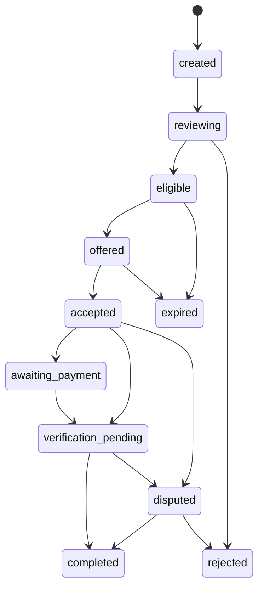

# BLAGO Economy 01

## Назначение

BLAGO Economy 01 описывает базовый протокол распределённого обеспечения потребностей. Его задача — помочь участнику сформулировать потребность, найти добровольные ресурсы сообщества, зафиксировать согласие исполнителя и сохранить проверяемую историю действий.

На этом этапе BLAGO не является банком, платёжным агентом, кошельком, биржей или системой хранения денег. Протокол не создаёт денежные требования, не выпускает токены, не ведёт доступный для вывода баланс и не выполняет банковские переводы.

## Основные сущности

### Needs

Потребность участника. В MVP совместима с существующей таблицей `blago_needs`.

Поля:
- `id`
- `blago_user_id`
- `title`
- `description`
- `visibility`
- `status`
- `created_at`

### Assets

Актив, который участник сам указал как принадлежащий ему, доступный ему или потенциально полезный сообществу.

Важное правило: самозаявленный актив не считается проверенным, принадлежащим BLAGO или переданным под управление.

Поля:
- `id`
- `blago_user_id`
- `title`
- `description`
- `asset_type`
- `ownership_claim`: `self_declared`, `custodian`, `unknown`
- `use_permission`: `owner_only`, `permission_required`, `community_allowed`
- `management_status`: `not_under_management`, `offered_for_use`, `under_management`
- `verification_status`: в MVP всегда `self_declared_unverified`
- `visibility`
- `created_at`
- `updated_at`

### ResourceOffers

Добровольное предложение помощи или ресурса. Оно не создаёт обязанности помогать и может быть отклонено без последствий для участника.

Поля:
- `id`
- `blago_user_id`
- `title`
- `description`
- `offer_type`: `service`, `asset_use`, `external_payment`, `coordination`
- `availability_status`: `available`, далее может расширяться
- `visibility`
- `max_amount_minor`
- `currency`
- `constraints_json`
- `created_at`
- `updated_at`

### PaymentRequests

Запрос на внешнюю оплату, если потребность невозможно закрыть внутренними ресурсами. В MVP такой запрос может быть только симулирован и затем вручную подтверждён.

Поля:
- `id`
- `need_id`
- `requester_user_id`
- `executor_user_id`
- `title`
- `description`
- `amount_minor`
- `currency`
- `payment_purpose`
- `payment_reference_digest`
- `risk_level`
- `risk_reason`
- `status`
- `contribution_recorded`
- `created_at`
- `updated_at`

Платёжные реквизиты не публикуются в списках и не сохраняются в открытом виде. MVP сохраняет только digest переданной строки, чтобы не раскрывать персональные данные.

### FulfillmentEvents

Неизменяемая история ключевых действий по исполнению.

Типовые события:
- `payment_request_created`
- `executor_offered`
- `executor_accepted`
- `simulated_payment_submitted`
- `manual_fulfillment_confirmed`

Каждое событие имеет `event_key`, чтобы повторная доставка или повторная команда не создала дубль.

### ContributionEvents

Учётный факт вклада участника. Он создаётся только после ручного подтверждения результата получателем и не является финансовым балансом.

Поля:
- `id`
- `payment_request_id`
- `contributor_user_id`
- `recipient_user_id`
- `contribution_type`
- `amount_minor`
- `currency`
- `xblago_estimate`
- `exchange_rate_source`
- `exchange_rate_at`
- `note`
- `event_key`
- `created_at`

## Диаграмма состояний PaymentRequest

В текущем MVP создание запроса сразу выполняет простую проверку риска и переводит запрос в `eligible` или `rejected`. Статус `awaiting_payment` зарезервирован для будущего шага, где исполнитель явно отметит готовность перейти к оплате; текущая симуляция допускает переход `accepted -> verification_pending`.

## Сценарий MVP

1. Участник создаёт потребность.
2. Если нужен внешний платёж, создаётся `PaymentRequest`.
3. Система классифицирует риск.
4. Для допустимого запроса выбираются добровольцы с `ResourceOffer.offer_type = external_payment`, `visibility = community`, подходящей валютой и лимитом.
5. Выбор добровольцев содержит случайность.
6. Исполнитель отдельно принимает предложение.
7. Система атомарно закрепляет одного исполнителя и закрывает остальные предложения как недоступные.
8. Исполнитель отмечает симуляцию оплаты.
9. Получатель вручную подтверждает исполнение.
10. Система создаёт `ContributionEvent`.

Ручное подтверждение в MVP не является банковской верификацией и не доказывает реальный перевод денег.

## Правила учёта

- Потребности учитываются отдельно от ресурсов, активов, предложений помощи и вкладов.
- Активы по умолчанию самозаявленные и непроверенные.
- Передача актива под управление фиксируется отдельным статусом, а не выводится из факта регистрации.
- Вклад фиксируется только после перехода `verification_pending -> completed`.
- Повторное подтверждение не создаёт второй вклад.
- Внутренняя оценка в xBLAGO является статистикой с источником и временем курса.
- Оценка xBLAGO не является токеном, правом требования, балансом, вознаграждением или финансовой привилегией.
- Отказ от предложения не ограничивает права участника.

## Аналитика

MVP считает:
- количество зарегистрированных запросов;
- долю завершённых запросов;
- внешний фиатный спрос в minor units;
- доступные добровольные предложения;
- количество зафиксированных вкладов;
- расчётную xBLAGO-оценку вкладов, если указан курс.

Не считаются:
- рейтинги людей;
- социальные уровни;
- финансовые привилегии;
- доступные к выводу балансы.

## Безопасность и ограничения данных

Запрещено запрашивать и сохранять:
- банковские пароли;
- PIN;
- CVV;
- доступ к банковским аккаунтам;
- полные публичные платёжные документы без отдельной политики хранения.

MVP не автоматизирует переводы произвольным физическим лицам. Любая реальная оплата остаётся действием человека вне BLAGO и требует отдельного правового, антифрод и комплаенс-решения.

## API MVP

Все методы требуют текущую web-сессию и CSRF для небезопасных методов.

- `GET/POST /api/v1/economy/assets`
- `GET/POST /api/v1/economy/resource-offers`
- `GET/POST /api/v1/economy/payment-requests`
- `GET /api/v1/economy/payment-requests/{id}`
- `POST /api/v1/economy/payment-requests/{id}/offer`
- `POST /api/v1/economy/payment-offers/{id}/accept`
- `POST /api/v1/economy/payment-requests/{id}/simulate-payment`
- `POST /api/v1/economy/payment-requests/{id}/confirm`
- `GET /api/v1/economy/payment-requests/{id}/events`
- `GET /api/v1/economy/payment-offers`
- `GET /api/v1/economy/analytics`

## Ошибки и спорные ситуации

- Нет добровольцев: запрос остаётся `eligible`, предложение не создаётся.
- Два исполнителя принимают один запрос: атомарное обновление закрепляет только первого.
- Повторная команда подтверждения: второй `ContributionEvent` не создаётся.
- Запрос содержит банковские секреты: статус `rejected`.
- Подтверждение исполнителем без принятия: `409`.
- Подтверждение получателем до симуляции: `409`.
- Чужой запрос или чужое предложение: `404`.
- Спор после ручного подтверждения требует будущего процесса модерации; в MVP состояние `disputed` зарезервировано.

## Что нужно для реальных платежей

Перед подключением настоящих платежей требуется:
- юридическая модель роли BLAGO;
- KYC/KYB и антифрод-процедуры;
- политика хранения платёжных документов и персональных данных;
- интеграция с лицензированным платёжным провайдером;
- проверка санкционных и мошеннических рисков;
- журналирование с неизменяемыми аудит-событиями;
- процедура возвратов, споров и ошибок оплаты;
- отдельное согласие участников на обработку платёжных данных.
