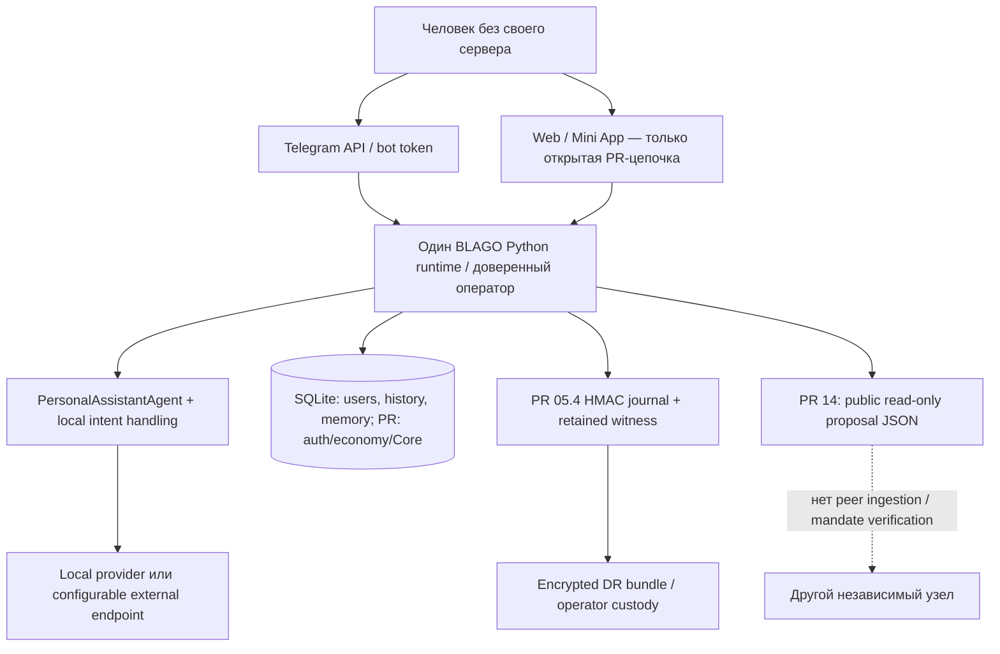
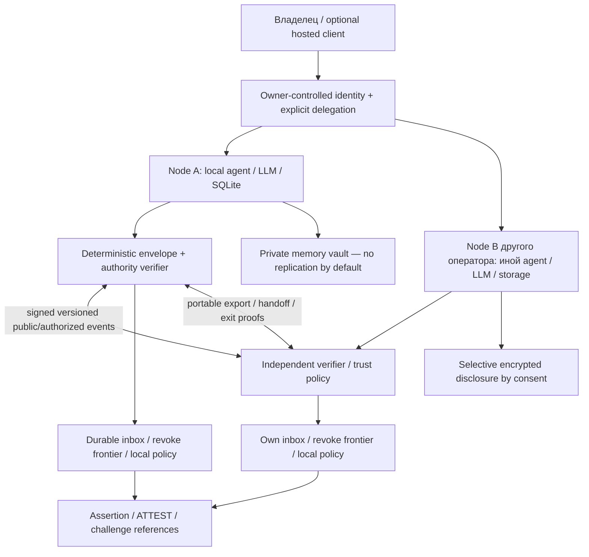

# BLAGO Foundation 08 — Federated Architecture Audit

**Статус: Draft. Решение: NO-GO для заявлений о готовой федерации. GO для
проектирования протокола и изолированных interoperability-испытаний.**

Срез проверен по GitHub API и закреплённым Git objects. Аудит отделён от реализации:
production-код, API, зависимости и БД не менялись; миграции не выполнялись.
Это повторная проверка исходного кода и границ доказательств, **не независимая
внешняя сертификация**: значительная часть открытых PR создана в той же рабочей
сессии. До федеративного пилота необходим review другой командой.

## 1. Ответ на главный вопрос

Сейчас BLAGO — переносимое **одноузловое приложение** с персональным агентом.
`main` содержит Telegram, SQLite, историю, JSON-memory abstraction и сменяемый
LLM endpoint. Более зрелые auth, privacy/recovery, экономика, Identity Core и
общественные публикации находятся в **открытых, не слитых PR**.

Эти наработки полезны для федерации, но не образуют её. Нет переносимого мандата
агента, межузловой проверки актуального отзыва, согласованного wire-протокола,
import/handoff identity, независимого ATTEST или доказанного выхода из федерации.
Два процесса с одной SQLite/копией HMAC-ключа не становятся независимыми узлами.
HTTP JSON, controller PoP и hash chain решают разные частные задачи; их наличие
не доказывает federated authorization, истину утверждения или отсутствие fork.

**Минимальный путь — сохранить текущий MVP как совместимый локальный узел,
добавляя проверяемые границы identity/mandate/event/transfer отдельными слоями.**
Не нужно сначала заменять SQLite, вводить blockchain, токен или распределённый
консенсус. Но нельзя выдавать shared-secret journal за независимый trust layer.

## 2. Проверенные версии и границы применимости

| Срез | SHA / ветка | Реально присутствует |
|---|---|---|
| M: актуальный `main` | `3c218dc5757879c26b3aec520af3636b2d702715` | CLI, персональный агент, Telegram, SQLite users/links/memory/history/update dedupe; Web и экономика отсутствуют |
| [PR #2](https://github.com/xBLAGO/space/pull/2) | `4bc48f2a6b23f198ca88a022e4bad0f03f709e8a`, `feat/foundation-02-unified-app` → main | Web/PWA/Mini App и экономические сущности |
| [PR #3](https://github.com/xBLAGO/space/pull/3) | `af94ac93dde649747b1a89104000f92f75ecb7fc`, `fix/foundation-04-memory-pilot` | Исправления semantic memory; base `feat/foundation-04-semantic-memory` |
| [PR #4](https://github.com/xBLAGO/space/pull/4) | `8820d7852f0db6c4fc5101f9e281211ba7b6b074`, `feat/foundation-05-identity-store` → #3 | Identity Store migrations |
| [PR #5](https://github.com/xBLAGO/space/pull/5) | `8b63b8795490a11ad2b5a709b9a258033b7d6381`, `feat/foundation-05-secure-identity-runtime` → #4 | Sessions, WebAuthn, Telegram replay controls |
| [PR #6](https://github.com/xBLAGO/space/pull/6) | `224ad9d2a1775a8372354af35d542f433cb8bdde`, `feat/foundation-05-privacy-recovery` → #5 | Privacy export/delete, journal/recovery |
| [PR #7](https://github.com/xBLAGO/space/pull/7) | `8634e94a6dddd2b8cfff415b112f6b895eb0f4ae`, `feat/foundation-05-pilot-safety-gate` → #6 | SQLite gate, lineage, witness, custody drill |
| [PR #9](https://github.com/xBLAGO/space/pull/9) | `37be0437578125503f0a851c6ce9a86222937cdc`, `feat/foundation-06-human-interface-05-4` → #7 | Human-first interface |
| [PR #10](https://github.com/xBLAGO/space/pull/10) | `d11a2a555efe57e6818450d534655020bf47b9ca`, `feat/foundation-06-natural-intelligence` → #9 | Conversation intent, bounded HF generation, atomic history |
| [PR #11](https://github.com/xBLAGO/space/pull/11) | `2d6d65913d9091e7d42966532162a0d1de9d0c76`, `feat/foundation-07-identity-architecture` → #10 | Архитектура; документ не является реализацией |
| C: [PR #12](https://github.com/xBLAGO/space/pull/12) | `b79cb603a58adbab1e8a5313a06393a2feb5532f`, `feat/foundation-07-identity-core` → #11 | Test-only Core, controllers, L1 possession proof, privacy/recovery extensions |
| R: [PR #13](https://github.com/xBLAGO/space/pull/13) | `d96ade9375f3499ad93095b2307abd750f0a8578`, `feat/foundation-07-identity-recovery` → #12 | Threshold ceremony evidence; authority activation всегда запрещена |
| G: [PR #14](https://github.com/xBLAGO/space/pull/14) | `483475fd237ba3400881699c407be5b91d53dcdd`, `feat/foundation-08-genesis-protocol` → #12 | Private declarations, consented proposals, public version hashes; не федерация |

Все перечисленные PR открыты; #3 не draft, остальные draft. R и G — **соседние**
ветки от C, их возможности нельзя суммировать как один протестированный runtime.
Для runtime-кода M/C/R/G получены отдельные Git archive snapshots. Промежуточные
ветки проверены по графу, присутствующему в C коду/тестам и документам; не заявляется
отдельное исполнение каждой промежуточной ветки. Линии ссылок ниже привязаны к SHA,
а не к меняющимся branch tips. `BLAGO_PROTOCOL_v0.1.md` в G — Genesis Draft;
этот аудит не объявляет его уже принятым BLAGO Open Protocol 0.1.

## 3. Метод и доказательства

Статус относится к **целевому свойству**, а не ко всему файлу:
Implemented — конкретное свойство реализовано в указанном scope;
Partial — есть локальная часть, но не весь контракт;
Missing — механизма в проверенном runtime нет;
Unknown — доказательств недостаточно (не синоним безопасности).

- **E0 — source:** прочитаны schema/handlers/guards/export/recovery/provider и tests.
  Отсутствие свойств проверялось по inventory моделей и маршрутов, а не только
  поиском слова. WebAuthn attestation ≠ общественный ATTEST; controller ≠ mandate.
- **E1 — свежая локальная проверка без БД:** на точном M исполнены 4 local-provider
  и 12 in-memory agent tests: **16/16 PASS**. На C чистые вызовы verifier и risk
  classifier без WebApp/store construction, сетевых запросов и миграций.
- **E2 — существующие интеграционные доказательства:** source tests прочитаны;
  GitHub API и фактические test-job logs повторно подтвердили success pinned CI:
  [C, 344 tests + Docker](https://github.com/xBLAGO/space/actions/runs/40568551246),
  [R, 380 tests + Docker](https://github.com/xBLAGO/space/actions/runs/40584412666),
  [G, 375 tests + Docker](https://github.com/xBLAGO/space/actions/runs/41520088632).
  Это ранее выполненные синтетические интеграции, не новые запуски этого аудита.
- **E3 — независимые узлы:** **не подтверждено ни одного** interop exercise разных
  операторов, без общих ключей/control files. Separate-process DR — перенос
  доверенного состояния, не федерация. Реальные topology/IAM/custody/SLO — Unknown.

[Machine-readable evidence](BLAGO_FEDERATION_AUDIT_EVIDENCE.json) содержит SHA,
file hashes, проверенные строки и результаты E1. AST inventory: M 27, C 304,
G 335, R 340 объявленных test functions; runtime counts выше, поскольку 40
conversation scenarios генерируются динамически. Inventory не равен числу
пройденных тестов. Новые зависимости и database fixtures не устанавливались/не
запускались. HF CLI skill использован как read-only guidance; ни Hub runtime,
ни секреты/credentials не запрашивались. Текущая production configuration Unknown.

### Локальные контрольные пробы

1. C `verify_independent_proof` принимает корректную Ed25519 possession signature
   и возвращает `key_possession=true`, `membership_attested=false`,
   `person_uniqueness_attested=false`. Повтор nonce отклоняется с 409.
   Входа revocation/mandate state у verifier нет. Это **не тест actual revoke**,
   а подтверждение узкой L1 границы. Actual server revoke покрыт E2 отдельно.
2. C `_classify_payment_risk('Tent',…)=low`, но с теми же смыслом и суммой
   `Camping tent` и `Пинцет` → `rejected`: substring `pin`/`пин` срабатывает внутри
   обычных слов. Воспроизведён false positive, не исследована дискриминация
   реальных групп. Код в этом аудите не исправлялся.

## 4. Текущая архитектура и зависимости



- M хранит random `blago_user_id`, Telegram links и историю в SQLite [M-store].
  Клиент Telegram не является узлом протокола. CLI и bot используют один agent
  class, не negotiation/discovery независимых агентов.
- HF **не обязателен** для генерации: M и C имеют local provider и configurable
  OpenAI-compatible endpoint [M-config][C-config]. Но prompt уносит на выбранный
  endpoint последний текст, историю и релевантную память [C-prompt]; provider
  portability ≠ privacy equivalence. Per-provider disclosure contract не найден.
- Default deploy workflow M публикует `main` в configurable Space с default
  `RomanMaloev/space`, используя GitHub `HF_TOKEN` [M-deploy]. Это конкретная
  централизованная deployment convenience, а не обязательный протокол идентичности.
  Workflow НЕ запускался. Docker позволяет иной hosting [M-docker].
- SQLite — локальная durability/transaction граница. Удалённой репликации, peer
  conflict resolution, signed causal DAG или independent node discovery нет.
  Заменять SQLite для самой федерации необязательно; сетевой trust layer нужен.
- HMAC key и retained head — критическое custody состояние C [C-journal][C-witness].
  Witness подписан тем же HMAC key, не независимой публичной authority. Разные
  directories и locks не доказывают разные операторов/дата-центры.
- Telegram link, bot token, DNS/TLS/RP origin, browser/passkey provider, GitHub
  mirror и model routing — разные зависимости. Смена hosting с тем же доменом
  принципиально отличается от смены RP ID. Реальные volume/WAL/fsync/IAM и
  WebView compatibility остаются Unknown, как указано в 05.4/06.1 [D54][D61].

## 5. Матрица 25 требований

Колонка PR — наилучшая реально найденная часть C, G или R, **не merged product**.
P0 — до любых authority-bearing межузловых действий; P1 — до federation pilot;
P2 — расширение после доказательства минимального ядра. P0 не означает, что
сегодняшнему локальному MVP требуется немедленная смена архитектуры.

| № | Требование | M | Открытые PR | Приоритет |
|---|---|---|---|---|
| A1 | Переносимые identity/memory/mandate/events | Partial | Partial | P0 |
| A2 | Независимый сервер | Partial | Partial | P1 |
| A3 | Identity сохраняется при migration | Partial | Partial | P0 |
| A4 | Независимая проверка событий | Missing | Partial | P0 |
| A5 | Отсутствие скрытых central dependencies | Partial | Partial | P0 |
| B6 | Ротация/отзыв/проверяемая история ключей | Missing | Partial | P0 |
| B7 | Независимая проверка мандата агента | Missing | Missing | P0 |
| B8 | Отозванный мандат не исполняется | Missing | Missing | P0 |
| B9 | Противодействие Sybil | Missing | Missing | P1 |
| C10 | Личная память отделена от коллективных утверждений | Partial | Partial | P0 |
| C11 | Происхождение/изменения утверждения | Missing | Partial | P1 |
| C12 | Независимые подтверждения/оспаривание | Missing | Partial | P1 |
| C13 | Disclosure levels / безопасное удаление | Partial | Partial | P0 |
| D14 | NEED/RESOURCE как долгоживущие объекты | Missing | Implemented | P1 |
| D15 | Need/resource/constraint/offer/commitment/fulfillment | Missing | Partial | P1 |
| D16 | Экономическая история из проверяемых событий | Missing | Partial | P0 |
| D17 | Объяснимое/проверяемое недискриминирующее распределение | Missing | Partial | P1 |
| E18 | Общий agent-independent message format | Partial | Partial | P0 |
| E19 | Signatures/references/replay/versioning | Partial | Partial | P0 |
| E20 | Независимый ATTEST | Missing | Missing | P1 |
| E21 | Отзыв публикации с необходимой историей | Missing | Partial | P0 |
| E22 | Проверяемый выход из федерации | Missing | Missing | P0 |
| E23 | Invariants/mechanisms/local policies разделены | Partial | Partial | P1 |
| F24 | Пользование без постоянно работающего личного сервера | Implemented | Implemented | P1 |
| F25 | Смена LLM/hosting без потери identity/state | Partial | Partial | P1 |

Implemented ограничен свойством/срезом, не означает E3. Реальная независимость
hosting, возможность отзыва всех чужих копий, справедливость по реальным группам
и production security — Unknown.

## 6. Разбор каждого требования

### A1 — Переносимый экспорт — Partial / P0

**Код:** M [M-store], memory/all и local SQL; C [C-export] `privacy.py:80–158`,
[C-custody] `journal_custody.py:36–88`; G [G-public] `genesis.py:240–273`.
**Тесты:** [TC-privacy] `test_экспорт_только_своих_данных_без_секретов`,
[TC-core] `test_export_and_journal_do_not_publish_keys_or_memory` (E2).
**Недостаёт:** verified import round trip в другую реализацию, complete authority
manifest, mandates и переносимого revocation state. Whitelisted personal JSON
намеренно исключает credential material и public-key bytes из Core export;
DR bundle, наоборот, переносит server journal secrets под wrapping key.
**Риск:** принять personal download/DR за sovereign migration.
**Изменить:** отдельный versioned portable bundle, ownership proof, manifest,
retention/tombstones, atomic handoff; private и public packages раздельно.

### A2 — Независимый сервер — Partial / P1

**Код:** [M-docker] `Dockerfile:1–19`, [M-cli], [M-tg]; C [C-custody] (строки 61–88)[C-restore].
**Тесты:** [TM-local] (E1), [TC-pilot] `test_lost_server_recovery_in_separate_instance`
(E2). **Недостаёт:** два отдельно управляемых узла с разными keys/stores, interop
и доказательство независимого контроля. **Риск:** общий secret/control directory
превращает «независимость» в ещё один frontend.
**Изменить:** documented self-host profile и two-operator drill без founder custody.

### A3 — Identity после migration — Partial / P0

**Код:** [M-store] `storage.py:39–98`, [C-schema] `sovereign_schema.py:21–38`,
[C-sovrestore] `sovereign_recovery.py:15–51`, [C-restore] (строки 39–63).
**Тесты:** [TC-core] `test_original_server_loss_recover_identity_on_separate_instance`,
`test_missing_new_controller_and_identity_hold_instead_of_regrant` (E2).
**Недостаёт:** receiver import без original server HMAC/custodian, fresh key/mandate
history и old-node handoff. **Риск:** SQL UUID скопирован, но полномочия/отзывы
потеряны; две действующие authorities. **Изменить:** сохранять старые internal IDs
в mapping, добавляя owner-controlled transfer и monotonic authority epochs.

### A4 — Независимая проверка — Partial / P0

**Код:** [C-proof] `sovereign.py:61–85`; [C-journal] (строки 82–86,122–176); G
[G-chain][G-public]. **Тесты:** [TC-core] `test_independent_proof_contains_no_internal_ids_or_memory`,
[TG-revision] public hash check; E1 L1 probe.
**Недостаёт:** публичные author signatures для domain events, authority resolution,
fresh revocation и fork evidence. **Риск:** HMAC verifier с shared secret сам может
создать историю; непривязанный к автору hash можно пересчитать.
**Изменить:** independent verifier и signed domain-separated envelope; authority
проверять отдельно от арифметической целостности и truth assessment.

### A5 — Централизованные зависимости — Partial / P0

**Код:** [M-deploy] (строки 23–74), [M-config], [C-config] (строки 22–48), [C-session],
[C-witness], [C-prompt]. **Тесты:** [TM-local] default provider (E1),
[TC-identity] session/passkey/Telegram cases (E2).
**Недостаёт:** runtime attestation, custody map, RP/DNS transfer rehearsal и
отказ founders' endpoints. Production topology Unknown.
**Риск:** migration требует прежних bot token/domain/HMAC/escrow либо выводит
память новому LLM без нового решения. **Изменить:** dependency manifest и explicit
per-provider disclosure/exit policy; не объявлять configurable dependency обязательной.

### B6 — Ключи и их история — Partial / P0

**Код:** [C-keys] `sovereign.py:203–318`, [C-schema] (строки 28–38,58–77),
[C-sovrestore] (строки 37–51). **Тесты:** [TC-core] rotation/revoked/weak-key/version-change,
[TC-privacy] passkey restore cases (E2).
**Недостаёт:** переносимая подписанная key-transition chain с независимой проверкой
полномочий на момент события. identity_events хранит action/version/time, не полный
signed command history; использованные short-lived challenges могут очищаться.
**Риск:** local revocation доказан, external verifier видит только L1 PoP.
**Изменить:** подписанные authority transitions и отдельный revocation verifier.

### B7 — Мандат агента — Missing / P0

**Код:** [C-schema] (строки 28–34) даёт роли owner/proof человеческим контроллерам;
[C-agent] даёт read-only boolean capabilities. [M-msg] не содержит delegation.
**Тесты:** [TC-core] proof-only restrictions/agent-reader; они не проверяют mandate.
**Недостаёт:** human→agent delegation, subject/scope/limits/recipient/expiry,
redelegation rules и recipient verifier. **Риск:** session или фраза в диалоге
будет ошибочно принята за универсальное разрешение агенту.
**Изменить:** явный ограниченный мандат и отдельный deterministic action gate;
LLM не получает права выдавать/расширять свой мандат.

### B8 — Отозванный мандат — Missing / P0

**Код:** [C-session] (строки 78–95), [C-sovrestore] реализуют local session/key denials;
[C-proof] не принимает mandate/revocation state. **Тесты:** [TC-core]
`test_revoke_replayed_even_when_feature_disabled`, [TC-privacy] revoke-after-backup;
mandate/partition test отсутствует.
**Недостаёт:** определение «подтверждённого отзыва», ACK/finality, replay scope,
partition/offline policy. **Риск:** криптографически верная старая подпись даёт
новое действие у disconnected peer.
**Изменить:** monotonic revocation epochs и проверка свежести перед effects;
при неизвестном актуальном состоянии sensitive writes fail-closed. Нельзя
обещать мгновенную глобальную revocation при offline доступе без этого trade-off.

### B9 — Sybil — Missing / P1

**Код:** [M-store] (строки 55–58), [C-schema] (строки 21–26), [C-sov] (строки 171–183),
[C-passkey]. **Тесты:** [TC-core] bio/capabilities tests явно не доказывают
person uniqueness. **Недостаёт:** принятая модель admission/abuse/fairness и
privacy-preserving evaluation. **Риск:** много accounts/keys/Telegram identities
дают больше offers, attestations или голосов.
**Изменить:** выбрать локальную, оспоримую admission policy и лимиты полномочий;
не объявлять WebAuthn, passport, IP или fingerprint доказательством уникальности.

### C10 — Личное и коллективное — Partial / P0

**Код:** M [M-store] (строки 150–185); C [C-memory], [C-prov]; G [G-event][G-public]
отделяет private drafts от approved public versions.
**Тесты:** [TM-tg] isolation (существуют, не запускались в этом аудите),
[TG-genesis] private declaration/consent/arguments (E2).
**Недостаёт:** самостоятельная ISTINA assertion/evidence/retraction модель и
формальная граница репликации. **Риск:** `confirmed` в semantic_memory или
`self_declared_unverified` asset трактуется как коллективная истина.
**Изменить:** distinct private memory/assertion/evidence types, explicit disclosure;
никакого автоматического экспорта memory в collective namespace.

### C11 — Происхождение утверждений — Partial / P1

**Код:** [C-memclass] `memory.py:23–36`, [C-memory] (строки 602–616),
[C-prov] (строки 15–22,49–62), G [G-event][G-chain].
**Тесты:** [TC-memory], [TG-revision] (E2).
**Недостаёт:** durable source-message/span reference, signer, evidence links,
наблюдаемое vs inferred, time semantics и causal author history между узлами.
`source='llm_extraction'` и confidence не заменяют первоисточник.
**Риск:** неподтверждённая интерпретация модели приобретает вид факта.
**Изменить:** provenance schema с типом утверждения и разрешёнными evidence refs;
сохранять origin только в допустимом privacy scope, не бессрочно весь диалог.

### C12 — Подтверждение и оспаривание — Partial / P1

**Код:** G [G-consent][G-publish][G-public] допускает аргумент другого account;
[G-interface] (строки 15–35) только типы и отказ. R [R-model][R-stop] — отдельная recovery
ceremony, не consensus о содержимом.
**Тесты:** [TG-genesis] argument-author consent, [TR-recovery] synthetic signatures.
**Недостаёт:** evidence от другого independently governed node, authority/subject
binding, challenge/retraction lifecycle и dispute semantics.
**Риск:** несколько аккаунтов одного сервера принимаются за независимый consensus.
**Изменить:** ограниченный ATTEST без автоматического «голосование = истина».

### C13 — Раскрытие и удаление — Partial / P0

**Код:** [C-export] (строки 95–124), [C-delete] (строки 18–66), [C-restore], [C-prompt] (строки 179–219);
G [G-public][G-purge]. **Тесты:** [TC-privacy] delete/forget/restore/cache,
[TG-genesis] account delete/old backup (E2).
**Недостаёт:** peer recipient consent, encrypted selective disclosure,
private replica deletion ACK/retention и контролируемый provider transition.
**Риск:** plaintext SQLite, модели, скачанные public JSON и backups за чужой
trust boundary не могут быть стёрты простым DELETE у исходного node.
**Изменить:** минимизация, адресное раскрытие, retention agreement и signed
revocation/tombstones отдельно от содержимого. Crypto-erasure не обещать без
проверенного key/backup lifecycle; existing economic retention blockers сохранять.

### D14 — NEED и RESOURCE — Implemented в PR / P1

**Код:** [C-econ-schema] `web.py:183–200`, [C-need] (строки 583–610) — самостоятельные
таблицы с ID, owner, created_at, need status и visibility.
**Тесты:** [TC-econ] и `test_web.py` CRUD/restart cases (E2).
**Недостаёт:** globally portable IDs/version transitions и interop; в M объектов нет.
**Риск:** считать semantic category `need` тем же самым economic NEED.
**Изменить:** сохранить таблицы как local read model; определить domain references
и boundary adapters без массовой замены существующих IDs.

### D15 — Разделение экономических объектов — Partial / P1

**Код:** [C-econ-schema] (строки 183–285), [C-offer] (строки 673–707), [C-accept], [C-fulfill].
**Тесты:** [TC-econ] полный simulated flow/competing acceptance (E2).
**Недостаёт:** самостоятельный тип обязательства с явно подписанными сторонами,
constraints vocabulary/enforcement, cancel/expire/dispute across peers.
Accepted payment request — локальное согласие, не универсальный обязательственный
контракт. **Риск:** constraints JSON — decoration или предложение сочтено передачей.
**Изменить:** формальные разные states/objects; preserve voluntary consent и
simulation labels, не вводя новые economic rules через serialization.

### D16 — Восстановление экономики по событиям — Partial / P0

**Код:** [C-events] (строки 1083–1145) fulfillment/contribution events, event_key dedupe;
[C-fulfill] (строки 949–1033) обновляет SQL statuses; G [G-event] добавляет declarations,
но не полный economic lifecycle replay.
**Тесты:** [TC-econ] no-double-contribution, [TC-core] data preservation (E2).
**Недостаёт:** signed complete genesis+transition stream, deterministic reducer,
state hash comparison после rebuild без основной SQL projection.
**Риск:** event log ≠ event sourcing; SQL backup единственный complete state,
а event key не является подписью или bank evidence.
**Изменить:** additive shadow event adapter/reducer и parity tests, не делать
новый reducer authority до доказанного совпадения с existing state machine.

### D17 — Дискриминация распределения — Partial / P1

**Код:** [C-risk] (строки 120–134), [C-offer] (строки 684–705), [C-match] (строки 827–886).
**Тесты:** [TC-econ] bank-secret rejection/flow, E1 false-positive probe.
**Недостаёт:** protected-group/language counterfactual tests, invitation exposure,
multiple-offer/Sybil analysis и appeal. Реальный disparate impact — Unknown.
**Риски:** substring pin/пин даёт воспроизведённый false positive; random shuffle
работает по offer rows, не unique humans; много offers увеличивает представленность;
amount/currency/visibility filters исключают часть участников; constraints_json
сохраняется, но не интерпретируется selector; лимит/повторный dispatch не имеет
переносимого audit record candidate set/policy version. High/medium risk не
объявлять автоматическим отказом: это flags, rejected блокируется явно.
**Изменить:** объяснимые локальные политики, контрфактический fairness harness,
ограничения amplification, проверка условий перед invitation, appeal и policy hash.
Не утверждать, что случайность сама по себе обеспечивает справедливость.

### E18 — Формат сообщений — Partial / P0

**Код:** [M-msg] (строки 7–24), [C-http], G [G-event] (строки 20–43).
**Тесты:** [TM-agent] provider history (E1), [TG-genesis] public export (E2).
**Недостаёт:** общий envelope/negotiation/errors/transport-independent semantics
и conformance fixtures второй реализации. **Риск:** dataclass и локальный REST
принимаются за открытый wire protocol.
**Изменить:** минимальная versioned specification с canonical signing bytes,
unknown-type handling и domain separation; transport выбрать после требований.

### E19 — Подписи, ссылки, replay, версии — Partial / P0

**Код:** [M-store] (строки 229–281) Telegram update dedupe; C [C-proof][C-keys];
G [G-consent] (строки 131–158), [G-chain].
**Тесты:** [TC-core] challenge replay/session/version, [TG-consent], [TG-genesis]
parallel retries (E2). **Недостаёт:** issuer/recipient/action-bound signed event
IDs, cross-node replay inbox и replay-after-restore/partition semantics.
**Риск:** локальный request ID не предотвращает повторное effect у другого peer;
меняющийся или неподписанный payload hash не аутентифицирует автора.
**Изменить:** разные event ID/command idempotency/causality concepts и durable
receiver dedupe с rollback-aware checkpoints, без exactly-once обещаний сети.

### E20 — ATTEST — Missing / P1

**Код:** [G-interface] (строки 15–35) `JuryEvidence.signature` — поле, не verifier;
[C-proof] L1 possession и WebAuthn в [C-passkey] решают другую задачу.
**Тесты:** [TG-genesis] `test_флаг_off_и_никакого_consensus_или_mainnet` проверяет
отказ placeholder; positive independent ATTEST test отсутствует.
**Недостаёт:** authority, exact subject version, statement meaning, evidence,
validity, conflict/retract и принятие другим оператором.
**Риск:** произвольная строка signature или account argument становится «подтверждением».
**Изменить:** typed ATTEST с ограниченным значением, detached verifier и adversarial
fixtures; не привязывать проверяемость к blockchain или Universal Jury заранее.

### E21 — Отзыв публикации — Partial / P0

**Код:** G [G-publish] `genesis.py:212–218`, [G-public] (строки 240–250), [G-purge].
**Тесты:** [TG-withdraw], [TG-genesis] stale-backup withdrawal (E2).
**Недостаёт:** signed externally consumable RETRACT/tombstone и политика retention
минимального evidence при удалении аккаунта. После withdrawal public GET даёт
404, но peer не может отличить отзыв от временного отсутствия; account purge
удаляет и local version content.
**Риск:** downloader продолжает считать старую публикацию текущей; необходимую
историю невозможно проверить по одному 404.
**Изменить:** content-free signed retraction/expiry proof и явная политика personal
content deletion, не обещающая уничтожение чужих public copies.

### E22 — Выход из федерации — Missing / P0

**Код:** [C-export][C-delete][C-restore]; отсутствие peer membership/mandates
видно из [C-schema][M-msg][G-interface].
**Тесты:** [TC-privacy] local deletion и [TC-core] withdrawal, не federation exit.
**Недостаёт:** проверяемый export/handoff, revoke delegations, switch authority,
replica ACK/retention, cutover boundary и receipt независимого принимающего node.
**Риск:** выход равен потерять доступ/стереть локальную SQL строку либо тайно
оставить действующие remote powers.
**Изменить:** explicit exit state machine с resume/cancel и отказом при partial
handoff; local account deletion не называть federation exit.

### E23 — Invariants / mechanisms / policies — Partial / P1

**Код:** [D7] architecture; [C-risk], [C-match], [C-session], [C-sqlite],
[G-draft]. **Тесты:** [TC-econ], [TC-core] enforce частные guards; policy compatibility
между nodes не тестируется.
**Недостаёт:** machine-readable policy identifiers, mandatory invariant set и
явные per-peer deviations. **Риск:** hardcoded currency, rate, word filters,
visibility и auth TTL незаметно становятся универсальным законом протокола.
**Изменить:** разделить нормативные категории; local policy может ужесточить
принятие, но не расширить mandate или отменить deletion/revoke invariant.

### F24 — Без собственного сервера — Implemented / P1

**Код:** [M-tg] hosted bot API, [C-http] Web/Mini App, [C-session].
**Тесты:** [TM-tg] и [TC-identity] (E2); E1 лишь in-memory core.
**Недостаёт:** доказательства независимых relay/custodian providers и доступности
при отказе основателя. **Риск:** технически доступный клиент, но единственный
провайдер распоряжается routing/state.
**Изменить:** optional hosted custodial service с explicit delegation/portability,
пользовательским consent и доступным recovery, без обязательного always-on node.

### F25 — Смена LLM/hosting — Partial / P1

**Код:** [M-config][M-llm], [C-config][C-prompt], [C-custody][C-restore],
[C-passkey] RP bindings.
**Тесты:** [TM-local] local build (E1); [TC-llm] provider failures и [TC-core]
separate-instance DR (E2).
**Недостаёт:** complete provider A→B migration без original HMAC у founder,
privacy consent, auth/RP/Telegram handoff, all-state parity и second implementation.
**Риск:** LLM switch сохраняет SQL IDs, но меняет качество/раскрытие; hosting move
теряет durable volume или делает старые passkeys неприменимыми.
**Изменить:** independent state ownership и provider-neutral adapter, export/import
conformance и continuity drill с тем же ID без вывода чужих данных новой модели.

## 7. Архитектурные разрывы и минимальные решения

| Gap | Сейчас | Минимальный результат до pilot | Priority |
|---|---|---|---|
| Version/branch ambiguity | Большая цепочка несведённых PR | Явно выбранная reviewable integration baseline; не автоматический merge | P0 |
| Owner identity / node / agent conflated | Session + user UUID + controller | Разные principals, owner binding и проверяемый scoped mandate | P0 |
| Fresh revocation | Local journal/server checks | Независимый current-authority verifier; partition fail-closed для effects | P0 |
| State portability | Personal JSON или server DR package | Ownership-aware export/import, stable mapping, no token leakage, atomic handoff | P0 |
| Event trust | SQL log / HMAC / public SHA | Signed envelope + causal refs + receiver replay/restore contract | P0 |
| Exit/privacy | Local delete + retention blockers | Export/revoke/transfer/delete protocol, minimal tombstones, honest limits | P0 |
| ISTINA | Memory confidence и account arguments | Typed assertion/evidence/ATTEST/dispute; no automatic truth promotion | P1 |
| Economy | Local simulated state machine | Complete event coverage/reducer parity и explicit voluntary commitment | P1 |
| Fairness | Row shuffle + substring risk | Auditable policy and candidate exposure, false-positive/Sybil counterfactual tests | P1 |
| Independent proof | One operator synthetic fixtures | Two implementations/operators, separate custody, founder-unavailable drill | P1 |
| Scale/abuse | Local locks/in-memory throttles / linear guards | Bounded schemas, quotas, pagination и adversarial workload | P1 |
| Blockchain/token | Только stubs/spec | Не требуется для minimum federation; сначала доказать необходимость | P2 |

### Целевая архитектура — требования, не реализованный дизайн



Связь nodes не даёт автоматического доступа к памяти. «Open» относится к
спецификации и проверяемости, не к обязательному публичному раскрытию данных.
Hosted client/relay допустим; universal founder key/sole revocation server — нет.

## 8. План перехода без разрушения MVP

| Этап | Работы в будущих PR | Exit criterion / откат |
|---|---|---|
| 0. Зафиксировать основу | Обсудить scope M vs PR baseline; закрывать 05.4/06.1 blockers отдельно; inventory schema/keys/retention | Проверенный baseline и owned-state map; аудит сам ничего не мержит |
| 1. Специфицировать минимум | [Требования 0.1](BLAGO_PROTOCOL_0_1_REQUIREMENTS.md), principals, envelope, mandate/revoke/exit и threat model | Test vectors до выбора transport/serialization; MVP без поведения federation |
| 2. Boundary adapters | Подписанный sidecar/outbox, pure verifier, private export/import sandbox; старые APIs/read models сохранены | Shadow verification/parity, no financial effects; feature flags OFF; можно удалить adapter без потери MVP |
| 3. Revocation и handoff | Scoped agent mandate, restore/partition semantics, no dual authorities, content-free tombstones | Fresh/expired/revoked/unknown states проверяются без original founder secrets; partial transfer fail-closed |
| 4. Two-node interop | Отдельные операторы, keys, volumes, clock/failure domains, желательно разные implementations/LLMs | End-to-end golden transcripts и negative vectors, replay/reorder/partition/old snapshot drills; founder unavailable |
| 5. ISTINA + economy shadow | Assertion/ATTEST/challenge, commitment transitions, reducer parity, constraints/fairness tests | Нет невидимого изменения экономических правил; no simulated→real payment escalation |
| 6. Контролируемое расширение | Independent security/privacy review, abuse/SLO/device acceptance, user exit rehearsal | Отдельный GO; зеленый CI сам по себе недостаточен |

Реальные schema migrations потребуют отдельных PR с additive changes, FK/unique,
version/checksum, backup/replay/downgrade review. Сейчас они только требования;
не нужно переименовывать все `blago_user_id` или отдавать LLM production keys.

## 9. Рекомендация и неизвестные

Можно начинать спецификацию/прототипирование минимального protocol boundary.
Нельзя заявлять, что текущий `main`, сумма PR или множество клиентских интерфейсов
уже образуют суверенную федерацию. P0: mandate, current authority/revocation,
portable handoff/exit, private/public boundary, signed/replay-safe envelopes.
Не нужно ждать blockchain или универсального Sybil решения, чтобы сначала доказать
контролируемый interop двух участников с ограниченными полномочиями.

Открыты: production topology/custody/IAM, actual HF runtime/volume и quality,
реальные WebView/passkeys, old-backup/legacy ownership/retention, реальные fairness
outcomes, независимая команда-аудитор. Исходное Genesis приложение в G не было
получено; отсутствие принятого Consensus 7 не замещается выдуманным quorum.

Проверка при завершении: только `docs/BLAGO_FEDERATION_AUDIT.md`,
`docs/BLAGO_PROTOCOL_0_1_REQUIREMENTS.md`, `docs/BLAGO_FEDERATION_AUDIT_EVIDENCE.json`
должны входить в diff к закреплённому main. Ни production deploy, ни workflow,
ни API, ни migration этого аудита не изменяется. На docs-ветке текущий main имеет
только deploy workflow для push main/manual; он не запускается ради аудита.

## 10. Проверка результата аудита

Документы проверены без открытия БД: 25/25 карточек, 68/68 source paths и anchors
существуют в соответствующих Git objects, 21 unique protocol requirement ID,
внутренние ссылки разрешаются. В evidence JSON сохранены свежие E1 logs и
выдержки реально прочитанных E2 job logs с runtime test counts и browser checks.

Свежий E1 можно повторить в read-only snapshot M, не открывая SQLite:

```sh
PYTHONPATH=src python -m unittest discover -s tests -p test_llm.py -v
PYTHONPATH=src python -m unittest discover -s tests -p test_personal_assistant.py -v
```

Это только local-provider и InMemoryStore tests (4 + 12), не полный main suite.
Для чистой risk-пробы на snapshot C импортируется `_classify_payment_risk`,
без создания WebApp; входы: (`Tent`, `Outdoor shelter`, `Equipment`, 10000),
(`Camping tent`, те же остальные поля), (`Пинцет`, `Инструмент`, `Ремонт`, 10000).
Результаты: low/rejected/rejected. Это диагностический case, а не fairness benchmark.

На новой docs-only ветке от M отдельный test CI не предусмотрен: существующий
workflow — production deploy, и запускать его ради отчёта нельзя. Состояние
«CI не запускался для docs» не подменяется зелёными CI других SHA. Финальный PR
содержит этот scope и проверенные исторические links; deployment/merge не выполняются.

## 11. Каталог закреплённых источников

Все ссылки ниже ведут на конкретные файлы и строки immutable SHA. Их file hashes
и существование/границы строк проверены локально; тестовые ссылки обозначают
действительно прочитанный test source, а не claim независимого E3 запуска.
| Ссылка | Закреплённый файл и начальная строка |
|---|---|
| M-store | [src/xblago/core/storage.py:28][M-store] |
| M-msg | [src/xblago/core/messages.py:7][M-msg] |
| M-llm | [src/xblago/core/llm.py:66][M-llm] |
| M-config | [src/xblago/core/config.py:20][M-config] |
| M-deploy | [.github/workflows/huggingface-space.yml:3][M-deploy] |
| M-docker | [Dockerfile:1][M-docker] |
| M-cli | [src/xblago/cli.py:1][M-cli] |
| M-tg | [src/xblago/integrations/telegram.py:1][M-tg] |
| C-store | [src/xblago/core/storage.py:363][C-store] |
| C-memory | [src/xblago/core/storage.py:602][C-memory] |
| C-prov | [src/xblago/core/semantic_memory.py:15][C-prov] |
| C-memclass | [src/xblago/core/memory.py:22][C-memclass] |
| C-llm | [src/xblago/core/llm.py:121][C-llm] |
| C-prompt | [src/xblago/core/llm.py:163][C-prompt] |
| C-config | [src/xblago/core/config.py:22][C-config] |
| C-sov | [src/xblago/core/sovereign.py:111][C-sov] |
| C-proof | [src/xblago/core/sovereign.py:61][C-proof] |
| C-keys | [src/xblago/core/sovereign.py:203][C-keys] |
| C-agent | [src/xblago/agents/personal_assistant.py:211][C-agent] |
| C-schema | [src/xblago/core/sovereign_schema.py:21][C-schema] |
| C-sovrestore | [src/xblago/core/sovereign_recovery.py:15][C-sovrestore] |
| C-session | [src/xblago/integrations/identity.py:78][C-session] |
| C-passkey | [src/xblago/integrations/identity.py:1][C-passkey] |
| C-export | [src/xblago/integrations/privacy.py:80][C-export] |
| C-delete | [src/xblago/core/privacy_control.py:18][C-delete] |
| C-journal | [src/xblago/core/security_journal.py:32][C-journal] |
| C-witness | [src/xblago/core/journal_witness.py:36][C-witness] |
| C-custody | [src/xblago/core/journal_custody.py:36][C-custody] |
| C-restore | [src/xblago/core/privacy_maintenance.py:39][C-restore] |
| C-sqlite | [src/xblago/core/sqlite_safety.py:1][C-sqlite] |
| C-econ-schema | [src/xblago/integrations/web.py:183][C-econ-schema] |
| C-need | [src/xblago/integrations/web.py:583][C-need] |
| C-offer | [src/xblago/integrations/web.py:673][C-offer] |
| C-match | [src/xblago/integrations/web.py:827][C-match] |
| C-risk | [src/xblago/integrations/web.py:120][C-risk] |
| C-accept | [src/xblago/integrations/web.py:903][C-accept] |
| C-fulfill | [src/xblago/integrations/web.py:949][C-fulfill] |
| C-events | [src/xblago/integrations/web.py:1083][C-events] |
| C-http | [src/xblago/integrations/web.py:1270][C-http] |
| G-event | [src/xblago/core/genesis.py:20][G-event] |
| G-chain | [src/xblago/core/genesis.py:59][G-chain] |
| G-consent | [src/xblago/core/genesis.py:131][G-consent] |
| G-publish | [src/xblago/core/genesis.py:189][G-publish] |
| G-public | [src/xblago/core/genesis.py:240][G-public] |
| G-interface | [src/xblago/core/genesis_interfaces.py:6][G-interface] |
| G-purge | [src/xblago/core/genesis_schema.py:102][G-purge] |
| G-draft | [docs/BLAGO_PROTOCOL_v0.1.md:1][G-draft] |
| R-model | [src/xblago/core/identity_recovery.py:102][R-model] |
| R-stop | [src/xblago/core/identity_recovery.py:319][R-stop] |
| TM-local | [tests/test_llm.py:12][TM-local] |
| TM-agent | [tests/test_personal_assistant.py:42][TM-agent] |
| TM-tg | [tests/test_telegram.py:57][TM-tg] |
| TC-core | [tests/test_sovereign_identity.py:1][TC-core] |
| TC-privacy | [tests/test_privacy.py:181][TC-privacy] |
| TC-pilot | [tests/test_pilot_safety.py:157][TC-pilot] |
| TC-identity | [tests/test_identity_runtime.py:1][TC-identity] |
| TC-memory | [tests/test_semantic_memory.py:1][TC-memory] |
| TC-econ | [tests/test_economy.py:29][TC-econ] |
| TC-llm | [tests/test_generation_reliability.py:1][TC-llm] |
| TC-natural | [tests/test_natural_conversation.py:1][TC-natural] |
| TG-genesis | [tests/test_genesis.py:54][TG-genesis] |
| TG-revision | [tests/test_genesis.py:117][TG-revision] |
| TG-withdraw | [tests/test_genesis.py:317][TG-withdraw] |
| TG-consent | [tests/test_genesis.py:308][TG-consent] |
| TR-recovery | [tests/test_identity_recovery.py:1][TR-recovery] |
| D54 | [docs/BLAGO_FOUNDATION_05_4.md:1][D54] |
| D61 | [docs/BLAGO_FOUNDATION_06_1.md:1][D61] |
| D7 | [docs/BLAGO_FOUNDATION_07_ARCHITECTURE.md:1][D7] |

[M-store]: https://github.com/xBLAGO/space/blob/3c218dc5757879c26b3aec520af3636b2d702715/src/xblago/core/storage.py#L28
[M-msg]: https://github.com/xBLAGO/space/blob/3c218dc5757879c26b3aec520af3636b2d702715/src/xblago/core/messages.py#L7
[M-llm]: https://github.com/xBLAGO/space/blob/3c218dc5757879c26b3aec520af3636b2d702715/src/xblago/core/llm.py#L66
[M-config]: https://github.com/xBLAGO/space/blob/3c218dc5757879c26b3aec520af3636b2d702715/src/xblago/core/config.py#L20
[M-deploy]: https://github.com/xBLAGO/space/blob/3c218dc5757879c26b3aec520af3636b2d702715/.github/workflows/huggingface-space.yml#L3
[M-docker]: https://github.com/xBLAGO/space/blob/3c218dc5757879c26b3aec520af3636b2d702715/Dockerfile#L1
[M-cli]: https://github.com/xBLAGO/space/blob/3c218dc5757879c26b3aec520af3636b2d702715/src/xblago/cli.py#L1
[M-tg]: https://github.com/xBLAGO/space/blob/3c218dc5757879c26b3aec520af3636b2d702715/src/xblago/integrations/telegram.py#L1
[C-store]: https://github.com/xBLAGO/space/blob/b79cb603a58adbab1e8a5313a06393a2feb5532f/src/xblago/core/storage.py#L363
[C-memory]: https://github.com/xBLAGO/space/blob/b79cb603a58adbab1e8a5313a06393a2feb5532f/src/xblago/core/storage.py#L602
[C-prov]: https://github.com/xBLAGO/space/blob/b79cb603a58adbab1e8a5313a06393a2feb5532f/src/xblago/core/semantic_memory.py#L15
[C-memclass]: https://github.com/xBLAGO/space/blob/b79cb603a58adbab1e8a5313a06393a2feb5532f/src/xblago/core/memory.py#L22
[C-llm]: https://github.com/xBLAGO/space/blob/b79cb603a58adbab1e8a5313a06393a2feb5532f/src/xblago/core/llm.py#L121
[C-prompt]: https://github.com/xBLAGO/space/blob/b79cb603a58adbab1e8a5313a06393a2feb5532f/src/xblago/core/llm.py#L163
[C-config]: https://github.com/xBLAGO/space/blob/b79cb603a58adbab1e8a5313a06393a2feb5532f/src/xblago/core/config.py#L22
[C-sov]: https://github.com/xBLAGO/space/blob/b79cb603a58adbab1e8a5313a06393a2feb5532f/src/xblago/core/sovereign.py#L111
[C-proof]: https://github.com/xBLAGO/space/blob/b79cb603a58adbab1e8a5313a06393a2feb5532f/src/xblago/core/sovereign.py#L61
[C-keys]: https://github.com/xBLAGO/space/blob/b79cb603a58adbab1e8a5313a06393a2feb5532f/src/xblago/core/sovereign.py#L203
[C-agent]: https://github.com/xBLAGO/space/blob/b79cb603a58adbab1e8a5313a06393a2feb5532f/src/xblago/agents/personal_assistant.py#L211
[C-schema]: https://github.com/xBLAGO/space/blob/b79cb603a58adbab1e8a5313a06393a2feb5532f/src/xblago/core/sovereign_schema.py#L21
[C-sovrestore]: https://github.com/xBLAGO/space/blob/b79cb603a58adbab1e8a5313a06393a2feb5532f/src/xblago/core/sovereign_recovery.py#L15
[C-session]: https://github.com/xBLAGO/space/blob/b79cb603a58adbab1e8a5313a06393a2feb5532f/src/xblago/integrations/identity.py#L78
[C-passkey]: https://github.com/xBLAGO/space/blob/b79cb603a58adbab1e8a5313a06393a2feb5532f/src/xblago/integrations/identity.py#L1
[C-export]: https://github.com/xBLAGO/space/blob/b79cb603a58adbab1e8a5313a06393a2feb5532f/src/xblago/integrations/privacy.py#L80
[C-delete]: https://github.com/xBLAGO/space/blob/b79cb603a58adbab1e8a5313a06393a2feb5532f/src/xblago/core/privacy_control.py#L18
[C-journal]: https://github.com/xBLAGO/space/blob/b79cb603a58adbab1e8a5313a06393a2feb5532f/src/xblago/core/security_journal.py#L32
[C-witness]: https://github.com/xBLAGO/space/blob/b79cb603a58adbab1e8a5313a06393a2feb5532f/src/xblago/core/journal_witness.py#L36
[C-custody]: https://github.com/xBLAGO/space/blob/b79cb603a58adbab1e8a5313a06393a2feb5532f/src/xblago/core/journal_custody.py#L36
[C-restore]: https://github.com/xBLAGO/space/blob/b79cb603a58adbab1e8a5313a06393a2feb5532f/src/xblago/core/privacy_maintenance.py#L39
[C-sqlite]: https://github.com/xBLAGO/space/blob/b79cb603a58adbab1e8a5313a06393a2feb5532f/src/xblago/core/sqlite_safety.py#L1
[C-econ-schema]: https://github.com/xBLAGO/space/blob/b79cb603a58adbab1e8a5313a06393a2feb5532f/src/xblago/integrations/web.py#L183
[C-need]: https://github.com/xBLAGO/space/blob/b79cb603a58adbab1e8a5313a06393a2feb5532f/src/xblago/integrations/web.py#L583
[C-offer]: https://github.com/xBLAGO/space/blob/b79cb603a58adbab1e8a5313a06393a2feb5532f/src/xblago/integrations/web.py#L673
[C-match]: https://github.com/xBLAGO/space/blob/b79cb603a58adbab1e8a5313a06393a2feb5532f/src/xblago/integrations/web.py#L827
[C-risk]: https://github.com/xBLAGO/space/blob/b79cb603a58adbab1e8a5313a06393a2feb5532f/src/xblago/integrations/web.py#L120
[C-accept]: https://github.com/xBLAGO/space/blob/b79cb603a58adbab1e8a5313a06393a2feb5532f/src/xblago/integrations/web.py#L903
[C-fulfill]: https://github.com/xBLAGO/space/blob/b79cb603a58adbab1e8a5313a06393a2feb5532f/src/xblago/integrations/web.py#L949
[C-events]: https://github.com/xBLAGO/space/blob/b79cb603a58adbab1e8a5313a06393a2feb5532f/src/xblago/integrations/web.py#L1083
[C-http]: https://github.com/xBLAGO/space/blob/b79cb603a58adbab1e8a5313a06393a2feb5532f/src/xblago/integrations/web.py#L1270
[G-event]: https://github.com/xBLAGO/space/blob/483475fd237ba3400881699c407be5b91d53dcdd/src/xblago/core/genesis.py#L20
[G-chain]: https://github.com/xBLAGO/space/blob/483475fd237ba3400881699c407be5b91d53dcdd/src/xblago/core/genesis.py#L59
[G-consent]: https://github.com/xBLAGO/space/blob/483475fd237ba3400881699c407be5b91d53dcdd/src/xblago/core/genesis.py#L131
[G-publish]: https://github.com/xBLAGO/space/blob/483475fd237ba3400881699c407be5b91d53dcdd/src/xblago/core/genesis.py#L189
[G-public]: https://github.com/xBLAGO/space/blob/483475fd237ba3400881699c407be5b91d53dcdd/src/xblago/core/genesis.py#L240
[G-interface]: https://github.com/xBLAGO/space/blob/483475fd237ba3400881699c407be5b91d53dcdd/src/xblago/core/genesis_interfaces.py#L6
[G-purge]: https://github.com/xBLAGO/space/blob/483475fd237ba3400881699c407be5b91d53dcdd/src/xblago/core/genesis_schema.py#L102
[G-draft]: https://github.com/xBLAGO/space/blob/483475fd237ba3400881699c407be5b91d53dcdd/docs/BLAGO_PROTOCOL_v0.1.md#L1
[R-model]: https://github.com/xBLAGO/space/blob/d96ade9375f3499ad93095b2307abd750f0a8578/src/xblago/core/identity_recovery.py#L102
[R-stop]: https://github.com/xBLAGO/space/blob/d96ade9375f3499ad93095b2307abd750f0a8578/src/xblago/core/identity_recovery.py#L319
[TM-local]: https://github.com/xBLAGO/space/blob/3c218dc5757879c26b3aec520af3636b2d702715/tests/test_llm.py#L12
[TM-agent]: https://github.com/xBLAGO/space/blob/3c218dc5757879c26b3aec520af3636b2d702715/tests/test_personal_assistant.py#L42
[TM-tg]: https://github.com/xBLAGO/space/blob/3c218dc5757879c26b3aec520af3636b2d702715/tests/test_telegram.py#L57
[TC-core]: https://github.com/xBLAGO/space/blob/b79cb603a58adbab1e8a5313a06393a2feb5532f/tests/test_sovereign_identity.py#L1
[TC-privacy]: https://github.com/xBLAGO/space/blob/b79cb603a58adbab1e8a5313a06393a2feb5532f/tests/test_privacy.py#L181
[TC-pilot]: https://github.com/xBLAGO/space/blob/b79cb603a58adbab1e8a5313a06393a2feb5532f/tests/test_pilot_safety.py#L157
[TC-identity]: https://github.com/xBLAGO/space/blob/b79cb603a58adbab1e8a5313a06393a2feb5532f/tests/test_identity_runtime.py#L1
[TC-memory]: https://github.com/xBLAGO/space/blob/b79cb603a58adbab1e8a5313a06393a2feb5532f/tests/test_semantic_memory.py#L1
[TC-econ]: https://github.com/xBLAGO/space/blob/b79cb603a58adbab1e8a5313a06393a2feb5532f/tests/test_economy.py#L29
[TC-llm]: https://github.com/xBLAGO/space/blob/b79cb603a58adbab1e8a5313a06393a2feb5532f/tests/test_generation_reliability.py#L1
[TC-natural]: https://github.com/xBLAGO/space/blob/b79cb603a58adbab1e8a5313a06393a2feb5532f/tests/test_natural_conversation.py#L1
[TG-genesis]: https://github.com/xBLAGO/space/blob/483475fd237ba3400881699c407be5b91d53dcdd/tests/test_genesis.py#L54
[TG-revision]: https://github.com/xBLAGO/space/blob/483475fd237ba3400881699c407be5b91d53dcdd/tests/test_genesis.py#L117
[TG-withdraw]: https://github.com/xBLAGO/space/blob/483475fd237ba3400881699c407be5b91d53dcdd/tests/test_genesis.py#L317
[TG-consent]: https://github.com/xBLAGO/space/blob/483475fd237ba3400881699c407be5b91d53dcdd/tests/test_genesis.py#L308
[TR-recovery]: https://github.com/xBLAGO/space/blob/d96ade9375f3499ad93095b2307abd750f0a8578/tests/test_identity_recovery.py#L1
[D54]: https://github.com/xBLAGO/space/blob/b79cb603a58adbab1e8a5313a06393a2feb5532f/docs/BLAGO_FOUNDATION_05_4.md#L1
[D61]: https://github.com/xBLAGO/space/blob/b79cb603a58adbab1e8a5313a06393a2feb5532f/docs/BLAGO_FOUNDATION_06_1.md#L1
[D7]: https://github.com/xBLAGO/space/blob/b79cb603a58adbab1e8a5313a06393a2feb5532f/docs/BLAGO_FOUNDATION_07_ARCHITECTURE.md#L1
