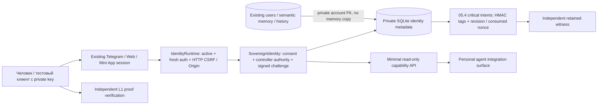

# Foundation 07.1 — Sovereign Identity Core (isolated test implementation)

База: `feat/foundation-07-identity-architecture`,
`2d6d65913d9091e7d42966532162a0d1de9d0c76`.
Архитектура: [Foundation 07](BLAGO_FOUNDATION_07_ARCHITECTURE.md).
Новая ветка: `feat/foundation-07-identity-core`.

**GO только для дальнейших изолированных испытаний. NO-GO для пилота,
production signing keys, реальной биометрии и blockchain deployment.**
Это приватный Identity Core поверх существующего аккаунта, а не новая регистрация,
публичный DID registry, доказательство уникального человека или завершённая система
децентрализованного восстановления. Default feature flag **OFF**.
Production SQLite, HF, secrets, deployment и экономические правила не менялись.

## Аудит и точки интеграции

База содержит всю цепочку 05.4 → 06 → 06.1 → 07. На исходной ветке прошли
**301/301 тест**, 123.401 s на изолированной Python SQLite 3.54.1.
Повторно использованы:

| Существующий компонент | Интеграция 07.1 |
|---|---|
| `users.blago_user_id`, Telegram links, Web/Mini App | Единственный внутренний account reference, без повторной регистрации |
| `IdentityRuntime.session_row` | Проверка active account, idle/absolute expiry и fresh auth на каждом значимом запросе |
| WebAuthn library и существующие passkey endpoints | Только факт UV в текущей свежей passkey session; credentials не копируются |
| `_locked_transaction` | BEGIN IMMEDIATE, FK, serialized critical writes и privacy write-ahead journal |
| 05.4 journal + independent witness | Подписанные opaque intents, replay отзывов и monotonic revision barriers |
| Privacy export/delete | Приватный экспорт собственных metadata; очистка Core вместе с account/aliases |
| Backup/restore и DR envelope 05.4 | Сброс sessions/challenges, повтор denials; проверка нового экземпляра |
| Семантическая память и atomic history 06.1 | Неизменённые tables и user scoping; память не участвует в авторизации |

Старые migration DDL/checksums **не менялись**. В частности, неизменен `OWNED`
из 05.3, из которого вычисляются его frozen guards/checksum: новая собственность
подключается отдельными проверяемыми hooks. При выключенном flag существующая
авторизация и естественное общение 06.1 сохраняются.

## Разрешённые границы и противоречия архитектуры

1. В проекте нет независимого реестра проверенного членства или уникальности
   физического человека. Active свежая password/Telegram/passkey session означает
   подтверждённый доступ к аккаунту. 07.1 **не повышает его автоматически до L2/L3**.
   Pending Core создаётся добровольно; активируется только после proof of possession.
2. Архитектура Mind предусматривает encryption, но текущая semantic SQLite хранит
   `value_json`, а не per-user encrypted vault. 07.1 не объявляет её зашифрованной
   и не меняет ключевой lifecycle памяти. Создана только защищённая внутренняя связь
   через существующий `blago_user_id`; encryption/capability sharing — отдельный 07.2+ review.
3. Нельзя автоматически объединить две криптографические личности по контролю над
   Telegram/password или по похожим данным. Merge с Core/recovery hold **с любой
   стороны отклоняется атомарно**. Existing merges без Core и same-account link
   no-op сохраняются. Протокол совместного согласия контроллеров — будущая работа.
4. Обратимость миграции ограничена **пустой, никогда не использованной** схемой.
   После любых Core intents в независимом журнале downgrade запрещён даже после
   удаления account rows: иначе старые backup могли бы обойти revoke/recovery.
5. Журнал 05.4 не является репликацией новых полномочий. При пропавшем после backup
   identity/controller нет автоматического восстановления прав по password или
   решению администратора: вводится recovery hold. Это безопасный отказ, а не
   обещание доступности при потере единственной свежей копии.

## Домен SovereignIdentity и жизненный цикл

`core/sovereign.py` отделяет управление человеческими публичными ключами от
authentication runtime. Создание требует existing fresh session, структурного
`CREATE_TEST_IDENTITY` и policy `07.1-test-v1`. `identity_id` — 32 случайных байта
в hex, не производная от Telegram ID, имени, биографии, памяти или биометрии.
Уникальный `blago_user_id` означает одну базовую identity даже после отзыва;
повторный create возвращает прежнюю запись, а не новую личность.



Bootstrap разрешён только для новой `pending` identity, у которой никогда не было
контроллеров. Предложенный Ed25519 public key обязан подписать action-bound challenge.
После этого `active` owner может добавлять, отзывать и ротировать ключи.
`proof` controller имеет только право proving; он не может добавлять owner или
ротировать ключи. Add/rotate требуют **старой owner signature и новой key PoP**.
Отзыв последнего owner приостанавливает Core. Ни password, ни admin session
не получают возможность повторного bootstrap вместо потерянного контроллера.

Отзыв consent через `WITHDRAW_TEST_IDENTITY` доступен fresh account session как
**запрет**, без выдачи новых полномочий. Он отзывает Core/ключи и не создаёт новую
identity при последующем create. Account deletion по прежней privacy-процедуре
также доступен без криптографического ключа: контроль ключа не должен блокировать
право прекратить обработку собственных данных. Финансовые retention blockers
остаются прежними. Потеря всех owner keys не имеет скрытого admin recovery endpoint.

### Crypto

Сервер принимает только public Ed25519 keys и проверяет подписи стандартной
`cryptography`. Дополнительно проверяется корректность/основная подгруппа точки
через `crypto_core_ed25519_is_valid_point` из **PyNaCl 1.6.2**. Это важно:
локальный OpenSSL принял тривиальную подпись для identity-point public key;
обнаруженный пример теперь отвергается до регистрации и покрыт негативным тестом.
Свои алгоритмы или таблицы запрещённых точек не реализованы.

Основания: [cryptography Ed25519](https://cryptography.io/en/latest/hazmat/primitives/asymmetric/ed25519/),
[libsodium point validation](https://libsodium.gitbook.io/doc/advanced/point-arithmetic),
[PyNaCl 1.6.2 release](https://pypi.org/project/PyNaCl/1.6.2/) с исправлением
libsodium/CVE-2025-69277. Пин добавлен в package dependencies; системные библиотеки
и production secrets не заменялись. Native dependency provenance требует отдельной
эксплуатационной проверки перед любым production использованием.

Подписывается canonical JSON `blago-identity-proof-v1`: random nonce, fixed
action/context, trusted RP origin audience, TTL, commitment к параметрам операции
и текущей revision. Commitment salted свежим nonce; в публичном message нет
`identity_id`, account/controller IDs, биографии или памяти. Authorized private
challenge response содержит signing details для проверки человеком действия;
их не следует публиковать вместе с proof. Клиент обязан отображать и проверять
эти details/commitment перед подписью; production signing UI здесь не реализован.

Challenge — 120 секунд, 32 random bytes, binding к session hash/account/Core/action
и expected version. Consume и изменение Core коммитятся атомарно. При новом
изменении version старые pending challenges теряют силу. Использованные challenge
фиксируются opaque intent в independent journal, поэтому direct open старого
snapshot тоже не разрешает replay. Expired technical challenges очищаются прежним
explicit cleanup; audit/consent/critical denials не удаляются этим TTL.

Перед исполнением команда заново сверяется с подписанным commitment, canonical
message, action/context, текущим trusted audience и исходными TTL timestamps.
Изменение сохранённого payload (например, `proof` → `owner`) не позволяет
переинтерпретировать уже подписанное действие. Отдельная регрессия моделирует
такое повреждение command record без подделки человеческой подписи.

`verify_independent_proof` проверяет только L1 подпись/possession, **не** membership,
актуальность server-side revocation или уникальность человека. Получатель обязан
заранее знать ожидаемый nonce и передать atomic durable consume callback; stateless
bearer-proof default отсутствует. Проверяется audience/TTL/nonce/signature перед
consume. Публичный ключ сам по себе может коррелировать повторные disclosures:
unlinkability/pairwise keys не считаются решёнными. Proof не является разрешением
перевода денег, подключения account или внешней публикации.

Private signing keys не генерируются и не хранятся production domain-кодом.
Ephemeral `Ed25519PrivateKey.generate()` существует только в synthetic tests/CI.
Случайные ID/nonce и уже существующий HMAC journal key — отдельные сущности,
не custody пользовательского signing key. Технически нельзя определить по public
key, использовался ли он раньше в production; test-only ограничение требует
контролируемого стенда и запрещает оператору подавать реальные ключи.

### Bio

Используется существующий WebAuthn verifier с origin/RP/challenge/UV/signature
проверками. Capabilities отражают только свежую `auth_method=passkey` session.
Registration с UV не превращает password session в biometric proof.
Никаких лиц, отпечатков, templates, их хэшей или типа локальной биометрии нет.
UV может быть PIN или локальной биометрией и не доказывает L3 uniqueness.
См. [W3C WebAuthn privacy](https://www.w3.org/TR/webauthn-3/#sctn-authenticator-biometrics).
`identity_credentials` резервирует private passkey reference, не выдаёт VC и
не дублирует COSE key; cross-owner reference запрещён trigger/FK.

### Mind и ограниченный API агента

Core связан с прежним account FK; memory queries и удаления по-прежнему scoped
к `blago_user_id`. Изменение/удаление памяти не изменяет key authority. Нет копии
памяти в attestation/events и нет авторизации по embeddings, интересам или целям.
GET capabilities возвращает только booleans: доступ к account, configured key
control, возможность запросить proof, recovery hold, свежий local UV и явные
`unique_human_verified=false`, `wallet_operations=false`,
`semantic_memory_is_auth_factor=false`. Identity IDs, keys, addresses и память
в эту поверхность не входят. Это готовый read-only integration surface; новые
LLM tools, автоматическое включение capability в prompt или исполнение действий
из разговора не добавлены. Метод `PersonalAssistantAgent.identity_capabilities()`
явно читает session-bound callback, повторно проверяет доступ и принимает только
whitelisted booleans. Web/Mini App host передаёт reader лишь для matching session;
без session reader недоступен (в том числе в обычном Telegram bot flow — нужен
прежний подтверждённый Mini App/Web вход). Метод не вызывается автоматически
из `respond`, данные не попадают в LLM или долговременную память. Разговорное
поведение, prompts и Natural Conversation Engine 06.1 не изменены.

## Модель данных и HTTP

| Новая таблица | Назначение |
|---|---|
| `sovereign_identities` | Unique internal account → random Core; status, monotonic version |
| `identity_controllers` | Public key, owner/proof role, immutable binding, revoke history |
| `identity_wallet_links` | Future multi-chain/address/role model; только unverified/revoked test metadata |
| `identity_credentials` | Private reference to existing passkey, no biometric data or copied keys |
| `identity_events` | Local minimal action/version/time audit, без подписей/ключей/текстов |
| `identity_consents` | Explicit isolated-test policy grant/withdrawal |
| `sovereign_challenges` | Action-specific one-time proof, session binding, TTL/version |
| `sovereign_recovery_holds` | Fail-closed state for absent original identity/controller grants |
| `sovereign_schema_migrations` | Exact DDL checksum/version |

Дополнительные tables не дублируют регистрацию: frozen `auth_challenges.purpose`
05.1 не допускает Core actions; расширять его CHECK значило бы менять старую
схему. Все child mappings имеют composite owner/Core FK, credentials проверяют
владельца passkey, INSERT/UPDATE guards запрещают stale writes inactive/deleted
account. Identity/controller bindings immutable; revoked keys не реактивируются.
Local events пишутся приложением append-only, но удаляются вместе с account;
это не публичный immutable ledger. Independent journal хранит HMAC targets,
тип и техническую revision, без open IDs/public keys/signatures/biometrics.

Все routes ниже находятся под существующими account auth, Origin и mutation CSRF:

| Endpoint `/api/v1/identity-core/…` | Метод / смысл |
|---|---|
| `capabilities` | GET: минимальный read-only ответ для интеграции агента |
| `me` | GET: только собственный private Core/controllers snapshot |
| `create` | POST: `{confirm: CREATE_TEST_IDENTITY, policy_version: 07.1-test-v1}` |
| `challenge` | POST: action и whitelisted authorizer/new_public_key/role/target |
| `complete` | POST: challenge, confirmation `CONFIRM_ACTION`, signature и/или new_key_signature |
| `withdraw` | POST: `{confirm: WITHDRAW_TEST_IDENTITY}` |

UID/Core scope выводится из session; поля `blago_user_id`/чужой `identity_id` не
принимаются. Все writes требуют fresh auth, правильных proof permissions и
структурного confirmation. Не существует public search, wallet transaction,
seed generation, admin rotate, signup или recovery-override endpoint.

Wallet слой — `WalletDescriptor`, typed `WalletOwnershipAdapter` и неисполняемый
`SolanaWalletInterface`. Последний намеренно бросает `NotImplementedError`.
Ownership/adapters/RPC не реализованы: никакая wallet link не считается verified.
Schema отвергает mainnet. P-256 passkeys не конвертируются в Solana Ed25519 keys.

## Восстановление, отзыв и удаление

Signed journal 07.1 добавляет только presence checks/denials/revision barriers:
`sovereign_identity`, `sovereign_grant`, `sovereign_revoke`,
`sovereign_revision`, `sovereign_challenge`, `sovereign_withdraw`.
Отзыв применяется к точному HMAC controller binding; versions только возрастают.
При отсутствующем grant данные/ключи не реконструируются из HMAC: Core получает
hold и не может заново bootstrap/create. Snapshot показывает effective
`recovery_required`/`suspended`, а не ошибочное активное состояние старой копии.
Replay отзыва последнего owner также приостанавливает оставшиеся proof-only keys;
иначе старый snapshot мог бы ошибочно сохранить ограниченные полномочия.

Hooks работают и при feature flag OFF, если схема уже применена. Restore не
может молча игнорировать новые kinds. Backup до 07.1 отклоняется при наличии
07.1 journal history; его нельзя «починить» простым запуском новой миграции:
reconciliation с исходным журналом откажет до DDL. Требуется certified fresh
control-state baseline. Повторное replay идемпотентно. Потеря журнала/ключа/
witness по-прежнему закрывает доступ по 05.4.

Privacy account deletion очищает все Core descendants/recovery holds до прежнего
purge пользователя. Old backup повторно очищается тем же user tombstone. Owned
export дополняется только private metadata whitelist; challenge/session hashes,
public-key credential material, signatures и journal secret material исключены.
Физическое уничтожение backup bytes и economic retention не объявлены решёнными.

Crash после durable journal append, но до commit application rows, может оставить
отзыв/hold без новой authority: система предпочитает остановку обслуживания
автоматическому гранту. Это availability tradeoff, требующий incident review.
Полный DR тест удаляет primary app/journal/key/head, восстанавливает encrypted
journal envelope и application copy в отдельном экземпляре, затем проверяет
сохранение identity ID, памяти и новую подпись прежнего человеческого ключа.
Это синтетический локальный экземпляр, не испытание физически независимого ДЦ.

## Модель угроз

| Угроза | Контроль / оставшийся предел |
|---|---|
| Stolen/expired session, IDOR, UID spoof | Existing session active/fresh, derived scope, CSRF/Origin, strict body fields |
| Replay/race/old action | Atomic consume, session/action/audience/TTL/version, journal barriers |
| Malicious/new/revoked controller | Owner authority + new-key PoP, immutable keys, strict Ed25519 point validation |
| Password-only key replacement/admin override | После bootstrap недоступен; нет emergency rebootstrap |
| Old backup grants stale authority | Exact revoke replay, revision update, absent grant → hold, reject pre07 backup |
| Filesystem or application commit failure | Existing write-ahead HMAC/witness + rollback; conservative denial/hold |
| Cross-user Mind/Bio leakage | Composite FK, passkey owner guard, minimal capabilities, no memory in proofs |
| Correlation / public profile hash | No public IDs/lookup/chain writes; nonce-salted commitments; repeated key disclosures still linkable |
| Compromised root/server + journal key | Не решено полностью: host может повредить mapping/availability; human private-key signature не становится admin-owned |
| Loss of all human controller keys | Нет скрытого admin recovery; stop/withdraw/delete либо отдельный reviewed protocol 07.2 |

Доверенная база — приложение, filesystem и independent custody из 05.4.
Это не Byzantine-server-proof DID network. Независимый verifier может проверить
подпись известного человеческого ключа, но не должен принимать server mapping
или L1 proof за доказательство членства/человеческой уникальности.

## Миграция и безопасный стенд

1. Использовать только согласованную **offline test COPY** reviewed Foundation
   05.4/06.1/07 DB. Quiesce writers, выполнить SQLite online backup; не копировать
   единственный `.sqlite3` при активном WAL. Сохранить оригинальные journal/keys/
   independent latest witness и control-state backup по [05.4 runbook](BLAGO_FOUNDATION_05_4_MIGRATION.md).
2. Проверить `python -m xblago.core.sqlite_safety --require-safe` в фактическом
   Python runtime. 07.1 требует verified SQLite, 05.4 marker, bound journal и
   независимый witness даже если общий `XBLAGO_PILOT_MODE` выключен.
3. Установить dependencies из `pyproject.toml` в изолированный venv/image,
   включая pinned PyNaCl 1.6.2. Не менять system Python или HF production.
4. Оставить `XBLAGO_IDENTITY_CORE_ENABLED=false`; проверить integrity/FK и
   baseline inventories memory/history/economy. Никакие пользователи не backfill-
   мигрируются в Core и не получают новый verified статус.

```sh
export XBLAGO_IDENTITY_CORE_ENABLED=false
export XBLAGO_SECURITY_JOURNAL_DIR=/isolated/original-journal
export XBLAGO_JOURNAL_WITNESS_DIR=/independent/fresh-witness
python -m xblago.core.sovereign_schema /isolated/reviewed-copy.sqlite3
python -m xblago.core.sovereign_schema /isolated/reviewed-copy.sqlite3
# Первый запуск changed, второй unchanged. Только на никогда не использованной копии:
# python -m xblago.core.sovereign_schema /isolated/reviewed-copy.sqlite3 --rollback-empty
```

5. На изолированном стенде с synthetic accounts задать
   `XBLAGO_IDENTITY_CORE_MODE=isolated_test` и
   `XBLAGO_IDENTITY_CORE_ENABLED=true`, существующие trusted origin/RP ID и auth
   параметры. Не включать эти флаги в production/HF. Flag не доказывает реальную
   изоляцию окружения: egress/IAM/данные/keys контролирует оператор стенда.
6. Войти прежним способом, явно создать pending Core и подтвердить bootstrap
   отдельным тестовым клиентским ключом. Private key хранить только у этого
   клиента; server domain не должен создавать его за человека.
7. Проверить revoke/rotate/replay, новый login после restore, dropped session,
   deletion, memory isolation и новый экземпляр DR. Снимать snapshot **после**
   известных authority grants; держать свежие control-state copies отдельно от
   старых application copies. Один и тот же journal не предназначен для
   параллельного обслуживания production и экспериментально восстановленного fork.
8. При missing grant/hold не чистить hold вручную, не создавать новый journal и
   не переиздавать identity по password. Восстановить reviewed original control
   state либо оставить доступ закрытым до отдельного recovery review.

## Проверки и результат

Добавлены 43 новых теста; прежние 301 сохранены. Новый набор покрывает все 14 требований: идемпотентность и process races,
cross-user scope/FK/UID spoof, replay, bad/weak keys, revoked keys, unauthorized
rotation, session loss/freshness, deletion/replay, encrypted DR/new instance,
Telegram/Web/Mini App/re-link, semantic isolation, migration rollback/drift и
crash после journal append до SQLite commit. Есть реальные library-based
WebAuthn verification и локальные HTTP CSRF/Origin tests, без реальных устройств.

Локальный результат полного набора: **344/344 PASS, 161.797 s**.
[Evidence](validation07_1/local-tests.txt). Базовый 301-тестовый набор сохранён;
Natural Conversation Engine и HF code не менялись. В этом задании реальные HF
запросы не выполнялись и качество HF не переоценивалось.
Локальное воспроизведение на проверенной SQLite 3.54.1:

```sh
python -m pip install -e .
python -m xblago.core.sqlite_safety --require-safe
PYTHONPATH=src python -m unittest discover -s tests -v
python -m compileall -q src tests tools
python -m pip check
```

На macOS используется изолированный `_sqlite3` driver из инструкции 05.4,
без замены system Python. Для новых миграций необходимы original journal и
независимый witness; синтетический fixture в `tools/pilot_fixture.py` создаёт
их только во временном каталоге.

CI выполняет полный набор, прежний Chrome/WebAuthn acceptance и все Docker
health/identity/privacy/strict-pilot/conversation smoke, плюс новый isolated Core
create/PoP/revoke/backup-recovery smoke. Точный final SHA/CI — в draft PR.

[Source CI Tests #61](https://github.com/xBLAGO/space/actions/runs/40567957551)
на `72e6bb9cae53ac41c1137839f7fe749f7ad1a0da`: **tests и docker SUCCESS**,
344/344 теста за 21.963 s, Python 3.12.15 в tests и 3.12.16 внутри Docker;
в обоих фактическая SQLite 3.54.1 с ожидаемым source ID. Chrome 155.0.8059.39 —
8/8 checks, прежние Docker smoke и новый Core/revoke/recovery smoke PASS.
[Выдержки логов](validation07_1/ci-source-evidence.txt),
[browser artifact](https://github.com/xBLAGO/space/actions/runs/40567957551/artifacts/12763343175).
Последующий коммит добавляет только эти документы/evidence; окончательный head
SHA и его CI приведены в draft PR #12. Никаких production readiness выводов
из зелёного CI не следует.

## Foundation 07.2 и пределы GO

- Review human recovery с несколькими подтверждёнными контроллерами, delays,
  notification/dispute; без password/admin-only восстановления signing authority.
- Protocol двустороннего cryptographic consent для merges, conflict/revocation
  semantics и certified control-state custody. Пока такие merges заблокированы.
- Реальный client signing UX, proof scopes/pairwise identifiers, DID/VC design,
  revocation freshness и независимый security review; не глобальный person hash.
- Wallet ownership adapter (сначала отдельно разрешённый Solana devnet), audited
  signing/custody model; никаких mainnet операций или финансовых обязательств 07.1.
- Per-user encrypted Mind vault/capability sharing, отдельная проверка удаления и
  key loss. Mind не становится фактором доступа.

Остаются все блокеры 05.4 (реальный HF SQLite/volume, custody/escrow/replication,
old-backup/legacy merge/retention, реальные WebView/passkeys) и проблемы HF 06.1
(timeouts, шаблонность, фактическое качество, непроверенный live repair).
Успешные тесты означают техническую основу для дальнейших **изолированных**
испытаний, не готовность закрытого пилота или суверенной production identity.
