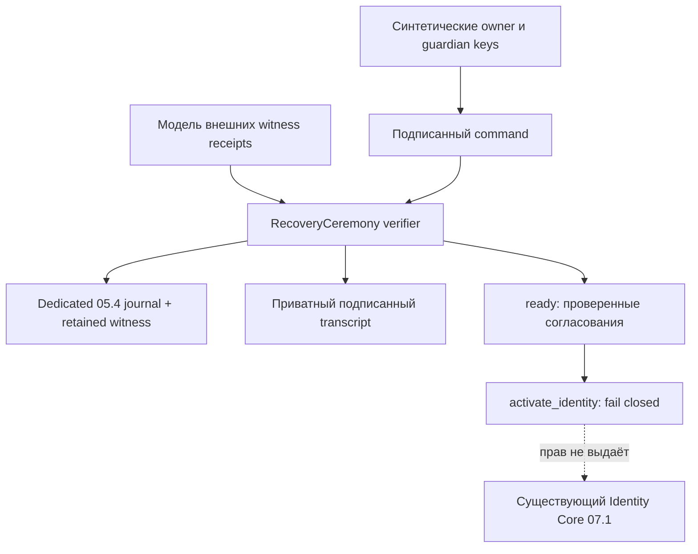

# Foundation 07.2 — Sovereign Identity Recovery Protocol

База: draft [PR #12](https://github.com/xBLAGO/space/pull/12),
`b79cb603a58adbab1e8a5313a06393a2feb5532f`.
Ветка: `feat/foundation-07-identity-recovery`.

**GO для изолированных испытаний модели церемонии. NO-GO для восстановления
действующих полномочий, MVP/pilot/production.** Реализована проверка подписанного
протокола, а не завершённое восстановление Identity Core. `ready` означает только
проверенные согласования. `activate_identity()` всегда отказывает. Здесь нет
подмены успешного восстановления выдачей новой session или повторным bootstrap.

Флаг `XBLAGO_IDENTITY_RECOVERY_ENABLED` выключен по умолчанию. Для самой
церемонии дополнительно нужен `XBLAGO_IDENTITY_CORE_MODE=isolated_test`.
Включение флага не снимает запрета активации. HTTP endpoints, регистрация,
интерфейс агента, production SQLite, deployment, HF и реальные ключи не менялись.

## Аудит и безопасная граница реализации

Повторно изучены 07 architecture, 07.1, 05.4 и 06.1, SovereignIdentity,
IdentityRuntime, privacy journal/witness, deletion, backup/restore и frozen DDL.
PR #12 остаётся открытым draft; его head соответствует заданной базе.
Исходный локальный набор: **344/344 PASS, 158.058 s**.

07.1 уже предоставляет криптографические owner/proof controllers, одноразовые
session/action/version-bound challenges, атомарные SQLite изменения, устойчивый
random identity ID и блокировку повторной активации suspended/revoked Core.
Telegram/Web/Mini App работают с прежним `blago_user_id`; память и история
изолированы через существующие ссылки. Эти механизмы повторно не создаются.

05.4 предоставляет HMAC write-ahead журнал, retained witness, fsync/locking,
проверку rollback, replay отзывов и fail-closed при потере контрольного состояния.
**Владение HMAC ключом не является правом восстановить owner.** Текущий witness
не является независимым threshold authority: он использует тот же ключ и
предполагает доверенный host. Физическая независимость путей не доказана.

В репозитории отсутствуют независимо управляемые участники, атомарный quorum
commit authority, внешний inbox доставки уведомлений и независимый клиент
проверки актуального владельца. Их нельзя безопасно заменить `True` callback,
локальной копией SQLite, паролем администратора или подписью сервера BLAGO.
Поэтому требование восстановления после компрометации сервера **не считается
выполненным**. Реализован допустимый заданием fail-closed вариант.

## Реализованная модель данных

`core/identity_recovery.py` — отдельный доменный модуль без доступа к user DB,
LLM, паролям, Telegram, биографии, Mind, платежам или приватным ключам.
Стандартные Ed25519 `cryptography` и строгая проверка point/canonical encoding
из 07.1/PyNaCl используются повторно; новые криптографические алгоритмы не вводятся.

| Объект | Содержимое / ограничение |
|---|---|
| `RecoveryPolicy` | Random private binding 32 bytes; public keys текущих owners, 3–16 guardians, threshold 2..N, delay 1h..30d, 4 witness keys |
| Policy digest | SHA-256 canonical policy, включая роли, quorum и delay; не person hash |
| Command | Protocol/domain, policy digest, parent head, action, random 32-byte nonce, issued/expires (120s), candidate только для start |
| Signature set | Уникальные разрешённые публичные ключи; подписи canonical command, без подсчёта дублей |
| Checkpoint | 3/4 разных pinned witnesses подписывают policy/head/nonce/time; допустимое расхождение clocks ≤30s |
| Notice | Для каждого прежнего owner 3/4 witness signatures над точным request hash и owner key |
| Private transcript | Command, signatures, checkpoint receipts и notices; artifact владельца/тестового harness, вне application SQLite |
| Evidence journal | Dedicated 05.4 SecurityJournal + собственный retained witness; только HMAC scope и SHA-256 record hashes |

Ключи ролей обязаны быть различными. Это проверяет уникальность ключей,
**не независимость людей или организаций**. Guardian не становится owner,
участником BLAGO или разрешённым фактором обычной авторизации. Привязка
policy к реальному Core и доказательство её установки текущими owners должны
быть проверены будущим независимым enrollment-протоколом. Сейчас binding
церемонии не является публичным идентификатором или реестром членства.

Политика фиксируется до утраты ключей: `configure` требует подписи **всех**
перечисленных текущих owners и **всех** guardians (явное принятие участия).
Изменение уже установленной политики не реализовано; owner может её retire.
Сессия не входит в набор разрешённых подписантов.

## State machine и архитектура



1. `unconfigured → idle`: owner authorization и принятие каждым guardian.
2. `idle → pending`: минимум K guardians плюс proof of possession нового
   candidate key; последний не совпадает с owner/guardian/witness ключами.
   Нужны signed notice receipts для каждого owner. Подпись notice означает
   лишь заявленную внешним сервисом durable доставку в inbox, не прочтение человеком.
3. `pending → ready`: прошла задержка, минимум K **новых подписей** guardians и
   новая candidate PoP над свежим command/current parent. Заявка истекает через
   7 дней после not-before. Готовое согласование терминально для этой церемонии.
4. Пока pending, любой текущий owner может `contest` или `cancel`;
   K guardians могут `cancel`. Обе операции сбрасывают pending в idle.
   Повторное начало требует новых подписей и новой полной задержки.
5. Любой owner может `retire` политику; состояние терминально.
6. `ready → active owner` **не реализовано и всегда запрещено**, независимо от
   feature flag, session, readiness или аргументов вызова.

Delay считается от максимального signed witness time старта; завершение
проверяет минимальное время нового quorum. TTL также проверяется по подписанным
внешним clocks, не по ускоренному application clock. Это условная гарантия:
внешние часы и receipts должны действительно исходить от независимых участников.
Harness генерирует их тестовыми ключами и временем, не выдаёт за real service.

Каждый command связан с parent hash полного предыдущего record. Повтор nonce,
другой action/policy/candidate, неизвестный signer и старый parent отклоняются.
Короткий TTL не заменяет nonce и независимую проверку последней вершины.
Дублирующиеся и конкурирующие локальные writers сериализуются POSIX lock
выделенного evidence journal, затем повторно сверяют полный retained transcript.
Это процессная CAS в доверенном host, **не BFT consensus** и не доказательство
безопасности при malicious filesystem/kernel.

## Почему не изменены guards 07.1

Обычное обновление `status='active'` после suspended сейчас запрещено frozen
trigger. Удаление этого guard или разрешение через session создало бы обход
07.1. Записывать новый owner по одному HMAC intent тоже небезопасно: владелец
server key смог бы самостоятельно выдавать полномочия; старые snapshots могли
бы вернуть прежних owners. В данном PR нет SQL update authority, нового
bootstrap, новой session и скрытого override.

Старый identity ID остаётся прежним, старые полномочия не дублируются, потому
что в этой версии они вообще не заменяются. **Успешное восстановление контроля
с сохранением ID пока не доказано.** Все owners могут оставаться недоступны;
правильный результат такого запуска — `RecoveryBlocked`, а не новый аккаунт.

## Модель доверия и оставшаяся инфраструктура

Для будущего применения нужны следующие внешние компоненты:

- Human-controlled enrollment: до утраты ключей клиент pin-ит identity binding,
  политику и независимые witness keys; проверяет current owner authority и все
  согласия. Сервер не может подменить корень или незаметно изменить policy.
- Четыре независимо управляемых control-plane nodes, 3/4 quorum при ≤1 Byzantine.
  Каждый durable фиксирует единственного преемника parent, TTL, role/revocation,
  delay и notice delivery, а затем подписывает commit. Нужны полноценные
  prepare/commit/reconcile и partition/restart испытания; простое число 3/4
  **не реализует** consensus. Этот PR проверяет только подписанные read receipts.
- Отдельные owner inbox/custodians с подтверждённой durable записью, независимым
  каналом проверки/оспаривания и обслуживанием при недоступности BLAGO. В PR нет
  реальной доставки сообщений, уведомлений Telegram или сторонним людям.
- Независимый verifier/client: fresh random nonce до запроса, pin policy/keys,
  проверка актуального quorum head, явный показ человеку candidate/action.
  Полностью скомпрометированный сервер может подменить UI и свою DB; код на
  этом же сервере не доказывает обратного.
- Atomic epoch handover: в одном проверенном commit отозвать ВСЕ прежние
  owner/proof authorities и установить единственный новый owner при прежнем ID.
  Сначала durable внешний commit, затем идемпотентное materialize в SQLite;
  crash между ними разрешается только свежим внешним commit certificate.
  Позднейший withdraw/deletion/revoke всегда сильнее старого сертификата.
- Публичный raw identity ID, biography, memory, Telegram ID и biometrics в
  recovery journal не публикуются. Даже opaque policy может связать guardians:
  transcript требует приватного хранения, retention и контролируемого экспорта.

Нет универсального ключа администратора. Сговор ≥K guardians остаётся
принципиальным риском выбранной социальной модели, даже при честных witnesses;
задержка, уведомление и contest дают время реакции, а не исключают этот риск.
Скомпрометированный действующий owner также может блокировать восстановление
через contest/retire; безопасного обхода veto без нового trust protocol нет.
Потеря всех guardians, всех независимых control copies или всех ключей клиентов
может означать постоянную недоступность. Автоматического bypass не предусмотрено.

## Security review: атаки, результаты, границы

Проведён авторский повторный review кода и negative tests; независимый внешний
аудит не проводился и не подразумевается.

| Атака / отказ | Реализованная проверка / остающийся риск |
|---|---|
| Один скомпрометированный guardian | K≥2; один guardian + candidate не достигают threshold |
| Подмена роли, duplicate key, weak Ed25519 point | Disjoint roles, уникальные ключи, проверка point и всех signatures |
| Admin/password/Telegram/Mind recovery | Не являются разрешёнными signers; runtime activation запрещена |
| Replay, замена candidate/action/policy/parent | Canonical signed context, nonce, current hash parent, TTL |
| Пропуск delay через app clock | Только quorum-signed clocks; проверены disagreement/expiry/fast-forward |
| Подмена notice или отсутствующая доставка | Точное request/owner binding и 3/4 signatures; real inbox отсутствует |
| Contest/cancel и устаревший ready | Parent изменяется; старая подпись не переиспользуется |
| Параллельные одинаковые/разные local commands | POSIX serialization + retained parent comparison; один transition |
| Partition / отсутствуют 3 witnesses | Проверка отказывает; recovery activation никогда не открывается |
| Old transcript / old journal, retained witness свежий | Exact transcript-to-journal sequence, 05.4 high-water rollback detection |
| Crash после append, до сохранения transcript | Старый transcript блокируется; нужен сохранённый точный signed record |
| Потеря FS/key/witness | `JournalUnavailable`/`RecoveryBlocked`; без auto-init и regrant |
| Захват HMAC key | Не создаёт human/witness signatures; не защищает сам журнал от хозяина key |
| Полный захват сервера / всех control copies | Гарантии отсутствуют без независимого client + external authority; NO-GO |
| Account delete/withdraw и старый backup | Прежний 05.4/07.1 replay сохраняет revoke; церемония не возвращает права |
| Утечка памяти/экономические действия | Модуль не читает user DB; integration проверяет отсутствие изменений |

## Хранение, backup и восстановление

**Dedicated evidence journal обязателен.** Переиспользуется механизм 05.4,
но не его application journal instance. В application PrivacyControl нет
разрешения применять `recovery_ceremony_evidence`; смешивание намеренно
отклоняется. Церемония также отвергает чужие event kinds в своём журнале.
Это исключает незаметное изменение политики replay и удаления 05.4.

В trusted-host изолированной модели:

1. Создать отдельный пустой `SecurityJournal` и `journal_witness.initialize`
   вне его дерева; permissions 0700/0600. Не использовать production пути.
2. До потери keys получить все configure signatures и pin policy вне BLAGO.
   В этом PR этот шаг моделируется исключительно синтетическими ключами.
3. На каждом submit сохранять полный возвращённый private transcript отдельным
   защищённым artifact. Domain module не создаёт копии на диске автоматически.
   Производственный durable encrypted transcript store ещё не реализован.
4. Перед backup сохранить согласованную тройку journal/key/head, актуальный
   retained witness и transcript; оригинальные independent copies не откатывать.
   Не считать application SQLite backup полной копией recovery state.
5. На отдельном процессе открыть оригинальный контрольный журнал/witness и
   повторно проверить весь transcript. Отсутствующий/обрезанный/изменённый
   transcript блокирует продолжение. Точный durable signed record после crash
   может быть предоставлен для повторной полной проверки, без редактирования history.
6. Старую копию журнала при свежем witness не обслуживать. Потеря ключа/witness
   или противоречие контрольных копий требует расследования и NO-GO; не создавать
   новый пустой journal под прежнюю identity и не менять baseline.
7. Даже восстановленный `ready` transcript **не применяется к Core**.

Тест отдельного процесса проверяет replay public transcript без owner/guardian
private keys. Это local synthetic DR, не испытание физически независимого ДЦ.
Одновременный откат journal и ВСЕХ witnesses не обнаруживается только HMAC
механизмом; future external latest-head quorum обязателен.

## Миграция и совместимость

Application schema migrations в этом PR **отсутствуют**: ни DDL/checksum, ни
`OWNED`, ни triggers, ни production/startup SQLite не меняются. Новые authority
таблицы без пригодного независимого commit позволили бы имитировать гарантии.
Для изолированного evidence режима создаётся только существующая схема
SecurityJournal в новом временном каталоге; это не миграция пользовательских данных.

Обновление приложения при flag OFF сохраняет весь 07.1 runtime. Rollback к
базе не требует удаления application tables. Evidence artifacts не превращаются
в политику действующего аккаунта. Удаление тестовых artifacts возможно после
завершения isolated exercise; автоматической retention/публичного архива нет.
Реальная политика удаления/transcript retention должна быть утверждена до
какого-либо external enrollment, с учётом минимально необходимого anti-replay state.

Будущая миграция должна добавить account-scoped policy/epoch references с FK,
unique active policy, immutability/checksum и extension hooks export/delete/TTL;
не менять frozen guards без narrowly scoped certificate verifier и тестов.
Обязательно проверить pre-policy snapshot, policy-row deletion, concurrent
contest/activation, deleted account, authority epoch revocation и impossible
regrant после возврата старого сертификата. Это открытая работа, не код данного PR.

## Воспроизводимые проверки

На macOS используется изолированный Python 3.12.10 и pinned patched SQLite
3.54.1, а не системная 3.49.1. В CI/Docker patched-library gate остаётся обязательным.

```sh
# Linux: сначала tools/build_sqlite.py; указать LD_LIBRARY_PATH/LD_PRELOAD,
# как в .github/workflows/tests.yml. На macOS использовать verified sqlite shim.
PYTHONPATH=src python -m unittest discover -s tests -p test_identity_recovery.py -v
PYTHONPATH=src python -m unittest discover -s tests -v
python -m compileall -q src tests
```

Новые тесты используют только временные каталоги и сгенерированные test keys.
Witness signatures, clocks и inbox acknowledgements — **модель** внешних сервисов,
не реальная независимость/доставка. Проверяются configure thresholds, compromise
одного guardian, недействительные signatures, roles, replay, TTL, delay, notice
binding, contest/cancel, terminal retirement, clocks, lost key/FS/witness,
rollback, exact replay, process restart, concurrent writers, отсутствие
runtime activation даже с включённым flag, privacy revoke/delete и восстановление
старой application DB с integrity_check/foreign_key_check.

Итоговый локальный full suite: **380/380 PASS, 170.467 s** — все прежние
344 теста и 36 новых. Compileall, pip check, diff check и actual SQLite safety
gate PASS. [Полный локальный log](validation07_2/local-tests.txt),
[runtime](validation07_2/runtime.json), [решение и scope](validation07_2/decision.json).
[Source CI Tests #65](https://github.com/xBLAGO/space/actions/runs/40584040558)
на `9b09bbedd893b1ef45f21f0e73bf70ba89a5e8eb`: **SUCCESS**, tests и docker.
Linux Python 3.12.15: 380/380 за 36.288 s. Docker Python 3.12.16:
SQLite 3.54.1, все прежние smoke/gate steps и 36 recovery tests за 2.069 s.
Chrome 156.0.8078.47 + virtual CTAP2: 8/8 checks; это не real-device acceptance.
[Выдержки CI logs](validation07_2/ci-source-evidence.txt). Последующий коммит
обновляет только documentation/evidence; его статус также проверяется в PR. Docker job теперь дополнительно запускает весь новый
recovery test module внутри собранного image с read-only synthetic tests/tools
mounts; production mounts, secrets и сеть провайдера не требуются.
Локального Docker executable нет, поэтому Docker подтверждается только Actions.

## Оставшиеся блокеры 05.4 и 06.1: план MVP

| Блокер | Что есть | Следующее доказательство / PR |
|---|---|---|
| Фактический HF Python/SQLite и durable volume | CI patched SQLite gate | Read-only runtime attestation, WAL/locks/fsync qualification на целевом storage; отдельное разрешение на инфраструктуру |
| Независимые custody/IAM/escrow/retention | Локальная модель journal/witness | Реально независимые fault domains, IAM, key custody, потеря основного сервера и DR drill |
| Legacy backups/merges до 05.4 | Fail-closed baseline guards | Проверенная alias lineage/golden baseline, retirement unsafe copies, approved remediation |
| Economic retention | Без изменения правил, delete blockers | Утвердить юридическую/продуктовую политику и отдельный управляемый процесс |
| Реальные WebAuthn/WebView | CI Chrome + virtual CTAP2 | iOS/Android Telegram, поддерживаемые browser/devices, public HTTPS RP, recovery UX |
| HF качество и availability 06.1 | Bounded repair/retry/context и regression tests | Стабильный route, повторные реальные synthetic диалоги, независимая оценка естественности, завершённости и фактов, latency/error SLO |
| Sovereign recovery 07.2 | Проверяемая модель, activation blocked | External authority/inboxes, pinned independent client, atomic epoch handover и restore/partition audits |

Данные HF 05.4/06.1 наследуются из их отчётов: реальные 503/timeout, повторные
приглашения продолжить разговор, ложная эмпатия/выводы о человеке и semantic
truncation при ложном stop не закрыты. Новый живой HF прогон здесь **не проводился**;
ни ключи, ни receipts, ни transcript не отправлялись LLM. Улучшение качества или
готовность HF этим PR не заявляются.

## GO / NO-GO критерии

GO только для новых синтетических protocol/security exercises при isolated flag,
original test journal/witness и явном понимании, что authority не меняется.

Для перехода к реальному recovery нужны одновременно: independent enrollment,
remote quorum commit и anti-equivocation, подтверждённая доставка owner notices,
спор/отмена при partition, trusted time, pinned external verifier, atomic epoch
handover, restart/crash/old-snapshot/deletion tests на отдельных fault domains,
retention/privacy review и независимый security audit. До этих доказательств —
**NO-GO для активации, реальных пользователей и пилота**, даже если весь CI зелёный.
