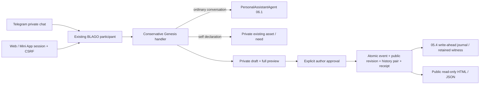

# Foundation 08 — Genesis Protocol & Public Deliberation

База: draft [PR #12](https://github.com/xBLAGO/space/pull/12),
`b79cb603a58adbab1e8a5313a06393a2feb5532f`, ветка
`feat/foundation-07-identity-core`. Новая ветка: `feat/foundation-08-genesis-protocol`.
PR #13 / Sovereign Recovery не является зависимостью. PR #2–#12 остаются отдельной
не слитой цепочкой; наличие кода не означает принятие governance или pilot readiness.

**GO только для изолированных синтетических испытаний. NO-GO для публичного
пилота, mainnet и принятия общественных решений.** Genesis feature flag OFF
по умолчанию; Identity Core и Sovereign Recovery автоматически не включаются.

Исходная приложенная спецификация Genesis не была предоставлена и не найдена в
репозитории. Запрошено её местонахождение. [Protocol v0.1](BLAGO_PROTOCOL_v0.1.md)
имеет статус **Draft** и документирует требования задания и открытые вопросы;
точное соответствие отсутствующему приложению не заявляется. Его получение и
сопоставление — блокер приёмки самого протокола, но не основание останавливать
безопасную реализацию независимых механизмов.

## Аудит существующей архитектуры

| Основа | Повторное использование / влияние |
|---|---|
| 05.4 SQLite gate | Проверенная библиотека Python SQLite 3.54.1, original journal и independent witness; требования не ослаблены |
| Общий `blago_user_id` | Telegram link/verified Mini App/Web session по-прежнему определяют участника; новая регистрация отсутствует |
| 06.1 agent/history | Обычный разговор идёт через прежний PersonalAssistantAgent; память, bounded generation и provider fallback не менялись |
| `blago_assets`, `blago_needs` | Используются прежние таблицы; private declarations не создают параллельную экономическую модель |
| Existing asset/need API | При Genesis ON дополнительно записывает versioned event в той же SQLite transaction |
| `events` Telegram dedupe | Сохраняет повторные updates; Genesis receipt дополнительно защищает retry после crash между domain commit и mark_update_processed |
| 07 / 07.1 | Совместимость schema, privacy, merge guard и Core tests; экспериментальные флаги не включаются |
| Privacy export/delete/clear-history | Новые ownership tables включены отдельными hooks; frozen `OWNED` и старые DDL/checksums не менялись |
| Backup/restore | SQLite backup переносит полную новую схему; original journal replay блокирует устаревшую Genesis историю |

Отсутствовал общественный proposal lifecycle, типизированный журнал деклараций и
публикаций, exact-version consent и публичный export. Существующий economic
fulfillment/payment lifecycle не переопределён. Исходные 344 теста сохранены.

## Поток разговора и согласия

Нет дополнительного LLM запроса для classification, publication или declaration.
Однозначные фразы обрабатываются детерминированно; при неопределённости сообщение
остаётся обычным разговором. Текущий handler не переписывает мысль пользователя
самовольно: показывает её как редактируемый черновик. Для обсуждения и совместного
формулирования сохраняется естественный агент. Universal drafting/NLU не заявлены.

Пример: «У меня есть 5000 рублей» → частный `self_declared_unverified` asset.
Не требуется банковское доказательство; не создаются payment request, balance,
resource offer, перевод или разрешение распоряжения. «У меня нет…», чужие деньги,
цитаты, вопросы, гипотезы и запрет запоминания не дают такого события.

Потребность записывается только по явной просьбе или существующему API. «Мне нужен
велосипед» само по себе не создаёт economic need. «Предлагаю…» создаёт частный
черновик, не публичную заявку.

Preview содержит полный текст, псевдоним и предупреждение о публичности/чужих копиях.
Web/Mini App передают server-issued draft event reference, который клиент получил
с показанным preview. «Да, публикуй этот текст» требует совпадения этого reference,
последнего history turn, неизменённого draft event и TTL 600s. Непривязанное или
задержанное подтверждение другой версии не публикует новый текст. Telegram
использует «Публикуй: [точный полный текст]» и существующий update dedupe.
Общее «да»/«хорошо», quotes, tool-looking JSON и решения LLM не исполняются.

Новая редакция требует нового согласия. Другой участник добавляет свой аргумент
через собственный preview. Для редактирования/отзыва нужен owner account. Приватная
история/semantic memory никогда не извлекается в публичный текст автоматически.

## Схема и целостность

Explicit migration `foundation08_genesis_001`, seven new tables:

| Таблица | Назначение |
|---|---|
| `genesis_migrations` | Version + checksum exact DDL |
| `genesis_streams` | Random document/claim stream, existing owner FK, kind, per-document pseudonym |
| `genesis_events` | Typed v1 event, monotonic sequence, payload JSON, previous/event hash; immutable UPDATE guard |
| `genesis_previews` | Current private draft/last visible turn/expiry; не согласие на произвольный будущий текст |
| `genesis_publications` | Immutable approved public revisions и отдельная public hash chain |
| `genesis_receipts` | Owner-scoped request ID + input/context hash + original reply; persistent dedupe |
| `genesis_holds` | Missing post-backup event: запрет выдачи incomplete public/private state |

События: asset.declared, need.declared, proposal/argument.drafted,
proposal/argument.published, proposal/argument.withdrawn. Типизированный Event
фиксирует schema_version=1; SQLite проверяет type/kind, composite owner FK,
unique sequence, event ID/hash и active account. Данные не переводятся в новую
user table и не получают новый BLAGO ID.

Event body canonical JSON hash защищает private stream; публичная chain содержит
только явно утверждённые revision payloads. В публичной цепочке нет hashes
частных drafts: это снижает утечку через перебор коротких текстов. Guard проверяет
chain, соответствие public projection опубликованным events и наличие каждого
journaled event перед Genesis операцией/публичным чтением. Пропавшая даже последняя
public projection не выдаётся как более старая «актуальная версия».

`BEGIN IMMEDIATE` сериализует competing writes; событие, projection existing
asset/need, history pair, preview и receipt фиксируются вместе. После durable
05.4 append, но до SQLite commit crash даёт missing_event hold, не частичную
публикацию или ложное восстановление. После commit повтор request ID возвращает
первоначальный ответ без второго события/turn pair; другой payload/context с тем
же ID отклоняется. Повторная денежная декларация той же суммы не дублирует asset.

Append-only действует в прикладном API. Account deletion имеет приоритет и удаляет
локальные записи; DELETE не маскируется обещанием «вечной неизменяемости» private
данных. Нет server-key подписи авторства человека; HMAC 05.4 остаётся в прежней
trusted-host модели и не защищает от захвата сервера и всех контрольных копий.

## API и интерфейс

- Existing authenticated `POST /api/v1/chat/messages` принимает text, optional
  request_id и preview_ref. Scope берётся только из session, CSRF/Origin прежние.
  Response дополнен publication_preview; клиент не вводит технический код.
- `GET /api/v1/genesis/records` — свои streams/events для проверки и экспорта.
- `GET /api/v1/public/proposals/<random-id>` — анонимный read-only JSON утверждённых
  версий и аргументов; не список личных деклараций.
- `GET /proposals/<random-id>` — server-escaped HTML, текст/авторство/версии/аргументы,
  hashes, JSON link. CSP default-src none, frame-ancestors none, base-uri none,
  nosniff, no-store. Нет выполнения HTML/JS/Markdown автора.
- Chat UI показывает безопасную ссылку только на локальный proposal path,
  создавая DOM text nodes / anchor; не вставляет response через innerHTML.

Публичный псевдоним — происхождение от аккаунта, не unique human verification.
Частный draft остаётся 404 с публичной стороны. Отозванный документ тоже 404.
При повреждении/missing control state запрос блокируется, а не обслуживается
из неподтверждённого cache. Public directory/search, reactions, voting, moderation
и federation в этот этап не входят.

## Миграция и восстановление: только offline copies

1. Не включать Genesis на production. Взять согласованную offline SQLite copy,
   original 05.4 journal/key/head и оригинальный retained witness; не откатывать
   контрольные копии вместе с application DB.
2. Проверить patched SQLite (`python -m xblago.core.sqlite_safety --require-safe`),
   integrity_check/FK, совместимые migrations 05.1–05.4. Активировать 07.1 не нужно.
3. При `XBLAGO_GENESIS_ENABLED=false` запустить
   `python -m xblago.core.genesis_schema /path/to/reviewed-copy.sqlite3`.
   Миграция транзакционная, идемпотентная, проверяет DDL/checksum и original witness.
   Startup migration отсутствует. Ошибка откатывает все новые DDL.
4. Только на disposable test stack включить `XBLAGO_GENESIS_ENABLED=true`.
   Старые economic rows не backfill-ятся в «подтверждённые» journal events.
5. Перед restore остановить writers, выполнить existing privacy_maintenance.restore
   с оригинальными control files. Restore аннулирует sessions/challenges и previews;
   старый consent не превращается в разрешение после перезапуска.
6. Backup после актуальных Genesis событий восстанавливает approved versions.
   Backup до последнего события получает hold и не публикует старую версию.
   Pre08 backup при уже существующих Genesis intents блокируется: автоматической
   установки новой схемы и переименования baseline нет.
7. Для снятия hold нужен reviewed current complete backup/control-state drill.
   Hidden admin regrant/clear-hold endpoint отсутствует. При потере witness/key — отказ.

Старые schema checksums и правила retention не менялись. Schema downgrade после
появления Genesis intents не поддерживается: старое приложение не понимает новые
journal kinds и fail-closed. Genesis-owned account merge отклоняется existing
unknown ownership guard вместо тихого переноса публичного авторства. Same-account
Telegram relink и merge без новых ownership данных сохраняются.

## Приватность и security review

Проведён авторский code/security review; независимый внешний аудит не заявляется.

| Угроза | Проверка / ограничение |
|---|---|
| Автопубликация из размышления/LLM | Conservative handler; отдельный preview/approval; no LLM executor |
| Delayed approval другой редакции | Web version reference + last turn + TTL; Telegram exact text |
| Replay/retry/competing confirmations | Existing Telegram dedupe, request receipts, input hash, SQLite serialization |
| IDOR/author spoof | Authenticated scope, stream owner lookup, owner FK; публичный API только читает |
| XSS/SQL/prompt injection | Parameterized SQL, escaped HTML, CSP; arbitrary command-like draft text не исполняется |
| Raw credentials/public identifiers | Sensitive-text guard; no automatic memory/profile dump; per-document pseudonym |
| Corrupt hash chain/projection/schema | Recompute, event/projection counts, exact DDL/checksum, journal-presence checks |
| Old backup возвращает withdrawal/delete | Opaque event intents + hold; existing account-deletion replay + extension purge |
| History clear/cache leakage | Deletes previews/receipts; replay clears alias-family caches; drafts remain distinct account data |
| Missing journal/key/witness/fsync | Existing 05.4 fail-closed; no auto-reinitialization |
| Server compromise / forged personhood | Не решено hashes/HMAC; independent custody/crypto-authorship/anchors требуют дальнейшего review |

Публикация может содержать сведения, которые фильтр чувствительности не распознает;
необходимы человеческая проверка, abuse/moderation policy и privacy review до
публичного сервиса. Intent recognition ограничен русскими формами, не решает весь
язык, сарказм или adversarial paraphrase. Private group Telegram declaration handler
не включается; существующее поведение группового агента не объявляется private.

Guard сейчас перечитывает историю владельца и журнал: O(events + journal). Это
проверяемая тестовая реализация, не доказанная масштабируемость. До публичного
приёма нужны quotas/rate limits, pagination, bounded verification checkpoints,
нагрузочные/DoS испытания и review кэшей без ослабления rollback guarantees.

## Демонстрация и проверки

Синтетический [первый Genesis-диалог](validation08/genesis-dialogue.json) воспроизводит:
декларацию 5000 RUB → личное размышление → частный текст мастерской → явное согласие
→ public JSON. `tools/genesis_demo.py --output /tmp/genesis-demo.json` создаёт только
temporary stack, local provider, 0 network calls, 0 transfers, Identity Core OFF.

Браузерный стенд `tools/pilot_browser_check.py --genesis --output /tmp/browser`
проверяет UI claim, preview, отсутствие public link до согласия, consent, публичный
HTML/JSON без внутренних IDs и прежние WebAuthn/session/export сценарии. Только
виртуальный CTAP2, не реальные biometrics или Telegram WebView.

Тесты включают все прежние unit/integration/security и новые сценарии деклараций,
согласия/версий/аргументов, delayed consent, double submit, Telegram/Web shared
history, API compatibility, rollback миграции, backup/restore/delete, schema/hash
corruption, lost witness, crashes и TTL. Итоговый локальный набор: **374/374 PASS, 311.220 s** (344 прежних + 30 новых на первом source commit),
[полный log](validation08/local-tests.txt). Chrome 150.0.7871.125: **15/15 checks**,
включая мобильную ширину public page; [browser evidence](validation08/browser-results.json).
После последнего review исправлено повторное открытие старой публикации при создании
частной редакции после withdrawal. Добавлен negative test; **31/31 Genesis tests
PASS, 28.371 s**: [regression log](validation08/withdrawal-regression.txt).
Видимость определяется последним published/withdrawn событием, не draft.
Compileall, pip check и diff check PASS. После восстановления временного venv
браузерные проверки повторены, dependencies не меняли production. CI/Docker evidence
добавляется после проверки source commit. Локального Docker executable нет.

## GO / NO-GO и следующий этап

GO: синтетический диалог и проверка новой общественной памяти на disposable stack.
NO-GO: public pilot, принятое Genesis governance, Consensus 7 execution и Solana.

Открыты: исходная Genesis specification и её общественный review; Consensus 7
selection/quorum/dispute/Sybil/authority; реальные supported devices/WebView;
05.4 offsite custody/IAM, HF runtime/volume attestation, legacy baseline и economic
retention; 06.1 реальные HF availability/naturalness acceptance; независимый security
review, public abuse/moderation/privacy policy и нагрузочная квалификация.

Контрактные интерфейсы — [Solana Draft](BLAGO_FOUNDATION_08_SOLANA.md), typed Python
Protocols не исполняются и по умолчанию отказывают. Документ не объявляет, что
публикация идеи или hashes автоматически делает предложение общественным решением.
Production-данные, secrets, реальные платежи/токены/deployment не менялись. Merge не выполняется.
