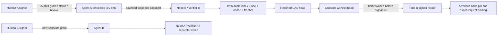

# Foundation 08.2 — Durable Federation Runtime & Fault Injection Lab

**Draft.** Exact base PR [#16](https://github.com/xBLAGO/space/pull/16),
`0a6acd9178de8c1aaac8f3af729d896efd4eb98a`; branch
`feat/foundation-08-2-durable-lab`. Experimental profile `bop-0.1-lab.1` only.

## Scope and architecture

New isolated code in `experiments/federation_08_2`; no production imports,
SQLite, API changes, identity flags, deployment, HF calls or memory transfer.
Human, Agent and Node have different fresh Ed25519 keys. Human/Agent signers are
spawned processes; private Human key never crosses its pipe. This is role/process
separation under an honest-host model, not protection from root or a debugger.

Two local Node processes are not independent operators. Each has separate config,
node key, app records, retained and witness stores. Outgoing authority is issued
by the respective Human; no automatic response mandate or shared owner key exists.
Both nodes currently use the same filesystem implementation, another reason not
to claim independently implemented federation.

## Durable boundary

Receiver-owned unpredictable nonce is committed before returning a challenge.
Delivery verifies bounded canonical wire, agent and owner signatures, scope,
recipient, full issue/revoke history, current retained frontier, event-bound fresh
status and one-use limit. Caller-supplied validator context is rejected.

One immutable transaction contains inbox, message hash, use counter, consumed
nonce, frontier and stable receipt blueprint. It is fsynced before advancing the
retained CAS pointer and second witness. Only then is the receipt signed/sent.
Exact duplicate returns original deterministic receipt; changed event hash fails.
Revoke shares the same receiver lock. A historical duplicate after revoke returns
old proof without a new effect; every new delivery under that mandate is denied.
Late receipts do not update or rewind authority state.

Frozen receipt revision: `bop-0.1-lab.1-receipts-08.2.1`,
[exact schema](lab_08_2/receipt-schema.json), canonical schema SHA-256
`64667aa8fb6abd535e4a2f93d17d6ed56c46d31ab548c84eb56f4cc80a86b85a`.
Runtime rejects a different schema hash. Delivery/revocation use distinct signature
domains and exact field sets from 08.1. Receipts are Node evidence, never Human
permission. State hash commits to the immutable record; blueprint excludes its
own final state hash to avoid circular hashing.

## Evidence and results

[Scenario matrix S01–S12](lab_08_2/MATRIX.md),
[machine-readable local assertions](lab_08_2/evidence.json),
[recovery report](lab_08_2/RECOVERY.md),
[threat model / same-author review](lab_08_2/THREAT_MODEL_DELTA.md),
[launch and independent-operator acceptance](lab_08_2/INDEPENDENT_RUN.md).

Offline: **73/73 per reference**, parity PASS, corpus SHA-256
`fed4d35558c2a94c4ea070dac7b972ac2e9884adc7775b2807bc84da55ef3c36`.
Existing golden files, validators and expectations remain byte-identical.
Stateful: **35/35 tests PASS**; source hashes are in `evidence.json`.
[Two-process signed public evidence](lab_08_2/local-demo-evidence.json) records
both directions, pins, grants, statuses and receipts. CI repeats tests,
regeneration, design consistency, compileall, pip check and two-process demo.
CI has read-only permissions; artifact upload allowlists only public evidence.
[Source CI](https://github.com/xBLAGO/space/actions/runs/41714627627): **SUCCESS**
on `3aba843334a07dfebfcfb7fbb066e507b066bd3b` (35 tests in 8.713s on Ubuntu,
73 vectors per reference and two-process demo PASS). Details and public artifact
are recorded in [CI evidence](lab_08_2/ci-evidence.txt).
Draft PR: [#17](https://github.com/xBLAGO/space/pull/17).
No whole application/Docker or real-HF readiness is inferred from this isolated job.

## Limits and decision

- **GO offline conformance**, unchanged 08.1 scope.
- **GO local stateful lab** only for all-green S01–S11 assertions under honest POSIX
  filesystem, supplied synthetic clock and non-correlated control-copy rollback.
- **NO-GO independent A↔B lab**. S12 **NOT EXECUTED**. Remote authenticated transport,
  independently operated retained service/anchor, clock/storage qualification,
  independent key custody and review remain mandatory blockers.
- **NO-GO production federation, payments, user migration or private publication.**

This does not solve whole-server compromise or rollback of all local app/control/
witness copies together. Missing/mismatched state fails closed; there is no reset
or automated reconciliation. Real disk power-loss/full-volume tests remain open;
ENOSPC/EIO are injected. Human/Agent signing keys are ephemeral in this rehearsal;
loss requires stopping, not inventing new authority. History is bounded to the
existing epoch-1/64-event profile. Full snapshots are deliberately unoptimized;
there is no compaction, remote authenticated membership proof or production API.

Foundation 05.4 external journal/retention/restore operational qualification and
06.1 live-HF reliability/naturalness blockers remain unresolved. No test here
changes their status or claims pilot readiness. Next work: independent review and
retention adapter, two-operator experiment, qualified crash/storage/clock tests;
only then propose a separately reviewed MVP integration. No merge/deploy performed.
