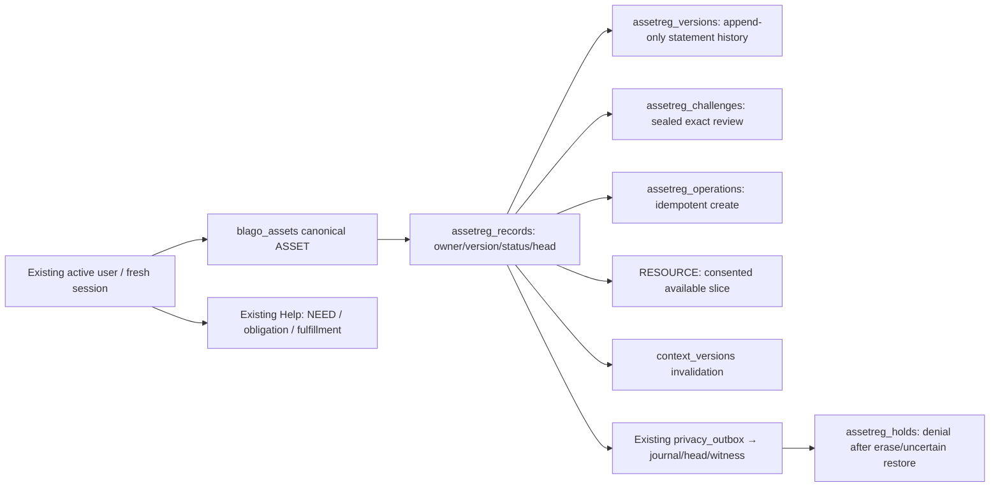

# Foundation09.1 — Durable Asset & Resource Statements

Draft. **GO: дальнейшая изолированная разработка на синтетических данных. NO-GO: реальные участники и production.** Это работающий долговечный доменный реестр, а не независимая экономика, кошелёк или новый Help lifecycle.

Exact base [PR27](https://github.com/xBLAGO/space/pull/27): `00c665b369acb6465f9afa795a6046c43f4107ce`, CI42691789476 SUCCESS перепроверен до начала работы. Source: `34fb475455678dc024cf39f8fa27d2cd0c5af7dd`; ветка `feat/foundation-09-1-durable-registry`, [Draft PR29](https://github.com/xBLAGO/space/pull/29). Documentation HEAD и финальный CI указаны отдельно в PR. Production, сайт, реальные данные, secrets/webhook не использовались; merge/deploy не выполнялись.

## Аудит существующих моделей и выбор интеграции

| Компонент | Фактическая реализация | Решение09.1 |
|---|---|---|
| Legacy ASSET | `integrations/web.py:create_asset`, таблица `blago_assets`; description/right/visibility без qty/version | Канонический ASSET ID остаётся здесь; новый реестр добавляет связанные версии, не второй asset row |
| Legacy RESOURCE/NEED | `blago_resources`, `blago_resource_offers`, `blago_needs`, отдельные UI/API | Нет однозначного physical-object mapping с assets. Автоимпорт отсутствует; excluded from new accounting |
| Calculator01 | `domain/collective_calculator.py:LabRegistry`, memory-only synthetic fixture | Не превращать его principals в новую регистрацию. Durable API принимает существующий session token |
| Help | `domain/help_service.py:tx/prepare/commit`, общая SQLite и audience | Переиспользовать authenticated guarded transaction. NEED/OBLIGATION/FULFILLMENT не копируются и не изменяются |
| Identity | active canonical `blago_user_id`, IdentityRuntime sessions, Web/Bot/Mini linking | owner_id только из `session_row`, произвольный user ID не принимается как полномочие |
| Privacy/recovery | PrivacyControl, authenticated journal/head/witness, lifecycle holds | Новый `asset_state` consumer, retained fingerprint и erase hold; отсутствие controls блокирует чтение/запись |
| G09 | context_versions/revision/epoch + generation CAS | Новые additive SQL triggers инвалидируют контекст при insert/update/delete registry record |
| Integration02 migrations | byte-checked modules/frozen baseline; Help rerun после Context/Lifecycle отказывает | Новый явный installer проверяет уже установленные predecessor modules, не запускает их повторные ALTER loops |

Старые checksums, frozen baseline JSON, dependencies и deployment workflow неизменны: [compatibility.json](asset09_1/compatibility.json). Integration preflight допускает только **точно проверенную** optional assetreg-схему; неизвестные/частично изменённые объекты по-прежнему запрещены. Feature flag `XBLAGO_ASSET_REGISTRY_ENABLED` **OFF по умолчанию**. После установки safeguards действуют и при выключенном flag; выключение UI/API не отменяет privacy protection.

## Модель данных

Новая schema version `foundation09_asset_registry_001`; точный checksum/SQL: [lab-evidence.json](asset09_1/lab-evidence.json). Шесть новых таблиц: ledger, records, versions, operations, challenges, holds. Три context triggers и два erase/no-resurrection triggers. FK и ON DELETE CASCADE обеспечивают удаление дочерних версий/operations/challenges вместе с canonical asset. Старые таблицы не ALTER и не backfill.

ASSET — заявление владельца/пользователя/распорядителя о благе, **SELF_DECLARED**. RESOURCE — доступная по отдельному согласию часть того же canonical ID, не дополнительное имущество. Признак готовности не передаёт титул, не бронирует ресурс и не создаёт обязательство. Право OWNER/USE/DISPOSAL — заявление, не юридическая или независимая проверка.

Record status: DRAFT → ACTIVE → REVOKED; ACTIVE может иметь новые явно подтверждённые версии. REVOKED не активируется старым challenge. ERASED не возвращает содержимое; остаются только независимый псевдонимный denial и HMAC hold. Отдельный новый объект не переносит права прежнего.

Каждая версия содержит UUID event ID, canonical asset ID/version, action DRAFT/DECLARE/REVISE/REVOKE, server timestamp и exact JSON: label, category, quantity/unit, available, share_consent, right, audience, conditions. Nullable quantity/available обозначают неизвестность. При known qty `0 <= available <= quantity`, положительная доступность требует согласия. PRIVATE/LAB_COMMUNITY и ON_REQUEST/SCHEDULE_REQUIRED ограничены текущим synthetic scope. Условия использования требуют отдельного будущего согласования; transfer/booking executor отсутствует.

Владение и доступность раздельны. Один asset row + available slice не удваивают stock; old unmapped legacy excluded. Draft idempotency key связан с owner и immutable initial body hash; другой payload по тому же ключу отклоняется. Физические дубли под разными заявленными ID, правдивость титула и Sybil-аккаунты **не доказуемы** этим реестром; это ограничения SELF_DECLARED, не скрытая независимая проверка.

## Доменный API и естественный разговор

Новых HTTP routes/клиентских форм в09.1 нет. Работающий Python domain API `AssetRegistry(app)`:

| Операция | Полномочия и эффект |
|---|---|
| `draft(token, body, key)` | Existing fresh session. Только приватный черновик без availability grant. Один canonical ID на owner/key |
| `prepare(token, id, version, body)` | Owner-only, current revision; exact body/audience/right preview; token bound to session/actor/action context, TTL120s |
| `commit(token, challenge, 'ПОДТВЕРЖДАЮ')` | HMAC seal binds nonce hash/owner/asset/version/session/body/expiry; atomic version comparison; same receipt on retry |
| `revoke(token, id)` | Owner-only, immediate PRIVATE + no availability; append version; invalidate outstanding challenges |
| `erase(token, id)` | Owner-only, remove canonical row and all associated content; durable deny prevents key replay |
| `feed/balance(token)` | Active fresh session; owner sees private history, others only current confirmed-publication ACTIVE statements, no owner internal UID/history |

`suggest_claim(text)` — чистая tentative schema, без I/O и записи, без угаданного qty/right или согласия. «У меня есть велосипед, которым готов делиться» не публикует и не создаёт obligation. Разговорное намерение не получает session/challenge. Agent tool execution, identity-bound chat card и cross-channel action UX требуют отдельного PR: агенту нельзя передавать session/challenge в LLM-контекст.

Backend не изменяет естественную манеру общения и не добавляет новых LLM-вызовов. Existing Bot/Mini/Web identity остаётся общей, но **новые registry UI actions в Telegram/WebView пока не реализованы/не испытаны**. Дополнительный локальный [channel harness](asset09_1/channel_check.py) прошёл6 checks с включённой schema: Bot /link, rotation/replay, canonical ID, private asset Web/Mini session views и запрет подмены challenge между сессиями. Это synthetic signed initData/domain API, не физический WebView. Повтор /link возвращает прежний G09 SAFE_CONFLICT вместо исходного command ACK; проверены один processed event и отсутствие повторной привязки/изменения заявления. Это известное ограничение UX, не повод ослаблять cache fencing. Existing browser/synthetic Mini App regression проверяет совместимость прежнего UI, не физическую работу новых действий.

## Атомарность и crash/recovery

Все операции используют существующий `SQLiteBlagoStore._locked_transaction`: BEGIN IMMEDIATE → reconcile durable denials → schema/integrity/frontier + session/owner checks → SQL changes → post-state validation → append journal/checkpoint/witness → SQLite commit → return receipt. Для каждого изменения fingerprint покрывает canonical row, record, все версии и create-operation provenance; в журнал попадают только HMAC tags/fingerprint, не label/quantity/UID/challenge.

Сравнение current version и изменение/receipt находятся **в одной write transaction**, а не process-local lock. Другой worker не может вклинить revoke между проверкой и commit. Успешный возврат происходит после commit и подтверждённой control записи. Если external journal уже записан, но SQL commit потерян, следующий guarded open не реконструирует положительный grant: несовпавшая запись удаляется и получает hold. Это потеря доступности, выбранная вместо неподтверждённого восстановления прав.

| Crash point | Результат |
|---|---|
| До journal append | SQLite rollback; старая версия сохраняется; retry может законно завершить подготовленное действие |
| После journal/witness, до SQL commit | Journal frontier опережает row: erase/hold, challenge/key закрыты; никакого success ACK |
| После SQL commit, до доставки ответа | Restart/replay возвращает исходную receipt, без новой версии |
| Journal/witness/SQL unavailable | Ошибка/отказ, не успешное подтверждение; controls не переинициализируются |

Old snapshot replay с изменённой availability/audience/revocation/erase не восстанавливает старое согласие. Backup **до09.1 migration**, но с будущими asset_state событиями, блокируется до явной установки новой schema; installer затем применяет только denials. Backups раньше полного Context/Lifecycle baseline не поддерживаются этим installer и требуют отдельно проверенного coordinated upgrade. Полностью актуальная копия с совпавшим authenticated frontier может сохранить действующие заявления, но все sessions/challenges при restore инвалидируются по прежним правилам.

Журнал/head/key/witness должны переживать rollback app DB и храниться в квалифицированном независимом custody. Same-host temp directories не доказывают независимость. Компрометация host/HMAC key или одновременный откат всех controls не решаются этим кодом. Нельзя одновременно обслуживать original и restored primary; полноценный multi-host fencing ещё не доказан.

## Privacy, retention, удаление, export

- Canonical `blago_assets` остаётся в существующем account purge; reviewed sidecar FKs признаны явным known ownership set, удаляются cascade. Неизвестные ownership tables по-прежнему блокируют purge.
- Legacy lifecycle90-day record policy (NOT APPROVED for real users) применяется к canonical created_at и удаляет весь registry payload через existing sweep. Новые triggers записывают erase denial и меняют context version в той же транзакции. Срок не продлевается незаметно после каждого edit.
- Expired challenges удаляются existing cleanup без изменения опубликованного формата ops counters. Restore очищает challenges, даже если feature flag выключен.
- Personal export добавляет только собственную версионную историю в существующий bounded export; без session hashes/seals/challenges/other participant history/journal secrets.
- Account deletion/re-registration не возвращают старые данные. Canonical IDs/holds связаны со старым uid; новая регистрация получает новую identity по существующим правилам.
- Erase удаляет **registry** содержимое, не является командой забыть независимый исходный чат/semantic fact. Здесь оригинальные диалоги не копируются; memory/history удаляются прежними пользовательскими процедурами. G09 инвалидирует in-flight generation, но не даёт основание заявить физическое стирание старых backup/provider/client copies.
- Исходный аккаунт с registry claims не переносится автоматическим merge: existing unknown-FK guard даёт409 и rollback. Linking пустого source к existing target не должно переносить имущество и остаётся в рамках прежней логики. Полный reviewed claim-transfer при merge — следующий этап.

## Коллективная модель и будущая федерация

`balance` считает current actor-authorized ACTIVE statements, known stock и available-self-declared subtotal по category/unit. Unknown object count и nullable total_stock/total_available не подменяются нулями. Own unmapped legacy count показывается отдельно; чужие private claims и историю aggregate не раскрывает. Это не полный общественный census и не wellbeing ranking. Small-cohort/differencing privacy требует внешнего review до реальных участников.

NEED/OBLIGATION/FULFILLMENT остаются в existing Help.09.1 demo использует **тех же canonical пользователей и ту же SQLite** для memory/history, registry и полного mutual Help completion. Registry не меняет Help state или экономические суммы. BTC/flow/confirmed-resource valuation остаются null: Calculator01 умеет offline Decimal оценки, но долговечное связывание valuation с quantity/version/provenance требует отдельного слоя; guesses и self-declared availability не становятся confirmed value. Stock и cumulative flow никогда не складываются.

Заложены versioned view format `blago.asset.claim-view.v1`, stable object/event IDs, ordered revision/action/body, exact serialization и separate consent history. Для межузлового обмена потребуются participant-selected disclosure, federation-safe identity references, signed envelope/mandate, issuer key history, fresh revocation frontier и replay protection независимых узлов. Внутренние UID/session/HMAC key не экспортируются как публичные полномочия. Нынешний HMAC журнал **не** публичное криптографическое доказательство собственника и не федерация; Federation/Sovereign experimental flags остаются OFF.

## Проверки и решение

49 новых unit/integration/security tests и23-check lab; **565/565 локально (524.124s) и source CI (158.211s), Docker PASS**; полный итог — [test-results.json](asset09_1/test-results.json), [source CI](asset09_1/ci-source.json). [Threat model](asset09_1/THREAT_MODEL.md), [migration/recovery runbook](asset09_1/RUNBOOK.md), [readiness](asset09_1/READINESS_MATRIX.md), [gates](asset09_1/gates.json), [evidence index](asset09_1/evidence-index.json). Предыдущие516 tests сохранены; точный финальный CI проверяется в PR.

Проверяем: create/commit replay, owner/session isolation, expiry/session rotation, two/three processes, competing versions, revoke race, corruption/forged receipt, delete/retention/export, crash до/после journal и commit, old backup before/after migration, account deletion/re-registration, G09 с независимым worker и состояние одной БД после restart.

**GO — изолированная следующая разработка. NO-GO — реальные участники.** G04 остаётся UNKNOWN; G09 имеет только scoped synthetic доказательства; G11 FAIL. Требуются owner approval retention/audience/custody, reviewed legacy disposition/merge, target-host DR/fsync/storage tests, independent security/privacy review, authenticated UI/CSRF action bridge и physical WebView/device trials. Live LLM quality и общие блокеры Integration02 не закрыты этой миграцией.
