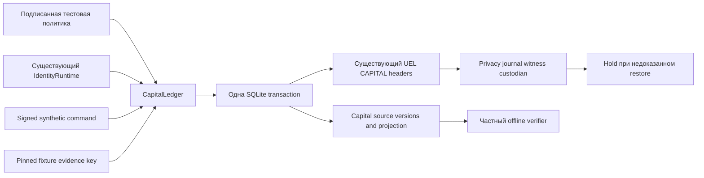

# Foundation 09.1 — Durable Collective Capital & Approvals

Статус Draft, synthetic only. Номер 09.1 уже использовался для Asset Registry PR #29; прежний docs/BLAGO_FOUNDATION_09_1.md сохранён без изменений. Этот отчёт относится к новому заданию Durable Collective Capital поверх #35. Exact base PR #35 `e707a19b0b98324ffd914a28b08601237cd6aea2`. Это развитие существующего UEL/Identity, Help и Asset сохраняют свои источники и жизненные циклы.

## Что реализовано

CapitalLedger хранит условные поступления, проверку, точные предложения, согласования, резервы, освобождение, расходы и возвраты. Поддержаны все восемь запрошенных финансово-учётных типов, дополнительные ProposalCreated и KeyRevoked. Реальных финансовых операций нет.

Начальная политика подписывается новыми тестовыми ключами участников. Каждая команда связывает фонд, текущую версию, policy hash, actor key, expiry, idempotency key и точное действие. Отдельный fixture evidence key подтверждает условные поступления, расходы и возвраты. Неизвестные и неподтверждённые деньги не доступны.

Резервы частей нескольких lots, CAS, потребление approvals и запись source/проекции/UEL выполняются атомарно существующей SQLite транзакцией. Квитанция COMMITTED возвращается после commit. Повтор не создаёт новое событие. Отзыв и расход сериализуются, исполнение после принятого отзыва запрещено.

Новая миграция capital_local_001 расширяет source_kind UEL до CAPITAL и сохраняет прежние заголовки и checksums. Она явная, транзакционная и не выполняется при запуске приложения. Никаких новых публичных маршрутов, платежей, HF-вызовов или агентских полномочий не добавлено. Feature flag XBLAGO_CAPITAL_LAB_ENABLED по умолчанию OFF.

## Архитектура

[Точный контракт и инварианты](capital091/CONTRACT.md), [threat model](capital091/THREAT_MODEL.md), [migration/recovery runbook](capital091/RUNBOOK.md) и [матрица испытаний](capital091/TEST_MATRIX.md).

## Синтетическая экономика

Стенд tools.capital_lab использует существующий 100-participant fixture с canonical Help/Asset и независимым локальным custodian process. Это local integration, не независимая федерация. Новая политика содержит 100 отдельных ключей и существующие привязки участников. Conditional capital равен 1 000 000 000 копеек из двух проверенных источников.

| Показатель | RUB |
|---|---|
| Проверено в синтетическом стенде | 10 000 000,00 |
| Подтверждённый условный расход | 7 030 000,00 |
| Текущий резерв | 500 000,00 |
| Доступный остаток | 2 470 000,00 |

Проверка истории пересчитывает тот же баланс по подписанным фактам без SQLite и journal secret. Частный audit export требует separately pinned policy/hash/count/head. Текущий reference verifier использует тот же переходный механизм и не является независимой реализацией или аудитом.

## Восстановление и privacy

Сбой до journal откатывает source и проекцию. После подтверждённого commit повтор возвращает старую квитанцию. Сбой между external journal и SQLite commit блокирует фонд, не восстанавливая положительные approvals из HMAC-заголовков. Это безопасная потеря доступности, а не успешное восстановление баланса.

Удаление любого связанного участника закрывает затронутый синтетический фонд, удаляет payload и membership, сохраняя минимальные защищённые holds и UEL history. Старый backup не возвращает удалённые сведения и разрешения. Такая общая erasure policy допустима только для стенда. Перед реальным коллективным капиталом требуется решение о правах остальных участников и retention доказательств.

## Ограничения и следующий этап

- RUB only, без rate conversion и реальных ценовых источников.
- Нет live payment receipts, правового подтверждения капитала, банка, wallet и переводов.
- Не реализованы policy rotation, quorum governance, независимость людей/ключедержателей и федеративный фонд.
- Просроченный резерв требует явного освобождения или отзыва действующим уполномоченным участником.
- Потеря private source payload не компенсируется восстановлением полномочий из журнала.
- Старый runtime #35 не совместим со схемой CAPITAL и должен отказывать. Откат данных ради старого кода запрещён.
- Реальные устройства, пользователи, HF и независимый operator/security review не испытаны.

GO возможно только для изолированного синтетического ядра после успешных проверок. Реальный пилот, деньги и независимая федерация остаются NO-GO. Прежние release gates не повышаются. До реального применения нужны независимый verifier implementation, review схемы доверия/удаления, ротация/quorum, эксплуатационные restore evidence и отдельное явное решение о допуске.

## Результаты проверок

Runtime source `66bb337e212f1ab63eba6c31549028b2c4439e57` прошёл [CI 44267543310](https://github.com/xBLAGO/space/actions/runs/44267543310): два полных прогона 721/721 за 180,102 и 186,302 секунды, Docker и 100-participant lab PASS. Локальный полный прогон этого source — 721/721 за 867,937 секунды. Сохранены 684 прежних теста, frozen UEL 72/72 без изменения ожидаемых результатов. Browser/virtual WebAuthn, Help cycle и synthetic Mini App прошли в CI.

После этого добавлены четыре теста и усилены существующие expiry/restore проверки. Новые authority и restore проверки прошли отдельно. Итоговый набор содержит 41 новый тест и ожидаемые 725 общих. Финальный HEAD CI, его SHA и результат фиксируются в Draft PR #36 отдельно от source evidence, чтобы не создавать самоссылочный commit ID.

При усилении restore выявлен недостаток раннего harness: перезапись старого SQLite по исходному пути не исключала сохранённый WAL. Эти проверки заменены восстановлением в новый отдельный файл без WAL исходного экземпляра. Три исправленных сценария удаления/отзыва прошли за 12,919 секунды. Ранний harness не используется как доказательство фактического отката.

[Machine-readable evidence](capital091/evidence.json), [100-participant balance](capital091/lab-evidence.json), [readiness](capital091/readiness.json). Старые migration checksums и прежний отчёт Asset Registry 09.1 сохранены. Production, secrets, HF, webhook, main, merge и deployment не изменены.
