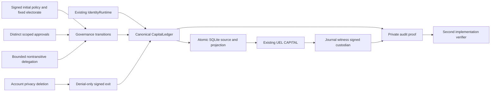

# Foundation 09.2 — Collective Capital Governance

Draft, synthetic only. Exact base PR #36 `c3c6896076c9e24932ebdb0ee14e7c04065b91dd`. Реальные деньги, платежи, HF и публичные endpoints отсутствуют. Новый флаг `XBLAGO_CAPITAL_GOVERNANCE_ENABLED` выключен по умолчанию.

## Реализация и интеграция

Развивается существующий CapitalLedger и тот же источник CAPITAL в UEL. IdentityRuntime, Help и Asset остаются каноническими. Новые политики имеют явный формат `capital-governance-policy-2`; прежние `capital-lab-policy-1` не импортируются автоматически и сохраняют контракт 09.1. Перевод старого фонда требует отдельного согласованного переходного протокола, особенно если в нём недостаточно независимых согласующих.

Добавлена аддитивная миграция `capital_governance_002`: только marker и recovery holds. Старые SQL/версии/checksums не меняются. Состав и суммы существующих фондов при миграции не меняются. Никаких startup migrations.

## Управление

Начальную политику подписывают все заранее аутентифицированные синтетические участники. В стенде 100 участников, пять governors, четыре голоса для изменения политики и два отдельных согласующих для расхода. Это параметры испытания, а не утверждённый общественный порядок BLAGO.

Изменение требует подписанного предложения точной новой политики, голосов действующих governors и задержки не менее 60 секунд. Кворум считается по первоначальному фиксированному составу, не уменьшается после выходов. Нельзя подменять ключи/электорат, понижать кворумы и задержку, увеличивать предел делегирования или менять trust anchors этим механизмом. Новая версия отказывает старым незавершённым approvals, освобождает резервы и отзывает делегирования. Отзыв голоса управления сбрасывает readiness задержки только при потере кворума. Лишний голос и его отзыв не перезапускают таймер непрерывно существующего кворума.

Согласование расхода считает отдельно исходных обладателей полномочий и фактических подписантов. Нельзя самосогласовать предложение или исполнить собственное согласование. Делегирование относится к одному предложению, сумме и сроку, не передаёт GOV и не образует цепочек. Один proxy не может набрать два голоса через несколько доверителей. Отзыв или выход, нарушающий кворум резерва, освобождает незавершённый резерв. Истёкшее согласование блокирует расход, но не создаёт автоматического возврата.

Отзыв ключа требует сверхкворумного сертификата, связанного с fund/version/policy/action/nonce/expiry. Единоличный KeyRevoked старого формата в v2 не допускается. История выполненного расхода не исчезает после отзыва голоса; возврат требует самостоятельного подтверждения.

## Выход и удаление

MemberExited подписывается участником. Его приватная UID-привязка удаляется, новые операции запрещаются, связанные незавершённые разрешения пересчитываются. Сам фонд, проверенный капитал и права остальных сохраняются. Один участник не может вызвать прежний erase всего v2-фонда.

Удаление аккаунта использует действующий privacy challenge. Узел подписывает только отрицательный PrivacyMemberExited отдельным доменом существующего pinned source key. Такая подпись не может выдать голос, добавить участника, подтвердить деньги или снизить кворум. Удаление работает и при выключенном governance feature flag; guards остаются обязательными.

Сохранённая совместная история содержит публичные тестовые ключи, непрямые actor codes, opaque назначения и подписи. Связь с удалённым UID снимается. Это не полное уничтожение псевдонимного криптографического следа и не гарантия отсутствия повторной идентификации. Копии у ранее уполномоченных аудиторов также нельзя отозвать технически. Перед реальными людьми нужна отдельно утверждённая политика retention/прав третьих участников. G04 не повышается.

Свежий backup после выхода сохраняет подтверждённое состояние. При старом backup и недоказанных положительных событиях v2-фонд замораживается, его записи и членство остальных не удаляются. Отозванная UID-привязка не возвращается. Выдача новых grants из hashes запрещена. Сохранность прав не означает доступность исполнения без достаточных доказательств.

## Независимая реализация проверки

`tools/independent_capital_verifier.py` не импортирует BLAGO runtime, transition engine, canonical helper, SQLite, session или journal key. Отдельно реализует сериализацию, Ed25519 domains, переходы, кворумы, делегирования, учёт, версии и проекцию. В тестах его состояния сравниваются с runtime; отрицательные переходы должны отвергаться обеими реализациями. Проверяется запуск отдельного процесса из каталога без исходников проекта в PYTHONPATH.

Private proof включает выбранные UEL headers, остальные opaque leaves, signed custodian checkpoint и node binding. Внешний проверяющий отдельно получает genesis policy hash, custodian key, stream, node key и checkpoint hash. Проверяются включение заголовков, порядок локального CAPITAL source и подписи событий. **Привязка приватного payload к HMAC reference остаётся подписанным утверждением узла**, а не публичным доказательством знания его HMAC secret. Checkpoint требует внешне закреплённого актуального tip; самоприсланные pins не защищают от усечения/rollback.

Это независимость реализации от runtime, но не независимость автора или операторов. Независимый внешний security audit и операторский межузловой эксперимент — NOT EXECUTED. Формат v1 сохраняет прежний reference verifier, новая вторая реализация проверяет v2 governance history и UEL inclusion; универсальная публичная проверка всех доменных payload не заявляется.

## Синтетический стенд

Используются существующие 100 synthetic identities, Help/Asset и original local custody. Учтены 10 млн RUB из двух источников, 7,03 млн условного расхода и 2,97 млн свободного остатка. Два независимых согласования предшествуют расходу. Затем четыре governors принимают версию 2 с задержкой и участник выходит. Второй verifier пересчитывает тот же баланс и подтверждает включение событий в подписанную контрольную точку. Реальные источники денег не верифицируются.

[Контракт](governance092/CONTRACT.md), [модель угроз](governance092/THREAT_MODEL.md), [runbook](governance092/RUNBOOK.md), [матрица испытаний](governance092/TEST_MATRIX.md).

## Решение

GO допускается только для дальнейших изолированных синтетических испытаний при успешном полном CI. Реальные участники, капитал, production и независимая федерация — NO-GO. Не устранены Sybil/сговор полного кворума, реальные key custody и consent, эксплуатационные privacy/retention условия, independent-operator evidence и прежние release gates. Протокол не способен доказать независимость людей только по разным ключам.

## Проверенные результаты и финальное усиление

Initial source `6c315c71c884715c6e8786bdd06d75288079a949`: [CI 44308053656](https://github.com/xBLAGO/space/actions/runs/44308053656) — два полных прогона 771/771 за 300,838 и 313,016 секунды, Docker и браузерные synthetic проверки PASS. Локальный exact-source полный прогон — 771/771 за 1292,505 секунды. Сохранены все 725 прежних тестов и frozen 72 UEL-примера.

Заключительный review выявил возможность minority vote-flapping: лишний голос и его отзыв сбрасывали delay при сохранённом кворуме. Правило усилено в обеих реализациях: время активации сохраняется при непрерывном кворуме и сбрасывается только ниже порога. Добавлены два сценария, все 26 pure differential тестов PASS. Финальный набор содержит 48 новых тестов, ожидаемый полный count — 773.

Усилены fresh backup проверки: на новом восстановленном файле выполняются reauthentication, новый quorum, резерв и расход. Проверены строгие поля audit events, UUID и checkpoint hashes. Три изменённых integration проверки PASS за 49,303 секунды.

[Синтетический proof и инструкция](governance092/VECTORS.md), [evidence](governance092/evidence.json), [lab result](governance092/lab-evidence.json), [readiness](governance092/readiness.json). Producer-generated pins не являются независимым OOB подтверждением. SHA финального HEAD и его CI фиксируются в Draft PR #37 и machine-readable CI artifact с checkout SHA, отдельно от этого source snapshot.

Production, secrets, HF, webhook, main, Help/Asset state machines и прежние migration checksums не изменены. Merge/deployment не выполнялись.
