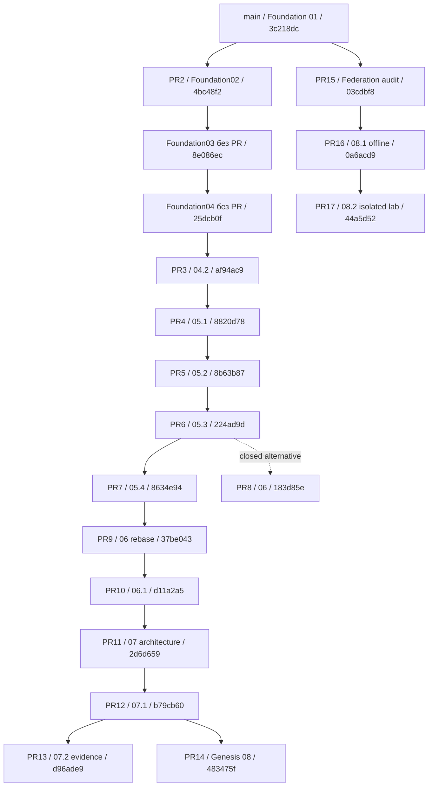

# Foundation Dependency Map — Integration Audit 01

**Draft, snapshot 2026-11-03 UTC.** Источник: свежие GitHub REST collections `pulls?state=all&per_page=100` и `branches?per_page=100`; обе вторые страницы пусты. 16 PR (#2–#17): 15 open, один closed/unmerged (#8), ни одного merged. 19 веток. Номера Foundation не совпадают с номерами PR. Этот документ не меняет состояние веток.

## 1. Точный inventory PR

Base/head ниже — значения GitHub на момент снимка; base SHA может двигаться в будущем. Не путать `merge_commit_sha` виртуального PR merge с фактом merge в main. Все открытые PR draft, кроме #3.

| PR / Foundation | State | Base branch / exact SHA | Head branch / exact SHA | Files | CI exact head |
|---|---|---|---|---:|---|
| [#2](https://github.com/xBLAGO/space/pull/2) — Foundation 02: Unified BLAGO Web/PWA + Telegram Mini App | open; draft; merged=False | `main`<br>`3c218dc5757879c26b3aec520af3636b2d702715` | `feat/foundation-02-unified-app`<br>`4bc48f2a6b23f198ca88a022e4bad0f03f709e8a` | 19 | [pull_request success](https://github.com/xBLAGO/space/actions/runs/38478463327); [push success](https://github.com/xBLAGO/space/actions/runs/38478457480) |
| [#3](https://github.com/xBLAGO/space/pull/3) — Foundation 04.2: безопасное обновление и удаление персональной памяти | open; ready; merged=False | `feat/foundation-04-semantic-memory`<br>`25dcb0fae420b27916629b1686f07f6f96e5c446` | `fix/foundation-04-memory-pilot`<br>`af94ac93dde649747b1a89104000f92f75ecb7fc` | 17 | [pull_request success](https://github.com/xBLAGO/space/actions/runs/39905173451); [push success](https://github.com/xBLAGO/space/actions/runs/39905169508) |
| [#4](https://github.com/xBLAGO/space/pull/4) — Foundation 05.1: Identity Store audit and compatible offline migration | open; draft; merged=False | `fix/foundation-04-memory-pilot`<br>`af94ac93dde649747b1a89104000f92f75ecb7fc` | `feat/foundation-05-identity-store`<br>`8820d7852f0db6c4fc5101f9e281211ba7b6b074` | 4 | [pull_request success](https://github.com/xBLAGO/space/actions/runs/39979523604); [push success](https://github.com/xBLAGO/space/actions/runs/39979438391) |
| [#5](https://github.com/xBLAGO/space/pull/5) — Foundation 05.2: secure identity, WebAuthn and session runtime | open; draft; merged=False | `feat/foundation-05-identity-store`<br>`8820d7852f0db6c4fc5101f9e281211ba7b6b074` | `feat/foundation-05-secure-identity-runtime`<br>`8b63b8795490a11ad2b5a709b9a258033b7d6381` | 10 | [pull_request success](https://github.com/xBLAGO/space/actions/runs/39986772105); [push success](https://github.com/xBLAGO/space/actions/runs/39986125189) |
| [#6](https://github.com/xBLAGO/space/pull/6) — Foundation 05.3: backup-safe revocations, privacy and minimal analytics | open; draft; merged=False | `feat/foundation-05-secure-identity-runtime`<br>`8b63b8795490a11ad2b5a709b9a258033b7d6381` | `feat/foundation-05-privacy-recovery`<br>`224ad9d2a1775a8372354af35d542f433cb8bdde` | 13 | [push success](https://github.com/xBLAGO/space/actions/runs/40014813406); [pull_request success](https://github.com/xBLAGO/space/actions/runs/40000255798); [push success](https://github.com/xBLAGO/space/actions/runs/40000164978) |
| [#7](https://github.com/xBLAGO/space/pull/7) — Foundation 05.4: Pilot Safety Gate and privacy recovery hardening | open; draft; merged=False | `feat/foundation-05-privacy-recovery`<br>`224ad9d2a1775a8372354af35d542f433cb8bdde` | `feat/foundation-05-pilot-safety-gate`<br>`8634e94a6dddd2b8cfff415b112f6b895eb0f4ae` | 33 | [push success](https://github.com/xBLAGO/space/actions/runs/40016281349); [pull_request success](https://github.com/xBLAGO/space/actions/runs/40015200505); [push success](https://github.com/xBLAGO/space/actions/runs/40015195649) |
| [#8](https://github.com/xBLAGO/space/pull/8) — Foundation 06: human-first conversation interface | closed; draft; merged=False | `feat/foundation-05-privacy-recovery`<br>`224ad9d2a1775a8372354af35d542f433cb8bdde` | `feat/foundation-06-human-interface`<br>`183d85e6083fb0806127e569036d2bb7012dfaf7` | 1 | [push success](https://github.com/xBLAGO/space/actions/runs/40014959680) |
| [#9](https://github.com/xBLAGO/space/pull/9) — Foundation 06: human-first UI on Foundation 05.4 | open; draft; merged=False | `feat/foundation-05-pilot-safety-gate`<br>`8634e94a6dddd2b8cfff415b112f6b895eb0f4ae` | `feat/foundation-06-human-interface-05-4`<br>`37be0437578125503f0a851c6ce9a86222937cdc` | 1 | [push failure](https://github.com/xBLAGO/space/actions/runs/40016287991) |
| [#10](https://github.com/xBLAGO/space/pull/10) — Foundation 06.1: conversational intent and reliable HF generation | open; draft; merged=False | `feat/foundation-06-human-interface-05-4`<br>`37be0437578125503f0a851c6ce9a86222937cdc` | `feat/foundation-06-natural-intelligence`<br>`d11a2a555efe57e6818450d534655020bf47b9ca` | 26 | [push success](https://github.com/xBLAGO/space/actions/runs/40076029537); [pull_request success](https://github.com/xBLAGO/space/actions/runs/40075042228); [push success](https://github.com/xBLAGO/space/actions/runs/40075039113) |
| [#11](https://github.com/xBLAGO/space/pull/11) — Foundation 07: Sovereign Human Identity — architecture and safety gates | open; draft; merged=False | `feat/foundation-06-natural-intelligence`<br>`d11a2a555efe57e6818450d534655020bf47b9ca` | `feat/foundation-07-identity-architecture`<br>`2d6d65913d9091e7d42966532162a0d1de9d0c76` | 1 | [push success](https://github.com/xBLAGO/space/actions/runs/40076089703) |
| [#12](https://github.com/xBLAGO/space/pull/12) — Foundation 07.1: Sovereign Identity Core (isolated tests, flag OFF) | open; draft; merged=False | `feat/foundation-07-identity-architecture`<br>`2d6d65913d9091e7d42966532162a0d1de9d0c76` | `feat/foundation-07-identity-core`<br>`b79cb603a58adbab1e8a5313a06393a2feb5532f` | 16 | [pull_request success](https://github.com/xBLAGO/space/actions/runs/40568551246); [push success](https://github.com/xBLAGO/space/actions/runs/40568539175) |
| [#13](https://github.com/xBLAGO/space/pull/13) — Foundation 07.2: isolated recovery protocol; live authority fail-closed | open; draft; merged=False | `feat/foundation-07-identity-core`<br>`b79cb603a58adbab1e8a5313a06393a2feb5532f` | `feat/foundation-07-identity-recovery`<br>`d96ade9375f3499ad93095b2307abd750f0a8578` | 8 | [pull_request success](https://github.com/xBLAGO/space/actions/runs/40584412666); [push success](https://github.com/xBLAGO/space/actions/runs/40584405236) |
| [#14](https://github.com/xBLAGO/space/pull/14) — Foundation 08: Genesis declarations and consented public deliberation (Draft) | open; draft; merged=False | `feat/foundation-07-identity-core`<br>`b79cb603a58adbab1e8a5313a06393a2feb5532f` | `feat/foundation-08-genesis-protocol`<br>`483475fd237ba3400881699c407be5b91d53dcdd` | 25 | [pull_request success](https://github.com/xBLAGO/space/actions/runs/41520088632); [push success](https://github.com/xBLAGO/space/actions/runs/41520078991) |
| [#15](https://github.com/xBLAGO/space/pull/15) — Foundation 08: federation architecture audit and Open Protocol 0.1 requirements | open; draft; merged=False | `main`<br>`3c218dc5757879c26b3aec520af3636b2d702715` | `docs/foundation-08-federation-audit`<br>`03cdbf82ec45ee10ec45567ba60f3bfb06fbca5f` | 3 | NO RUN FOUND |
| [#16](https://github.com/xBLAGO/space/pull/16) — Foundation 08.1: protocol baseline, scoped authority and conformance design | open; draft; merged=False | `docs/foundation-08-federation-audit`<br>`03cdbf82ec45ee10ec45567ba60f3bfb06fbca5f` | `docs/foundation-08-1-protocol-conformance`<br>`0a6acd9178de8c1aaac8f3af729d896efd4eb98a` | 20 | [pull_request success](https://github.com/xBLAGO/space/actions/runs/41704965826); [push success](https://github.com/xBLAGO/space/actions/runs/41704957443) |
| [#17](https://github.com/xBLAGO/space/pull/17) — Foundation 08.2: durable federation lab, receipts and fault injection | open; draft; merged=False | `docs/foundation-08-1-protocol-conformance`<br>`0a6acd9178de8c1aaac8f3af729d896efd4eb98a` | `feat/foundation-08-2-durable-lab`<br>`44a5d52a4ac8022478a247f4e1bbd2eaea551142` | 17 | [pull_request success](https://github.com/xBLAGO/space/actions/runs/41714974472); [push success](https://github.com/xBLAGO/space/actions/runs/41714964310) |

CI проверен GET `/actions/runs?head_sha=…`, включая push и pull_request; выборка <100 для каждого SHA. SUCCESS — conclusion job/run, не production acceptance. #9 failure: run 40016287991, job 120629061063, Chrome WebAuthn UI timeout на скрытой кнопке profile. В #10 tools/pilot_browser_check.py:48 открывает tools drawer; исправление подтверждается diff и зелёным CI #10. #11 имеет push CI, #15 не имеет CI; отсутствие не подменяется success. Main имеет только исторический deploy-run 38441506701 SUCCESS, не test-run.

## 2. Все ветки, включая без PR

| Branch | Exact HEAD |
|---|---|
| `docs/foundation-08-1-protocol-conformance` | `0a6acd9178de8c1aaac8f3af729d896efd4eb98a` |
| `docs/foundation-08-federation-audit` | `03cdbf82ec45ee10ec45567ba60f3bfb06fbca5f` |
| `feat/foundation-02-unified-app` | `4bc48f2a6b23f198ca88a022e4bad0f03f709e8a` |
| `feat/foundation-03-personal-ai` | `8e086ec24bc9f3fe0d11e6dd12473f867ede3b44` |
| `feat/foundation-04-semantic-memory` | `25dcb0fae420b27916629b1686f07f6f96e5c446` |
| `feat/foundation-05-identity-store` | `8820d7852f0db6c4fc5101f9e281211ba7b6b074` |
| `feat/foundation-05-pilot-safety-gate` | `8634e94a6dddd2b8cfff415b112f6b895eb0f4ae` |
| `feat/foundation-05-privacy-recovery` | `224ad9d2a1775a8372354af35d542f433cb8bdde` |
| `feat/foundation-05-secure-identity-runtime` | `8b63b8795490a11ad2b5a709b9a258033b7d6381` |
| `feat/foundation-06-human-interface` | `183d85e6083fb0806127e569036d2bb7012dfaf7` |
| `feat/foundation-06-human-interface-05-4` | `37be0437578125503f0a851c6ce9a86222937cdc` |
| `feat/foundation-06-natural-intelligence` | `d11a2a555efe57e6818450d534655020bf47b9ca` |
| `feat/foundation-07-identity-architecture` | `2d6d65913d9091e7d42966532162a0d1de9d0c76` |
| `feat/foundation-07-identity-core` | `b79cb603a58adbab1e8a5313a06393a2feb5532f` |
| `feat/foundation-07-identity-recovery` | `d96ade9375f3499ad93095b2307abd750f0a8578` |
| `feat/foundation-08-2-durable-lab` | `44a5d52a4ac8022478a247f4e1bbd2eaea551142` |
| `feat/foundation-08-genesis-protocol` | `483475fd237ba3400881699c407be5b91d53dcdd` |
| `fix/foundation-04-memory-pilot` | `af94ac93dde649747b1a89104000f92f75ecb7fc` |
| `main` | `3c218dc5757879c26b3aec520af3636b2d702715` |

Foundation 03 (`8e086ec24bc9f3fe0d11e6dd12473f867ede3b44`) и исходный 04 (`25dcb0fae420b27916629b1686f07f6f96e5c446`) не имеют отдельных PR в коллекции. Это реальные коммиты в ancestry #3, а не включённые в main этапы. Foundation 01 здесь означает существующий baseline персонального агента/SQLite/Telegram в main; отдельного PR 01 коллекция не содержит.

## 3. Граф реального наследования



Solid edges — Git ancestry/base links; dashed — закрытая альтернативная UI-ветка, не требуемая интеграция. Для всех локально доступных 15 PR base является ancestor head; ни один head не ancestor main. #8 проверен по API patch (один HTML-файл), его Git object отсутствовал локально; не выдаём API base за отдельную проверку merge-base. #13 и #14 siblings; их совместный runtime не испытан. #15–#17 основаны на main и не содержат application stack #2–#14. Совпадение номера 08 у Genesis и federation не означает общий runtime.

| PR | Commits сверх main | Изменённых путей относительно main | HEAD в main |
|---|---:|---:|---|
| #2 | 30 | 19 | False |
| #3 | 39 | 35 | False |
| #4 | 40 | 38 | False |
| #5 | 41 | 42 | False |
| #6 | 42 | 49 | False |
| #7 | 44 | 74 | False |
| #9 | 45 | 74 | False |
| #10 | 48 | 89 | False |
| #11 | 49 | 90 | False |
| #12 | 51 | 98 | False |
| #13 | 53 | 105 | False |
| #14 | 54 | 114 | False |
| #15 | 1 | 3 | False |
| #16 | 3 | 23 | False |
| #17 | 5 | 40 | False |

## 4. Точные изменённые файлы каждого PR

Источник `/pulls/N/files`, первая страница <100 записей для всех PR; список полный для снимка. Это diff к base конкретного PR, не к main. Для точного кода использовать head SHA из таблицы, для aggregate tree — Git diff main..head.

<details><summary>PR #2: 19 paths</summary>

```text
modified .env.example
modified .github/workflows/huggingface-space.yml
added    .github/workflows/tests.yml
modified README.md
modified deploy/huggingface-space/README.md
added    docs/BLAGO_ECONOMY_01.md
added    docs/BLAGO_RELEASE_01.md
modified pyproject.toml
modified src/xblago/core/storage.py
added    src/xblago/integrations/static/icon.svg
added    src/xblago/integrations/static/index.html
added    src/xblago/integrations/static/manifest.webmanifest
added    src/xblago/integrations/static/sw.js
modified src/xblago/integrations/telegram.py
added    src/xblago/integrations/web.py
added    tests/test_browser_e2e.py
added    tests/test_economy.py
modified tests/test_telegram.py
added    tests/test_web.py
```

</details>

<details><summary>PR #3: 17 paths</summary>

```text
modified .github/workflows/tests.yml
added    docs/BLAGO_FOUNDATION_04_2.md
added    docs/BLAGO_FOUNDATION_04_MEMORY_AUDIT.md
modified src/xblago/agents/personal_assistant.py
modified src/xblago/core/llm.py
modified src/xblago/core/memory.py
added    src/xblago/core/memory_commands.py
added    src/xblago/core/memory_policy.py
modified src/xblago/core/routing.py
modified src/xblago/core/semantic_memory.py
modified src/xblago/core/storage.py
modified src/xblago/integrations/telegram.py
modified src/xblago/integrations/web.py
added    tests/test_foundation042.py
added    tests/test_memory_pilot.py
modified tests/test_semantic_memory.py
modified tests/test_telegram.py
```

</details>

<details><summary>PR #4: 4 paths</summary>

```text
modified .github/workflows/tests.yml
added    docs/BLAGO_FOUNDATION_05.md
added    src/xblago/core/identity_schema.py
added    tests/test_identity_schema.py
```

</details>

<details><summary>PR #5: 10 paths</summary>

```text
modified .github/workflows/tests.yml
added    docs/BLAGO_FOUNDATION_05_2.md
modified pyproject.toml
added    src/xblago/core/identity_runtime_schema.py
modified src/xblago/core/storage.py
added    src/xblago/integrations/identity.py
modified src/xblago/integrations/static/index.html
modified src/xblago/integrations/telegram.py
modified src/xblago/integrations/web.py
added    tests/test_identity_runtime.py
```

</details>

<details><summary>PR #6: 13 paths</summary>

```text
modified .github/workflows/tests.yml
added    docs/BLAGO_FOUNDATION_05_3.md
added    src/xblago/core/privacy_control.py
added    src/xblago/core/privacy_maintenance.py
added    src/xblago/core/privacy_schema.py
added    src/xblago/core/security_journal.py
modified src/xblago/core/storage.py
modified src/xblago/integrations/identity.py
added    src/xblago/integrations/privacy.py
modified src/xblago/integrations/static/index.html
modified src/xblago/integrations/telegram.py
modified src/xblago/integrations/web.py
added    tests/test_privacy.py
```

</details>

<details><summary>PR #7: 33 paths</summary>

```text
modified .github/workflows/huggingface-space.yml
modified .github/workflows/tests.yml
modified Dockerfile
added    docs/BLAGO_FOUNDATION_05_4.md
added    docs/BLAGO_FOUNDATION_05_4_MIGRATION.md
added    docs/BLAGO_FOUNDATION_05_4_RETENTION.md
added    docs/validation05_4/browser-results.json
added    docs/validation05_4/chrome-desktop.png
added    docs/validation05_4/chrome-mobile-viewport.png
added    docs/validation05_4/ci-source-evidence.txt
added    docs/validation05_4/hf-integration.json
added    docs/validation05_4/independent-baseline-review.md
added    docs/validation05_4/independent-recheck.md
added    docs/validation05_4/local-tests.txt
added    docs/validation05_4/pilot-decision.json
added    docs/validation05_4/pr-chain.json
added    docs/validation05_4/runtime-inventory.json
added    src/xblago/core/journal_custody.py
added    src/xblago/core/journal_witness.py
added    src/xblago/core/pilot_schema.py
modified src/xblago/core/privacy_control.py
modified src/xblago/core/privacy_schema.py
modified src/xblago/core/security_journal.py
added    src/xblago/core/sqlite_safety.py
modified src/xblago/core/storage.py
modified src/xblago/integrations/static/index.html
added    tests/test_foundation_stack.py
added    tests/test_pilot_safety.py
added    tools/build_macos_sqlite_driver.py
added    tools/build_sqlite.py
added    tools/pilot_browser_check.py
added    tools/pilot_fixture.py
added    tools/pilot_hf_check.py
```

</details>

<details><summary>PR #8: 1 paths</summary>

```text
modified src/xblago/integrations/static/index.html
```

</details>

<details><summary>PR #9: 1 paths</summary>

```text
modified src/xblago/integrations/static/index.html
```

</details>

<details><summary>PR #10: 26 paths</summary>

```text
modified .github/workflows/tests.yml
added    docs/BLAGO_FOUNDATION_06_1.md
added    docs/validation06_1/browser-results.json
added    docs/validation06_1/ci-source-evidence.txt
added    docs/validation06_1/hf-after-before-status-projection.json
added    docs/validation06_1/hf-after-local-ca-failure.json
added    docs/validation06_1/hf-after.json
added    docs/validation06_1/hf-before-local-ca-failure.json
added    docs/validation06_1/hf-before.json
added    docs/validation06_1/local-tests.txt
added    docs/validation06_1/quality-review.json
modified src/xblago/agents/personal_assistant.py
modified src/xblago/core/config.py
added    src/xblago/core/conversation.py
modified src/xblago/core/llm.py
modified src/xblago/core/semantic_memory.py
modified src/xblago/core/storage.py
modified src/xblago/integrations/telegram.py
modified src/xblago/integrations/web.py
added    tests/fixtures/natural_dialogues.json
added    tests/test_generation_reliability.py
modified tests/test_llm.py
added    tests/test_natural_conversation.py
modified tests/test_telegram.py
added    tools/natural_hf_check.py
modified tools/pilot_browser_check.py
```

</details>

<details><summary>PR #11: 1 paths</summary>

```text
added    docs/BLAGO_FOUNDATION_07_ARCHITECTURE.md
```

</details>

<details><summary>PR #12: 16 paths</summary>

```text
modified .github/workflows/tests.yml
added    docs/BLAGO_FOUNDATION_07_1.md
added    docs/validation07_1/ci-source-evidence.txt
added    docs/validation07_1/local-tests.txt
added    docs/validation07_1/runtime-and-scope.json
modified pyproject.toml
modified src/xblago/agents/personal_assistant.py
modified src/xblago/core/privacy_control.py
modified src/xblago/core/privacy_maintenance.py
added    src/xblago/core/sovereign.py
added    src/xblago/core/sovereign_recovery.py
added    src/xblago/core/sovereign_schema.py
modified src/xblago/integrations/identity.py
modified src/xblago/integrations/privacy.py
modified src/xblago/integrations/web.py
added    tests/test_sovereign_identity.py
```

</details>

<details><summary>PR #13: 8 paths</summary>

```text
modified .github/workflows/tests.yml
added    docs/BLAGO_FOUNDATION_07_2.md
added    docs/validation07_2/ci-source-evidence.txt
added    docs/validation07_2/decision.json
added    docs/validation07_2/local-tests.txt
added    docs/validation07_2/runtime.json
added    src/xblago/core/identity_recovery.py
added    tests/test_identity_recovery.py
```

</details>

<details><summary>PR #14: 25 paths</summary>

```text
modified .github/workflows/tests.yml
added    docs/BLAGO_FOUNDATION_08.md
added    docs/BLAGO_FOUNDATION_08_SOLANA.md
added    docs/BLAGO_PROTOCOL_v0.1.md
added    docs/validation08/browser-results.json
added    docs/validation08/ci-source-evidence.txt
added    docs/validation08/genesis-dialogue.json
added    docs/validation08/genesis-dialogue.png
added    docs/validation08/genesis-public-mobile.png
added    docs/validation08/genesis-public.png
added    docs/validation08/local-tests.txt
added    docs/validation08/withdrawal-regression.txt
added    src/xblago/core/genesis.py
added    src/xblago/core/genesis_interfaces.py
added    src/xblago/core/genesis_schema.py
modified src/xblago/core/privacy_control.py
modified src/xblago/core/privacy_maintenance.py
modified src/xblago/core/storage.py
modified src/xblago/integrations/privacy.py
modified src/xblago/integrations/static/index.html
modified src/xblago/integrations/telegram.py
modified src/xblago/integrations/web.py
added    tests/test_genesis.py
added    tools/genesis_demo.py
modified tools/pilot_browser_check.py
```

</details>

<details><summary>PR #15: 3 paths</summary>

```text
added    docs/BLAGO_FEDERATION_AUDIT.md
added    docs/BLAGO_FEDERATION_AUDIT_EVIDENCE.json
added    docs/BLAGO_PROTOCOL_0_1_REQUIREMENTS.md
```

</details>

<details><summary>PR #16: 20 paths</summary>

```text
added    .github/workflows/protocol-conformance.yml
added    docs/BLAGO_FOUNDATION_08_1.md
added    docs/protocol_0_1/BASELINE_AND_ENTITIES.md
added    docs/protocol_0_1/CONFORMANCE.md
added    docs/protocol_0_1/ENVELOPE.md
added    docs/protocol_0_1/EXPERIMENT_AB.md
added    docs/protocol_0_1/MANDATE_AND_AUTHORITY.md
added    docs/protocol_0_1/PORTABILITY.md
added    docs/protocol_0_1/THREAT_MODEL.md
added    docs/protocol_0_1/conformance/check_design.py
added    docs/protocol_0_1/conformance/ci-evidence.txt
added    docs/protocol_0_1/conformance/generate_vectors.py
added    docs/protocol_0_1/conformance/golden.json
added    docs/protocol_0_1/conformance/lab-policy.json
added    docs/protocol_0_1/conformance/manifest.json
added    docs/protocol_0_1/conformance/results.json
added    docs/protocol_0_1/conformance/run_conformance.py
added    docs/protocol_0_1/conformance/validator_a.py
added    docs/protocol_0_1/conformance/validator_b.py
added    docs/protocol_0_1/conformance/vectors.jsonl
```

</details>

<details><summary>PR #17: 17 paths</summary>

```text
added    .github/workflows/federation-lab.yml
added    docs/BLAGO_FOUNDATION_08_2.md
added    docs/lab_08_2/INDEPENDENT_RUN.md
added    docs/lab_08_2/MATRIX.md
added    docs/lab_08_2/RECOVERY.md
added    docs/lab_08_2/THREAT_MODEL_DELTA.md
added    docs/lab_08_2/ci-evidence.txt
added    docs/lab_08_2/evidence.json
added    docs/lab_08_2/local-demo-evidence.json
added    docs/lab_08_2/receipt-schema.json
added    docs/lab_08_2/receipt-schema.sha256
added    experiments/federation_08_2/actors.py
added    experiments/federation_08_2/demo.py
added    experiments/federation_08_2/run_lab.py
added    experiments/federation_08_2/runtime.py
added    experiments/federation_08_2/test_runtime.py
added    experiments/federation_08_2/transport.py
```

</details>

## 5. Практические последствия

- Не складывать cumulative diff каждого PR к main: это повторно применит одни и те же таблицы/правила. Принимать один проверенный ancestry path, с отдельным review каждого слоя.
- Не включать закрытый #8 одновременно с #9. Не merge #9 в одиночку при красном exact-head CI; UI acceptance fix уже находится в #10.
- Минимальный runtime-кандидат пилота: #10, `d11a2a555efe57e6818450d534655020bf47b9ca`, с security/functional patches и gates. #12 — проверяемый superset для isolated compatibility, а не обязательная crypto identity для пилота.
- #13 и #14 пересекаются по `.github/workflows/tests.yml`; остальные имена различаются, но обе ветки зависят от общего journal/restore/identity контракта. Это potential semantic integration risk, не заявленный результат пробного merge.
- #15–#17 не имеют production adapter к blago_user_id, needs или economy. Их базу main нельзя принять за доказательство совместной работы с #12.

[Главный аудит](BLAGO_INTEGRATION_AUDIT_01.md) · [Release gates](BLAGO_MVP_RELEASE_GATES.md) · [План](BLAGO_INTEGRATION_PLAN.md)

## 6. Изменения веток без PR

Ниже diff exact parent-stage→head, проверенный Git, а не название Foundation.

### Foundation03

Base `4bc48f2a6b23f198ca88a022e4bad0f03f709e8a`; head `8e086ec24bc9f3fe0d11e6dd12473f867ede3b44`.

```text
M	.env.example
M	Dockerfile
M	README.md
M	deploy/huggingface-space/README.md
M	src/xblago/agents/personal_assistant.py
M	src/xblago/core/config.py
M	src/xblago/core/llm.py
M	src/xblago/core/memory.py
M	tests/test_llm.py
M	tests/test_personal_assistant.py
M	tests/test_telegram.py
```

### Foundation04

Base `8e086ec24bc9f3fe0d11e6dd12473f867ede3b44`; head `25dcb0fae420b27916629b1686f07f6f96e5c446`.

```text
M	src/xblago/agents/personal_assistant.py
M	src/xblago/core/memory.py
A	src/xblago/core/semantic_memory.py
M	src/xblago/core/storage.py
M	src/xblago/integrations/static/index.html
M	src/xblago/integrations/web.py
A	tests/test_semantic_memory.py
```
