# Foundation Help 01 — First Verifiable Human Help Cycle

**Draft. GO для следующих изолированных испытаний. NO-GO для реального пилота.**
Только synthetic participants, local provider, нефинансовый scope. Никаких merge,
deploy, production DB/HF/Telegram изменений, wallets, платежей, токенов или федерации.

## 1. База и архитектура

Перед работой свежие GitHub GET подтвердили main
`3c218dc5757879c26b3aec520af3636b2d702715`, PR #19 HEAD
`837b2bfd5d3db4842530d30ccf0f417bfe718737`, оба Actions run SUCCESS.
Diff HEAD #19 относительно **source**
`d7f619a1e6a7f15564facb5e8e84b184a3f24658` содержит только четыре documentation/
evidence файла. Ветка `feat/foundation-help-01` создана именно от d7f619a;
документационный HEAD не использован как runtime-база.

```mermaid
flowchart LR
  A[Участник A: свежая сессия] --> CHAT[Чат: только предложение черновика]
  CHAT --> DRAFT[Явное создание частного HelpRequest]
  DRAFT --> PREVIEW[Server preview: текст + версия + аудитория]
  PREVIEW --> CONFIRM[Одноразовое подтверждение участника]
  CONFIRM --> DB[BEGIN IMMEDIATE: состояния + событие + outbox]
  DB --> JOURNAL[Original privacy HMAC journal + retained witness]
  JOURNAL --> ACK[SQL commit, затем HTTP receipt]
  ACK --> B[Разрешённый участник B]
  B --> OFFER[Предложение помощи / принятие A]
  OFFER --> BOTH[Два явных подтверждения результата]
  BOTH --> DONE[COMPLETED + личная статистика A]
```



`HelpService` — доменный слой поверх текущих SQLiteBlagoStore/IdentityRuntime,
а не новая регистрация. «Подтверждённый участник» здесь означает active account
со свежей secure password/Telegram/passkey session, включая запрет legacy
fresh-auth. Это не доказательство физической уникальности, паспорта или личности
в юридическом смысле. Все значимые действия и Help reads требуют fresh session.
Auth/CSRF/origin и journal/witness controls сохранены.

Новые компоненты: `help_schema.py`, `domain/help_service.py`, адаптированный
`help_contracts.py`, существующие Web/chat/Telegram и privacy adapters.
Feature flag `XBLAGO_HELP_ENABLED` **OFF по умолчанию**. Launcher Integration 01
по-прежнему разрешает только synthetic/local-provider режим.

## 2. Жизненный цикл и исполнители

| Состояние | Смысл / допустимые переходы |
|---|---|
| DRAFT | Частный черновик; owner review → PUBLISHED; revision → новый DRAFT; withdrawal → WITHDRAWN |
| PUBLISHED | Только явно приглашённая аудитория; offer → OFFERED; revision снимает публикацию |
| OFFERED | Несколько добровольных предложений; owner принимает одно → ACCEPTED, может отклонять; без активных предложений → PUBLISHED |
| ACCEPTED | Один выбранный помощник; первое подтверждение → AWAITING_CONFIRMATION; спор → DISPUTED |
| AWAITING_CONFIRMATION | Одной стороны недостаточно; второй участник → COMPLETED; спор/withdrawal поддерживаются |
| COMPLETED | Оба подтвердили; dispute снимает завершение, owner withdrawal снимает публикацию |
| DISPUTED | Неразрешённое разногласие, не считается завершением; owner может закрыть withdrawal |
| WITHDRAWN | Терминальный privacy-safe цикл: текст/аудитория/notes/previews удалены; никаких новых grant/publish |

**Модель Help 01: много предложений, один принятый помощник на цикл.** Это выбор
первой реализации, а не утверждение, что у любой потребности всегда один помощник.
Коллективное исполнение требует отдельной модели commitments/partial completion;
сейчас несколько задач оформляются отдельными циклами. Принятия сериализуются
`BEGIN IMMEDIATE` с текущей версией/nonce; два конкурирующих подтверждения не могут
выбрать двух исполнителей. Другие предложения становятся REJECTED.

Helper может отозвать pending offer; отзыв уже ACCEPTED helper закрывает весь
цикл WITHDRAWN, чтобы не начать новое исполнение автоматически. У REJECTED/
WITHDRAWN предложения нет действующего обещания; новый offer требует нового
подтверждения. Dispute доступен owner/выбранному helper, включая после completion;
автоматического арбитража или принудительного закрытия нет. Незавершённая помощь
может оставаться ACCEPTED/AWAITING_CONFIRMATION без автоматического успеха.

Revision текста/аудитории разрешена до принятия: старые offers отзываются и удаляются вместе с notes
(анонимные события сохраняются), запись возвращается в DRAFT. Нужна новая публикация. После ACCEPTED
нельзя тихо поменять аудиторию: сначала withdrawal и новый цикл.

## 3. Подтверждения и права агента

Естественная явная просьба о помощи создаёт только ephemeral UI suggestion.
LLM не получает API tool, session token, challenge или полномочие. Ошибка модели
не публикует черновик и не меняет Help state. Heuristic ограничен прямыми
формулировками о помощи; размышление/чужая потребность не превращается в запись.

Создание частного draft — отдельное нажатие. Publish/offer/accept/decline/withdraw/
revise/confirm/dispute проходят prepare → explicit commit. Сервер binds actor,
request ID, current version, конкретные args и TTL 120s. Preview показывает exact
text, revision, audience codes и выбранное предложение с note/псевдокодом helper.
Commit принимает только issued challenge и буквальное `ПОДТВЕРЖДАЮ` от того же
fresh-auth actor; поля user ID не принимаются из клиента. Иные значимые действия
не выводятся из беседы, model output или результата предыдущего действия.

Draft idempotency key binds actor+exact body; другой body с тем же ключом — conflict.
Commit retry текущего receipt возвращает тот же результат без нового события.
После следующего изменения старый preview/receipt может быть отвергнут как stale;
он никогда не выполняется заново. Каждый mutation удаляет plaintext старых previews.

Агент/интерфейс может читать только scoped feed/state и видеть актуальные разрешённые
предложения. Matching не использует личную память, рейтинг, hidden profiling или
финансы: eligible helper уже включён owner в аудиторию и сам решает предложить помощь.

## 4. API и чат

Все endpoints ниже под существующими session/CSRF/origin controls:

| Метод / путь | Назначение |
|---|---|
| GET `/api/v1/help/code` | Собственный opaque invitation code; сам по себе не authorizes доступ |
| GET `/api/v1/help/requests` | Scoped feed/history + точный личный completed_owned |
| GET `/api/v1/help/requests/{id}` | Только permitted request; unknown/foreign одинаково недоступны |
| POST `/api/v1/help/drafts` | `{text,audience:[codes],key}`; private draft |
| POST `/api/v1/help/prepare` | `{rid,version,action,args}` → exact preview + одноразовый challenge |
| POST `/api/v1/help/commit` | `{challenge,confirmation}` → committed id/version/state |

Action args: publish/withdraw/withdraw_offer/confirm/dispute `{}`;
offer `{note}`; accept/decline `{offer_id}`; revise `{text,audience}`.
Unknown fields/types/financial actions отвергаются. Audience — 1–8 явно приглашённых
active participants; нет глобального public feed или поиска чужих профилей.

В существующем чате предложение открывает небольшой Help details block: черновик,
коды адресатов, доступные карточки, preview/подтверждение, history/status/result.
Новой страницы регистрации или обязательного кабинета нет. DOM использует
`textContent`; request/offer текст — inert, не HTML или инструмент модели.

Telegram Bot может предложить подготовить черновик через существующий Web/Mini App,
но не добавляет незащищённые `/accept ID` команды. Web/Mini App используют одинаковые
защищённые API и explicit confirmations; Bot text не является обходом этих проверок.
Actual Telegram WebView в этой задаче не проверен.

## 5. Приватность, удаление и восстановление

Personal Help text хранится в scoped SQLite, не в независимом control journal.
`help_events` содержит только request/version/action/role/state/time; без старых
текстов, participant IDs, notes или raw confirmation tokens. Journal `help_state`
содержит keyed opaque target/state commitments и user tag, не plaintext.
Это local server HMAC evidence, не human signature, независимый ATTEST или федерация.

Audience проверяется при каждом Help read/mutation/preview/commit. Owner видит
свои offers, helper — только свой offer. Неавторизованный actor не видит need или
metadata. После audience revision удалённый helper не получает новые state/export;
после withdrawal бывший helper может получить только обезличенный withdrawn outcome.
Другие участники не получают private requester text через export, history, memory
или LLM context. Help API не пишет в dialogue/semantic memory. Собственное исходное
сообщение A остаётся в его собственной истории по существующей policy.

Export содержит owner text и свои state/role; helper export не содержит чужого
текста, IDs, notes, audience codes или challenges. Account deletion scrubs все
затронутые requests/offers и anonymizes owner/helper FK; minimal anonymous roles/
event IDs остаются для lifecycle/recovery. Консервативная политика: удаление даже
приглашённого audience participant закрывает затронутые циклы, вместо сохранения
непроверенного согласия. Existing economic retention blockers не ослаблены.
Merges с новыми ownership FK fail closed до отдельного adapter review.

Состояние+event+outbox фиксируются одним SQL transaction; original journal/witness
фиксирует commitment **до** SQL commit/HTTP success. При crash after journal before
SQL commit последующий replay не угадывает grant — request помещается в hold и
scrubs до WITHDRAWN. Старый backup, который не совпадает с retained frontier,
аналогично теряет право публикации/исполнения; текст/согласие из HMAC не реконструируются.
Восстановление matching committed backup сохраняет состояние. Неопределённый
rollback не создаёт второй offer, grant или completion. Дедупликация/holds не TTL-ятся.

Если backup сделан до Help migration, runtime блокируется при неизвестном retained
Help checkpoint. Нужна **offline** migration с текущими original controls:
она создаёт schema и сохраняет holds для отсутствующих агрегатов, а не восстанавливает
публикации. Полное восстановление потерянного текстового журнала из одной HMAC-цепи
невозможно; нужны свежие согласованные application backups. В спорном restore
статистика не утверждает недоказанное завершение.

Удалить уже увиденный текст из человеческой памяти/скриншота невозможно. UI очищает
карточки/preview при refresh/logout/изменении видимости; старый открытый DOM может
оставаться до refresh. Нет обещания мгновенного стирания копий у людей или клиентов.
Production storage independence, offsite custody и host compromise не доказаны.

## 6. Миграция и воспроизводимость

`foundation_help_001`: explicit additive DDL/checksum, восемь `help_*` tables,
FK/unique revision/idempotency constraints. Перед DDL — verified SQLite, original
journal/witness и frozen Integration01 base shape; transaction rollback при любой
ошибке. Integrity/FK checks до/после; повтор — unchanged. Ни existing 05.x checksums,
ни IDs/users/history/memory не изменены. Startup не применяет миграцию.

```sh
# Только новый synthetic root, Python с verified patched SQLite:
PYTHONPATH=.:src python tools/integration_fixture.py --new-synthetic-root /tmp/blago-help-new --help-enabled
PYTHONPATH=.:src python -m tools.freeze_integration
PYTHONPATH=.:src python -m unittest discover -s tests -v
PYTHONPATH=.:src python -m tools.help_demo --output /tmp/help-demo.json
PYTHONPATH=.:src python -m tools.help_browser_check --chrome /path/to/chrome --output /tmp/help-browser
```

Для уже существующей **offline synthetic copy**: после backup и остановки writers
задать original journal/witness/secure guards и вызвать
`python -m xblago.core.help_schema /tmp/offline-copy.sqlite3`, затем включить Help flag.
Не использовать эту команду на production. Frozen manifests содержат base и Help
shape hashes; optional migration внесена в candidate manifest. Schema change требует
отдельного regenerate/review, CI проверяет drift read-only.

## 7. Доказательства

[Completed synthetic dialogue](help01/completed-demo.json) проходит
DRAFT → PUBLISHED → OFFERED → ACCEPTED → AWAITING_CONFIRMATION → COMPLETED,
шесть событий, mutually_confirmed_owned_count=1, financial_operations=0,
integrity_check=ok, foreign_key_check=[]. Два отдельно authenticated account.

Локальные regression результаты: **340/340 PASS**, 187.378s; финальные focused Help/security checks **25/25 PASS**, 68.783s. Compileall, pip check и frozen-manifest drift check PASS.
[Browser evidence](help01/browser-results.json): два isolated Chrome contexts,
11 checks, полный успешный цикл, withdrawal, inert script-like content, no page errors.
Внешние application resources блокируются; Telegram SDK явно stubbed для Web-only
сценария. Первый финальный browser run завис на внешней загрузке SDK; результат не
был записан PASS, test harness затем изолирован. Это не проверка реального Mini App.

Покрытие Help tests: успешный цикл/двусторонний результат; private draft/preview;
IDOR/actor substitution/CSRF; отказ/withdrawal на стадиях; concurrent threads и
**два процесса** accept; HTTP retries; rollback event insert; crash after journal
before SQL commit; lost ACK/restart; old backup/до migration; migration rollback;
revoked audience/export; account delete/anonymization; missing witness;
LLM unavailable/без automatic action; malformed types и sensitive input.
Все прежние 315 tests остаются в полном suite.
[Draft PR #20](https://github.com/xBLAGO/space/pull/20) направлен в integration
branch #19 для review только Help delta. В source-pinned CI checkout exact Help
HEAD, а не автоматически смешанный runtime documentation base. Это не проверка
произвольного будущего merged stack: изменение runtime базы потребует нового review.

Runtime source: `30a9794b15ce7b61a7705f4815a61bc798ad1698`.
CI/source recipe: `68c274022b3889ee91986c0ce6f63c560280f732`.
[Source CI](https://github.com/xBLAGO/space/actions/runs/42083896833): **SUCCESS**,
340 tests in 41.336s, tests job 127443770819 и Docker job 127443770191 PASS.
Frozen manifests/installed dependency/source identity checks PASS; Chrome/WebAuthn,
двухучастниковый Web Help cycle и completed demo PASS. Docker Help cycle также
COMPLETED с financial_operations=0, integrity=ok, foreign_key_check=[].
Actual ephemeral image ID:
`sha256:8991419f1a8561c29b29a4498d3eb7751e7ad1bb4a02758df604ce5db5ec7f4a`.
[Public artifact](https://github.com/xBLAGO/space/actions/runs/42083896833/artifacts/13441647911)
и [CI evidence](help01/ci-evidence.json); image не публиковался в production.

Следующий evidence-only commit согласует только gates metadata с documentation
HEAD #19; ни runtime-base d7f619a, ни tested source files не заменяются на 837b2bf.
Final HEAD CI проверяется отдельно в PR. Ни одно production испытание не заявлено.

## 8. Gates, новые риски и решение

[Machine-readable gates](integration01/gates.json) сохраняют NO-GO real pilot.
G07 подтверждается **только для synthetic Help scope**. G04 Help privacy/recovery
проверены в tests; legacy economic retention/policy approval остаётся UNKNOWN.
G05 Web-only checks не закрывают physical devices/WebView. G02/G03 external storage,
G06 live provider, G09 worker topology/global lock, G10 support и G11 operational
release acceptance остаются открытыми. Внешний независимый audit не выполнен.

Новые ограничения: 32 requests на author / 256 в synthetic lab, 8 audience members,
120s previews и fresh auth. Это bounded lab, не масштабируемая production queue.
Content-free receipts/challenges старых версий могут быть отклонены; новых effects
при retry нет. Notes пока остаются у owner/helper до withdrawal/revision/account
purge; REJECTED означает отсутствие обязательства, не ретроактивное стирание разговора.
Нет multiparty execution, автоматического dispute resolution, публичной репутации,
read-only federation mandate или доказательства объективного исполнения вне заявлений
двух аккаунтов. Restores предпочитают denial/hold потере приватности или повторному grant.

**GO:** дальнейшие изолированные Help/recovery/usability испытания.
**NO-GO:** реальные люди, production, payments, wallets, public federation/миграция.
Rollback: остановить writers, сохранить актуальный journal/witness; восстанавливать
только offline copy с replay denials, не понижать frontier, не удалять holds/ledger
и не выключать guards. Image без поддержки `help_state` не должен обслуживать такую
базу; использовать совместимый recovery/forward-fix. Никакого downgrade DDL или
восстановления старых grant ради rollback. `main`/production не изменялись.
