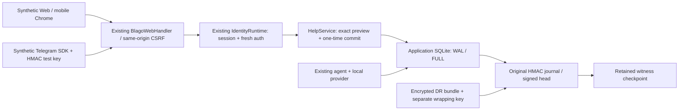

# Foundation Help 01.1 — Pilot Readiness

Draft, 2026-11-06 (Europe/Moscow). **NO-GO для ограниченного реального нефинансового пилота.** GO только для дальнейшей изолированной разработки. Merge, deployment, реальные участники/данные, HF Space, Telegram webhook и production secrets не затронуты.

## 1. Проверенная интеграционная база

| Объект | Точный SHA / результат |
|---|---|
| `main` | `3c218dc5757879c26b3aec520af3636b2d702715` |
| PR #19 HEAD | `837b2bfd5d3db4842530d30ccf0f417bfe718737`; Open Draft, base main; CI `41902654438`, `41902640211` success |
| Integration 01 runtime | `d7f619a1e6a7f15564facb5e8e84b184a3f24658` |
| PR #20 HEAD | `417e12be82e0b381d5251e12191a25d1c10921f4`; Open Draft, base #19; CI `42086997631`, `42086987777` success |
| Help 01 runtime | `30a9794b15ce7b61a7705f4815a61bc798ad1698` |
| Help 01 CI recipe | `68c274022b3889ee91986c0ce6f63c560280f732`; относительно runtime изменены только tests workflow и source manifest |
| Help 01.1 source candidate | `d2294c1b1c7b082c6dfcfe1eb788bb6e8d12285b` |

Ветка `feat/foundation-help-01-1` создана от exact HEAD #20 для сохранения исходных документов/evidence. `git merge-base --is-ancestor` подтвердил #19 в ancestry. Diff `68c2740..417e12b` содержит только документацию и evidence; документационный HEAD не объявляется новым runtime. Старые `docs/help01/*` и `docs/integration01/*` сохранены без переписывания результатов.

Новый manifest `integration/candidate.json` содержит прежние source pins, прежние migration/schema checksums и новые hashes проверочного кода. **Новой миграции нет.** Source identity/dependencies/фактическая SQLite: [candidate-identity.json](help01_1/candidate-identity.json). CI и image evidence: [ci-evidence.json](help01_1/ci-evidence.json). Source SHA, CI checkout и documentation HEAD различаются намеренно; JSON не содержит самоссылочного SHA.

## 2. Изменения и архитектура стенда

Добавлены 16 отрицательных/integration/recovery tests, lab CLI, изолированная Compose-рецептура, mobile/synthetic Telegram browser harness, отдельный worker probe и test-only provider harness. Workflow CI запускает полный regression, virtual WebAuthn, desktop Help, mobile emulation, probe и Docker smoke; никакого deployment job не добавлено.

Исправлена избыточная выдача legacy analytics в nonfinancial integration mode: разрешены только собственные needs/open_needs/resources/memory_facts и три community-счётчика. Финансовые поля не возвращаются, даже если UI их не рисует. Participants скрыты при <5 active accounts; потребности/ресурсы скрыты при <5 разных active авторов соответствующих community-записей. `null` отображается как отсутствие достаточных данных, не 0. Legacy compatibility mode не изменён. Это минимизация, не доказательство защиты всех возможных aggregate differencing attacks.

Стенд не запускает Telegram polling/webhook, не читает Hub token cache и не обращается к HF Space. `tools/help_readiness_lab.py` инициализирует только новый root, не существующую БД; служит существующим HTTP handler после preflight без startup migrations. Bind по умолчанию loopback; Compose публикует только `127.0.0.1:17860`, использует internal network и отдельные logical volumes. Это НЕ независимые failure domains.

Runtime сохраняет `XBLAGO_INTEGRATION_MODE=synthetic`, local-provider requirement, verified SQLite, secure identity, privacy journal и witness. Help OFF по умолчанию. Переименовать этот режим в «real pilot» через env недостаточно: настоящий режим допуска и approved manifest ещё не реализованы.

## 3. Integration audit

| Компонент | Подтверждённое взаимодействие | Оставшееся ограничение |
|---|---|---|
| Identity / access | Все Help reads/prepare/commit проверяют active account и fresh session; legacy fresh-auth запрещён; CSRF/origin проходят через прежний router | Physical passkeys, реальные Mini App и production config не проверены |
| Memory / chat | Help-тексты сами по себе не записываются в memory/history и не подмешиваются чужому LLM; разговор создаёт suggestion, не публикацию | **FAIL: межпроцессный chat/delete race**, ниже |
| Help consent | actor/session binding, request/version/args, TTL 120s; literal confirmation; receipts не дают новых прав | При refresh клиент может ещё держать уже показанный текст; невозможно отозвать человеческое знание/скриншот |
| Privacy / deletion | Export исключает чужие notes/IDs; deletion scrub/holds; recovery повторяет удаления и отзывает sessions/challenges | Retention policy для реальных людей не утверждена; retained metadata/control custody требует отдельного решения |
| Recovery | Current original control lineage проверяется до операций; старые backup не восстанавливают недоказанные Help grants | Same-host copies не доказывают offsite custody, IAM или устойчивость к потере всего сервера |
| PWA | Manifest/SW прежние; offline fetch private API в Chrome завершается ошибкой, не выдаёт cached Help response | Нет offline-chat обещания; физическое installed-PWA поведение не проверено |
| Финансовая поверхность | `/api/v1/economy*` по-прежнему blocked; новые сценарии не создают платежей/вкладов | Никаких новых финансовых возможностей; старый main этим PR не меняется |

## 4. Crash, WAL и recovery

Локально Python 3.12.10 вызывает SQLite **3.54.1**, source-id зафиксирован в evidence, `journal_mode=wal`, `synchronous=2` (FULL), `integrity_check=ok`, `foreign_key_check=[]`. Это проверка вызванной библиотеки, не assertion из env. Existing guard не ослаблен. WAL требует подходящей локальной общей файловой системы для процессов; NFS/network filesystem не квалифицированы. Основание: [официальная документация SQLite WAL](https://www.sqlite.org/wal.html).

| Испытание | Ожидаемое безопасное поведение | Факт |
|---|---|---|
| Process exit до journal flush / SQL commit | Нет ACK, SQL rollback, DRAFT | PASS, exit 74, integrity/FK ok |
| Exit после journal, до SQL commit | Старый grant не считается доказанным | Existing Help test PASS: WITHDRAWN/hold, без публикации |
| Exit после SQL commit, до возврата | Commit сохранён; retry без нового события | PASS, exit 75; PUBLISHED, ровно два события |
| Три процесса, один challenge | Одна операция, одинаковые receipts | PASS; не три публикации |
| Два конкурирующих accept | Не более одного helper | Existing multiprocess/thread tests PASS |
| ENOSPC на fsync witness | Нет успешного ACK | PASS, injected error, DRAFT; это fault injection, не физическое заполнение диска |
| Нет key / witness | Fail closed; не initialize заново | PASS, чтение/commit запрещены |
| Main-file copy без живого WAL | Не восстановить отсутствующие grants | PASS, retained Help holds, обращение не возникает |
| Старый app backup + свежий encrypted control bundle + retained witness copy | Новая instance, старые tokens недействительны, удаления/withdrawal остаются | PASS: прежний BLAGO ID, history pair сохранён, удалённого city нет, Help WITHDRAWN/text empty |
| Старый control bundle + свежий witness | Не отмотать frontier | PASS, recovery отвергнут |
| Потерянный witness / неверный control state | Не выдавать разрешения | PASS; нет recovered control destination |
| Подмена plaintext Help state | Никакого автоматического «исправления» grant | PASS, state integrity mismatch / fail closed |

DR использует существующий AES-GCM bundle и HMAC journal, не новую криптографию. Separate directories/копирование в тесте — только моделирование custody. Отдельные hosts/operators, immutable offsite retention, восстановление после настоящей потери диска и согласованный откат всех трёх доменов НЕ проверены. При потере одновременно всех актуальных frontier/keys безопасное восстановление не доказано; не выдавать новый journal за продолжение старой идентичности.

## 5. Security review и блокер G09

Review выполнен тем же исполнителем; это **не независимый security audit**.

| Угроза | Доказательство | Статус в проверенном scope |
|---|---|---|
| IDOR / actor substitution | Existing Help negatives, owner/member checks, чужой challenge отвергается | PASS synthetic |
| CSRF / cross-origin | Existing HTTP security suites; защищённый общий router | PASS synthetic |
| Replay / stale consent / race accept | Existing Help + 3-process duplicate + expiry/revocation tests | PASS synthetic Help |
| Audience leakage | Private DRAFT; preview не публикует; revision отзывает доступ/export; withdrawal scrub | PASS synthetic server scope; stale DOM caveat остаётся |
| Consent bypass / malicious LLM | Suggestion без записи, no tool/session authority, bad-provider tests | PASS synthetic |
| Account deletion | Pending commit не выполняется после удаления; counterpart text scrub, holds | PASS synthetic; реальный retention approval UNKNOWN |
| Aggregate privacy / financial data | Explicit field allowlist и minimum authors, включая 5 accounts/1 author negative | PASS для этих regression; broader inference review UNKNOWN |
| Chat/delete между workers | Два процесса на одной SQLite, held provider context; memory delete завершён до release LLM | **FAIL, воспроизведено** |
| Сервер/ключи/custody | Администратор хоста потенциально контролирует journal HMAC key; offsite independence не аттестована | UNKNOWN; нельзя обещать защиту от полностью скомпрометированного сервера |

**G09 reproduction:** `tools/help_worker_probe.py` запускает отдельный process, загружает synthetic `city` в LLM context, приостанавливает генерацию, удаляет факт через другой WebApp и затем завершает ответ. В SQLite history после deletion появляется ответ со старым содержимым. [worker-probe.json](help01_1/worker-probe.json) фиксирует все три booleans и FAIL, без реальных данных/текста/секретов.

Причина: `SQLiteBlagoStore.conversation_lock` — process-local `RLock`; Web chat/delete и Telegram используют lock конкретного store instance. BEGIN IMMEDIATE защищает отдельные транзакции, но не весь интервал «загрузка контекста → LLM → запись истории». Даже один процесс с несколькими store instances не следует автоматически считать безопасным. Сериализация Help commit не устраняет этот разрыв.

Не исправляли архитектуру межпроцессного chat locking поспешным общим mutex и не ослабляли deletion guarantees. Следующий blocking PR: единый проверяемый conversation/delete coordination либо transactional generation fencing; охватить Web, Bot, Mini App, privacy deletion и restart/worker death. Проверки должны доказать невозможность stale memory/history write и оценить latency/availability. До этого G09 FAIL. Probe намеренно сохраняет finding; его успешный запуск в CI означает воспроизведение эксперимента, а не PASS безопасности.

## 6. Проверки устройств, провайдера и CI

- **355/355** full regression PASS, 208.119s: старые 340 + первые 15 новых тестов. После добавления main-file/WAL случая focused suite **16/16 PASS**, 43.135s. Окончательный source содержит **356** tests; окончательный CI подтвердил **356/356 PASS**, 47.824s, на exact source; Docker job тоже PASS. [CI run 42172372930](https://github.com/xBLAGO/space/actions/runs/42172372930), подробности в `ci-evidence.json`.
- Desktop Chrome 150.0.7871.125, две isolated contexts: **11/11 PASS**, полный цикл до COMPLETED и withdrawal, inert injected text, no page errors.
- Mobile/touch Chrome 390×844: **11/11 PASS**, SDK синтетический, HMAC проверяется настоящим server exchange; replay/invalid signature denied, identity при reopen тот же, private DRAFT/preview не публикуют, explicit publication, offline private API failure. Это **не реальный Telegram WebView**.
- Actual iOS Telegram, Android Telegram, physical passkeys, Safari, Firefox, screen-reader/virtual keyboard acceptance: **NOT EXECUTED**, устройств/операторов нет.
- Live provider: **NOT EXECUTED, 0 requests**, явно выделенные `BLAGO_TEST_HF_TOKEN`, model и test approval отсутствуют. Не читались `HF_TOKEN`, cached Hub credentials или `.env`. Подготовлен безопасный opt-in harness; Integration launcher остаётся local-only.
- Local Docker CLI отсутствует: локальный Docker **NOT EXECUTED**. Docker build/runtime/library/cycle/lab checks выполняются отдельным CI job; это не проверка реального HF host.
- `freeze_integration`, Python syntax, dependency `pip check` PASS. Первичные evidence #19/#20 сохранены, golden/старые test results не правились.

## 7. Сценарий будущего пилота 3–5 добровольцев

Это **проект процедуры**, не набор уже допущенных участников и не разрешение запуска.

**Допуск:** закрыты G02–G06, G08–G11, исправлен G09; exact release SHA/image и разрешённый nonfinancial runtime утверждены; понятные consent/privacy/retention и scope; независимый restore/stop drill; поддерживаемые реальные устройства проверены; выделенный provider credential с минимальными правами и бюджетом; оператор и контакт инцидентов назначены. Публичные инвестиционные обещания не использовать как условия участия. Никакой биографии/кошелька как обязательного onboarding.

**Состав:** 3–5 информированных добровольцев, отдельные подтверждённые accounts, только низкорисковая нефинансовая помощь и явная small audience. Не использовать реальные чувствительные сведения или публичные обещания конфиденциальности, которые не обеспечены. Проверка участника означает управление способом входа, не уникальность физического человека.

**Цикл:** A создаёт private draft → проверяет точный текст/версию/аудиторию → явно публикует B → B предлагает помощь → A принимает → обе стороны подтверждают результат; отдельно проиграть отказ, withdrawal и dispute. Третий участник проверяет отсутствие доступа без аудитории. Общая аналитика малой группы остаётся скрытой; показатели не рейтинг людей.

**Критерии остановки:** любой IDOR/leak, необъяснимое изменение аудитории/подтверждения, stale write после удаления, неожиданный повтор эффекта, несовпадение journal/witness/frontier, integrity/FK error, неизвестный restore outcome, невозможность revoke/delete, признаки компрометации доступа. Provider outage сам не создаёт Help operation; при неизвестном результате остановить повторы и сверить durable state.

**Остановка и откат:** закрыть ingress и остановить writers; сохранить private consistent app backup, original journal, retained witness и отдельный encrypted DR; не копировать эти материалы в публичный PR. Не rollback control plane вместе с app snapshot. Offline restore только с authenticated актуальным control state; инвалидировать sessions/challenges, сохранить Telegram quarantine. Недоказанное Help исполнение закрывается, а не публикуется повторно. Возобновление только после нового решения по gates; старый unsafe image не считать универсальным rollback.

**Удаление и срок:** до допуска утвердить точный срок пилота и расписание post-pilot удаления. В текущем коде Help plaintext не имеет автоматического TTL — withdrawal/deletion scrub реализованы; challenges удаляются по expiry maintenance. Нельзя обещать automatic purge через N дней без реализации/проверки. Завершение пилота: export по запросу, withdrawal/delete через защищённые controls, проверка scrub/backup replay и протокол минимальной retention metadata. Реальные экономические legacy-связи не вносить; существующий retention blocker не обходить.

## 8. Команды и следующая работа

Воспроизводимый стенд и команды: [runbook](help01_1/RUNBOOK.md). Machine-readable gates: [gates.json](help01_1/gates.json). Case-level результаты: [test-results.json](help01_1/test-results.json).

Следующие blocking PR: (1) conversation/delete fencing и worker topology; (2) квалификация host/filesystem и независимой custody/recovery; (3) real-device/Telegram + разрешённый test-provider прогон; (4) retention/consent/incident policy и approved real-user release mode. Новые финансы, wallets, Genesis, federation или Sovereign Identity для этого не нужны.

**Итог: NO-GO.** Успешные synthetic tests и CI подтверждают проверенный scope и воспроизводимость, но не устраняют воспроизведённый privacy blocker и отсутствие эксплуатационных/физических доказательств.
