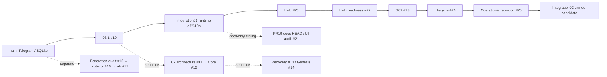
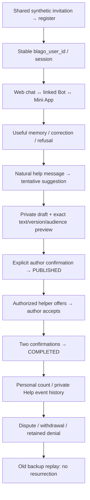

# Foundation Integration 02 — Unified MVP Audit & Release Candidate

Draft. **GO: единая synthetic integration/development база. NO-GO: ограниченный реальный нефинансовый пилот.** Проверена работа существующих компонентов вместе; успешные CI отдельных PR не используются как доказательство эксплуатационной готовности.

Exact base PR #25: `0772e5bc5919aefac2c209f4e40fe5ea790d6792`. Source candidate: `395ecf10f9187663fddb64795597e7efe0f014fa`. Ветка `integration/foundation-02-unified-mvp`, [Draft PR #26](https://github.com/xBLAGO/space/pull/26). Документационный HEAD указан в PR отдельно. Production, реальные данные/секреты/webhook не использовались; merge/deploy не выполнялись.

## Что фактически объединено

Актуальный `main` перепроверен: `3c218dc5757879c26b3aec520af3636b2d702715`, 25 tracked files. В нём **есть Telegram, SQLite, personal agent, простая память и история**. Web/Mini App, WebAuthn, semantic-memory revisions, privacy journal/witness, Help, G09 и operational retention в main отсутствуют. Его deployment workflow по-прежнему содержит auto-push trigger для main; изменять main или production этим заданием не разрешено.

База #25 содержит206 files, main→#25 diff197 paths (+33489/−192 lines, включая документацию и evidence). Integration02 добавляет проверки, аудит и расширяет существующий browser harness; **application runtime, API, database schema и migration checksums не меняет**. Точный diff и наличие файлов: [repository-audit.json](integration02/repository-audit.json). Поэтому перенос экспериментальных веток не нужен, чтобы проверить текущий нефинансовый цикл.

Все PR #10–25 на момент снимка открыты и Draft, не merged. Полные base/head SHA, файлы и HEAD checks: [pr-inventory.json](integration02/pr-inventory.json). Ancestry и read-only merge simulation вычислены заново, а не перенесены из прошлых отчётов.

#19 current HEAD `837b2bfd…` **не ancestor** #25: общий runtime `d7f619a1…` включён, четыре последующих изменения #19 — docs/evidence. Это не потерянный runtime; нельзя автоматически подменять tested source новейшим documentation HEAD. #18/#21 также docs-only siblings. #11–14 и #15–17 не включены в candidate. Text merge simulation даёт11 conflict markers для #12/#13,18 для #14; нулевой marker count у federation/doc веток не означает semantic/security compatibility. GitHub `mergeable=true` относится к **собственной** base каждого PR.

## Сквозной путь на одной базе

[`tools/unified_mvp_check.py`](../tools/unified_mvp_check.py) поднимает один реальный localhost HTTP handler и один новый synthetic SQLite, пять приглашённых account principals, Bot simulation и криптографически подписанный synthetic initData. Это не real Telegram transport, не физические устройства и не доказательство уникальности людей.

**38/38 checks PASS**: invitation rejection/registration; auth/CSRF; explicit Telegram linking с ротацией старой Web session; one ID во всех трёх каналах; shared/corrected memory/history; Bot replay без генерации; reopen/restart; refusal to remember; private draft; exact preview; foreign confirmer/outsider rejected; offer/accept; unilateral confirmation не completion; реальный worker exit86 после durable commit; повтор HTTP confirmation не дублирует event; mutual completion, dispute и withdrawal; old backup не возвращает публикацию/город, sessions invalidated; FK/integrity и отсутствие financial events.

Результат и synthetic turns: [journey-local.json](integration02/journey-local.json). Help history — отдельный журнал, не automatic chat messages. После dispute personal completed count уменьшается; это не пожизненная статистика вклада и не количественная мера благополучия.

| Шаг исходного сценария | Реальное состояние |
|---|---|
| 1–3 invitation/access/identity | PASS synthetic shared invite + password + signed Mini App exchange. Individual invitation lifecycle/physical-person uniqueness отсутствуют |
| 4–6 chat/context/memory | PASS safety/restart/isolation; offline auto-extraction ограничена. Модельное извлечение навыка проверено mock contract, не live quality |
| 7 natural need | PASS tentative suggestion; не создаёт durable Help или legacy NEED автоматически |
| 8 clarification/publication | PARTIAL: нужные text/audience вводятся в Help panel и подтверждаются там. Разговорное «да, публикуй» ничего не публикует; полноценного conversational action bridge нет |
| 9–11 offer/accept/result/dispute | PASS на подтверждённых UI/API-переходах с проверкой actor/version/audience |
| 12 history/statistics | Help event history и personal count работают. Collective fulfillment counter и verified Help status projection в agent context **MISSING** |

## Агент: безопасность отдельно от качества

Добавлены8 tests на активированной общей Identity/Privacy/G09 базе:40 существующих dialogue scenarios/50 turns, correction/negation/preferences/forget, veto/quotes/other-person claims, isolation, synthetic503/timeout/recovery, empty/null/invalid JSON, bounded generation continuation и mocked grounded skill extraction. Existing464 tests сохранены.

Offline journey сделал12 local provider calls, **0 external calls**; observed median HTTP chat latency130.589ms на локальной машине (не provider/capacity benchmark). В этом baseline семь ответов были общим «Я прочитал твоё сообщение»; skill/interest из свободных реплик автоматически не сохранились. Это конкретное ограничение fallback, не доказательство плохого или хорошего real HF. Main OpenAI-compatible path имеет bounded extra memory-extraction call; mocked skill test показывает2 transport calls на таком ходе.

Разрешённые test token/model/approval отсутствуют: [provider-status.json](integration02/provider-status.json) — NOT EXECUTED, реальные/cached production credentials не читались. Связность/естественность/достаточность уточнений реального провайдера **UNKNOWN**. Агент безопасно не выполняет Help actions, но без scoped read projection не может достоверно сообщить текущий серверный статус обращения. Поэтому «полноценный conversational help companion» сейчас PARTIAL.

## UI и публичный сайт

Расширен **существующий** Chrome harness: registration через invitation UI, старт в чате, memory correction, reload без новых реплик, Help cycle, application-object restart, dispute, withdrawal/XSS safety —17 checks PASS. Synthetic mobile/Mini App —14 PASS. Browser150.0.7871.125 локально; physical iOS/Android Telegram и passkeys NOT EXECUTED. Отсутствующий in-app browser execution tool не заменялся доступом к пользовательской Chrome session: harness использует новые headless profiles, localhost и блокирует внешние ресурсы.

UI уже начинает с диалога; Help details служат подтверждению полномочий. Одновременно существуют legacy «Мои потребности»/resources и Help graph: они не синхронизированы, dashboard может показывать0 legacy needs при существующем Help request. Текст о будущем поиске помощи устарел. Нужен один Help-backed список, status cards в чате, а не ещё один кабинет. Financial controls в audited integration surface запрещены; методы legacy economy в коде остаются и требуют approved launcher/routing guard.

Live unauthenticated GET `2026-11-09T18:49:01Z`: home/info/invest/login200; `/app`, `/healthz`, `/api/v1/auth/capabilities`404. [Public-site evidence](integration02/public-site.json). Это не доказывает отсутствие приложения на другом домене/HF: его deployment provenance UNKNOWN. Login ведёт к инструкции обратиться в Telegram, не к candidate Web App. Публичный bot не опрашивался и сообщений ему не отправлялось.

На [home](https://xblago.space/) описаны уже работающие decentralization/blockchain/transparent operations; [info](https://xblago.space/en/en_description/) обещает autobiography, NFT потребностей и управление активами ИИ; [token page](https://xblago.space/en/en_investors/) содержит parity claim «1 xBLAGO = 1 BTC», обещания увеличения активов и адреса переводов. Это противоречит текущему нефинансовому scope и privacy/consent guarantees. Наличие tracking tags подтверждено HTML, сами trackers не исполнялись. Исходники сайта в этом repository не найдены; ничего на сайте не менялось.

## Миграции, выпуск и решение

Отдельный [offline rehearsal](integration02/main_upgrade_check.py) создаёт DB **архивированным кодом main**, затем применяет существующий ordered migration path на synthetic copy. [Результат](integration02/main-upgrade.json) проверяет IDs, memory, history, integrity/FK, supported repeat paths и отсутствие восстановления удалённого факта. Первая попытка harness включила REQUIRED flags слишком рано и получила безопасный отказ; flags включены после offline migration, не ослаблены на serving runtime.

Выявлено ограничение: `migrate_help` после Context/Lifecycle отказывается из-за frozen-baseline check. Отказ rollback-safe, но **глобальная идемпотентность произвольного migration loop не доказана**. Перед реальным upgrade нужен reviewed ledger-aware dispatcher/validation и rehearsal на полном legacy inventory; старые checksums менять нельзя. Новых migrations в Integration02 нет. Real production SQLite/legacy JSON/offsite restoration не исследованы.

Проверки source candidate: полный regression472 tests, Docker/verified SQLite, browser17, synthetic Mini App14, unified journey38, inherited operational lab11/G09. Точные результаты/времена/CI — [test-results.json](integration02/test-results.json), [ci-source.json](integration02/ci-source.json); окончательный HEAD CI — в PR. [Readiness matrix](integration02/READINESS_MATRIX.md), [integration/release plan](integration02/INTEGRATION_PLAN.md), [runbook](integration02/RUNBOOK.md), [all gates](integration02/gates.json).

**Реальный пилот NO-GO:** G02/G03 storage+custody UNKNOWN; G04 approved policy/external deletion/monitoring UNKNOWN; G05 physical clients UNKNOWN; G06 live model quality UNKNOWN; G08 independent review/logging/re-identification UNKNOWN; G10 operator drill UNKNOWN; G11 FAIL (runtime намеренно synthetic-only). G09 сохраняет лишь прежний activated synthetic PASS. Владельцу нужны решения о scope guided panel vs chat-only, ответственности operators/custodian/providers, доступах и retention, legacy disposition, критериях спора/остановки, site/token communications и individual invitations. Ни merge, ни release approval этим отчётом не даны.
