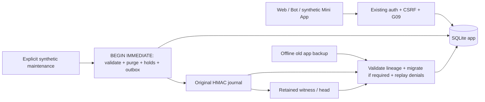

# Privacy 01.3 — Data Lifecycle & Retention

Статус: Draft, synthetic-only. **GO для дальнейшей изолированной разработки; G04 UNKNOWN; реальный пилот NO-GO.** Выполненный код закрывает перечисленные ниже локальные пробелы, но не подтверждает удаление всех внешних копий и не утверждает политику для реальных людей.

## Основание и доказательства

- Exact base PR #23: `7807f5aa1c2d1818427057c6ce072ffb6166e3d3`, branch `fix/privacy-01-2-context-fencing`.
- Ветка: `feat/privacy-01-3-data-lifecycle`; [Draft PR #24](https://github.com/xBLAGO/space/pull/24), непосредственно поверх #23.
- Runtime source: `9abb7cc7b22346be0a9b095e7f13b1dc81928e28`. Документационные коммиты поверх него не являются новой runtime-базой.
- [Source CI 42512292499](https://github.com/xBLAGO/space/actions/runs/42512292499): **432/432**, 54.338 s; browser, synthetic mobile и Docker PASS. Прежние 390 тестов сохранены; добавлено 42.
- Инвентаризация: **56 таблиц** нового синтетического экземпляра и семь внешних классов хранения; ни одна production DB не открывалась. [Matrix](privacy01_3/DATA_LIFECYCLE_MATRIX.md), [schema inventory](privacy01_3/inventory.json).
- [Threat model](privacy01_3/THREAT_MODEL.md), [migration/recovery runbook](privacy01_3/RUNBOOK.md), [evidence](privacy01_3/README.md), [gates](privacy01_3/gates.json).

## Аудит и исправления

| Пробел до изменения | Реализация | Граница доказательства |
|---|---|---|
| Help plaintext, archive memory, legacy needs и cached replies не имели согласованной retention | Явный атомарный `sweep`, зафиксированная версия policy; учёт пар реплик | Запускается оператором, не scheduler; до очистки возраст сам по себе не скрывает данные |
| Старый backup мог вернуть удалённые TTL-объекты | HMAC targets, retained denial events, holds, replay и guards INSERT/UPDATE | Требуются оригинальные ключи, актуальный journal и retained witness |
| Удаление superseded memory могло затронуть действующего потомка через прежний forget trigger | Только archive expiry отсоединяет потомка и подавляет старый trigger в узком replay-scope; точечный denial + context bump | Пользовательское forget по-прежнему удаляет соответствующую цепочку |
| Пара user/assistant могла быть разделена по времени retention | `lifecycle_history_pairs` пишется при атомарном append_exchange; удаляется весь обмен | Неясные старые одиночные реплики блокируют sweep, автоматического угадывания нет |
| Restore побочных удалений мог породить context revision поверх подписанного frontier | После применения denials восстановление устанавливает последний подписанный context frontier, отклоняет PREPARED | G09 не отключается; сравнение/запись остаются в write-транзакции |
| Отзыв optional consent сам по себе не очищал содержимое при replay | Узкий authenticated endpoint withdrawal, удаление activity/label и replay; SQL guards запрещают запись без grant | Нет новой системы трекинга или API выдачи consent |
| После Help удаления оставались лишние тексты/участники | Retire удаляет весь личный граф обращения, оставляет outcome/count/protocol/tag | Доказательство записи результата, не доказательство реальной помощи и не анонимность |
| Нет учёта retired app backups | Каталог, TTL, content digest, durable retirement перед unlink, запрет restore точных retired bytes | Не охватывает все неучтённые/изменённые копии, SSD и файловые snapshots |
| Account deletion удалял Telegram dedupe row; повторная регистрация позволяла снова обработать прежний update | Delete events создаёт retained HMAC `consumed-update` hold; begin_update и SQL INSERT/UPDATE guard запрещают повтор | Воспроизведён FAIL до исправления; known IDs после установки слоя. Неизвестные исторические IDs не восстанавливаются магически |
| Legacy multi-party export мог включить чужой свободный текст | Lifecycle export отклоняется при economic/ownership blockers | Политика legacy economics требует отдельного решения |

## Схема и совместимость

Добавлена `foundation_privacy_lifecycle_001`, checksum
`1549c5875e15571f35ae93c1f2535c42fcc690df65f04be29629ce3c2c89e02a`.
Семь новых таблиц: `lifecycle_schema_migrations`, `lifecycle_policy`, `lifecycle_holds`, `lifecycle_history_pairs`, `lifecycle_generation_times`, `lifecycle_help_evidence`, `lifecycle_backups`. Pair/generation metadata имеют FK с CASCADE. Сами privacy holds намеренно не ссылаются на удаляемые сущности.

Прежние DDL/checksums Identity/Runtime/Privacy/Pilot/Help/Context не изменены. Функция context migration распознаёт валидированную дополнительную lifecycle-схему. Новый manifest сохраняет прежние pins и добавляет version/checksum нового слоя. По умолчанию слой не включается: нужны explicit offline migration, synthetic mode и `XBLAGO_LIFECYCLE_REQUIRED=true` на стенде.

Миграция транзакционна и идемпотентна. Сертифицированный baseline до Help/context может получить их **канонические прежние** схемы в той же offline-транзакции, после чего replay применяет актуальные denials. Неизвестный baseline, drift, потерянный witness или неопределённая control lineage вызывают отказ. Старые пользователи, каналы, активная память, история, действующие passkeys и Help confirmations не пересоздаются. Миграция не угадывает границы старых exchanges.

## Атомарность и сбои

`sweep` использует прежний `_locked_transaction`: `BEGIN IMMEDIATE`, reconcile, domain changes + outbox, flush journal/witness, SQLite commit. Параллельные процессы сериализуются SQLite, не process-local mutex. При отсутствии journal/witness работа прекращается. При сбое до durable intent нет успешного удаления; если intent уже durable, а SQL не committed, следующий guard применяет **удаление**, а не восстанавливает разрешение. Ошибка ответа не даёт обещания отменить уже зафиксированный denial.

Memory/history deletion и consent withdrawal изменяют revision/epoch через прежние guards. Retention не держит транзакцию во время LLM; уже подготовленная генерация при конфликте отклоняется без автоматического retry. Telegram receipt body удаляется, но dedupe marker сохраняется. Отсутствующий/retired generation ticket не может commit. Возвращение старого SQL snapshot при актуальном control frontier требует replay до чтения/записи; rollback всей control-системы вместе с её независимой вершиной вне доказуемой модели.

При account deletion raw dedupe row удаляется вместе с персональными полями, но его одноразовость переносится в HMAC hold с независимым `lifecycle_update` denial. Результаты before/after: [reenrollment-replay.json](privacy01_3/reenrollment-replay.json). Первоначальный source `ad87cfed434685296f6175b39141cb4585dbcf6b` прошёл 430 тестов, однако новый negative test обнаружил этот пробел; итоговый source включает исправление и два дополнительных сценария. Неизвестные ID, удалённые до установки lifecycle без retained markers, остаются legacy evidence gap.

## API и операторские команды

Точки реализации для review: [`lifecycle_schema.py`](../src/xblago/core/lifecycle_schema.py) (policy, DDL, migration, denial validation), [`data_lifecycle.py`](../src/xblago/core/data_lifecycle.py) (sweep/Help minimization/managed backup), [`privacy_control.py`](../src/xblago/core/privacy_control.py) (replay и signed frontier), [`storage.py`](../src/xblago/core/storage.py) (paired exchange и guarded transaction), [`privacy.py`](../src/xblago/integrations/privacy.py) (withdraw/export), [`test_data_lifecycle.py`](../tests/test_data_lifecycle.py) (воспроизводимые assertions).

Новый `POST /api/v1/privacy/consent/withdraw`: body **только** `{"purpose":"optional_activity"}` либо `device_label`. Требуются существующая fresh session, CSRF/origin; uid берётся из сессии, а не body. Canonical account и recorded aliases обрабатываются вместе. Отзыв labels не удаляет работающий способ входа. Existing export/account deletion endpoints сохранены; lifecycle добавляет безопасный отказ для неразрешённого legacy ownership/economic scope.

`tools.lifecycle_maintenance`: `sweep`, `backup`, `retire-backup`; не запускается автоматически и не деплоится этим PR. Конкретные команды и порядок восстановления — в runbook. Никаких новых платежей, financial routes, LLM-вызовов, federation или экспериментальной identity.

Privacy-first account deletion в lifecycle mode удаляет весь затронутый Help-граф, включая обращения, где удаляемый участник был helper или членом аудитории. Остаётся `privacy_removed`, а не утверждение успешного исполнения. Это может прекратить отображение обращения другим участникам; более узкая частичная анонимизация и обновление исторической статистики требуют отдельного проектирования. Existing explicit publish/offer/accept/confirm остаются неизменными. Новый consent endpoint пока не имеет отдельного UI; нового сбора optional activity нет.

## Проверки и пределы

42 новых сценариев покрывают migration/rollback, paired history, archive/live memory, recent/foreign data, Help минимизацию и незавершённую помощь, consent/CSRF/IDOR, Telegram dedupe, expired auth pending, G09 conflict, два процесса, crash после journal до SQL, missing witness, journal write failure, backup hash/path tampering, старый snapshot до миграций, повторную регистрацию, legacy blockers и active/revoked credentials. Полные имена и индивидуальные результаты — `test-results.json`; `integrity_check`/`foreign_key_check` выполняются в migration/sweep/rehearsal и restore-тестах.

CI: Chrome WebAuthn с virtual CTAP2 **8 checks**, Help desktop **11**, synthetic Mini App/mobile **14**, lifecycle rehearsal **5**, все PASS. Физические iOS/Android Telegram и passkeys **NOT EXECUTED**. Docker использует verified SQLite **3.54.1**; новый lifecycle smoke работает `--network none`. Локальные failures при разработке (restore frontier mismatch) исправлены до source commit. Отдельный финальный запуск сначала не импортировал `certifi`: у прежнего `/tmp`-venv отсутствовал `pyvenv.cfg`; создан новый изолированный venv из прежнего lock, system Python не менялся. Полный sandbox-повтор остановил 10 HTTP-тестов на запрете localhost bind (430 выполнений, без assertion failures); повтор с bind начался до последнего исправления и не используется как exact-source qualification. Финальная полная проверка — CI 432/432; локально lifecycle 42/42 (112.703 s) плюс отдельно расширенный Bot replay scenario PASS (3.824 s).

Дополнительных LLM-вызовов нет. Lifetime sweep — один write lock на всю партию, повторный journal scan пропорционален retained history; большие объёмы/нагрузка и лимит времени обслуживания не квалифицированы. CI G09 probe сохранил отказ устаревшей генерации; его latency — synthetic, не оценка provider или production throughput.

## Что мешает закрыть G04

1. Policy — **предложение для лаборатории**, не утверждённый срок хранения реальных данных. Нужны accountable owner, назначение, основания, исключения, отзыв и разрешение legacy economics.
2. Нет испытанного production-планировщика, мониторинга, overdue alerts и SLA удаления. Fail-closed blockers намеренно могут остановить всю очистку; нужен операторский маршрут разрешения.
3. Нет проверенного списка внешних backup/snapshots/logs/client copies и доказательств их retirement/erasure. SQL DELETE/unlink не доказывает физическое стирание WAL/SSD.
4. Нет договора/конкретного route и проверки retention/deletion downstream LLM provider; private prompts наружу этим заданием не отправлялись.
5. Journal и Help evidence псевдонимны: старые backup, знание request ID, последовательности и legacy metadata позволяют связывание. Нужны независимая оценка повторной идентификации, доступов и сроков controls.
6. Независимая off-host custody, физические устройства, live HF quality и operational drill остаются открытыми gates 05.4/06.1. Same-author review не независимый аудит.

См. [SQLite secure_delete](https://www.sqlite.org/pragma.html#pragma_secure_delete): физическое стирание требует отдельного анализа всех хранилищ. [HF Inference Providers security](https://huggingface.co/docs/inference-providers/security) описывает политику router и отсылает к политикам downstream providers; это опубликованное заявление, не доказательство конкретного BLAGO deployment. Production/секреты/реальные данные/webhook не изменялись, merge/deploy не выполнялись.
