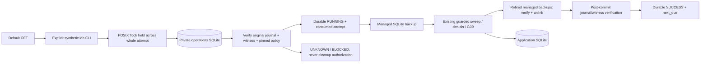

# Privacy 01.4 — Operational Retention & G04 Readiness

Draft. **GO для дальнейшей изолированной разработки; реальный нефинансовый пилот NO-GO. G04 UNKNOWN.** Это проект технической политики и результаты synthetic rehearsal, не юридическое утверждение владельца BLAGO и не разрешение deployment.

## Основание и состав

Exact base [PR #24](https://github.com/xBLAGO/space/pull/24): `80e60b4792067b9e4832a3db88e8ea3a0f031f37`. HEAD/ancestry и успешный CI #24 перепроверены; документационный HEAD используется как запрошенная база, его проверенный runtime source `9abb7cc7b22346be0a9b095e7f13b1dc81928e28` сохранён в provenance. Новая ветка `feat/privacy-01-4-operational-retention`, [Draft PR #25](https://github.com/xBLAGO/space/pull/25).

**Новый runtime source: `0fb65db601de9f75806fbf51a0dfdafb130554ee`.** Последующие документационные коммиты не подменяют runtime source. [Identity](privacy01_4/source-identity.json), [operator schema](privacy01_4/operator-schema.json), [results](privacy01_4/test-results.json), [CI](privacy01_4/ci-source.json), [gates](privacy01_4/gates.json).

| Слой | Файлы / назначение |
|---|---|
| Scheduler | [`retention_ops.py`](../src/xblago/core/retention_ops.py): private ops DB, scheduling, OS lock, retries, alerts, result protocol |
| Explicit CLI | [`retention_scheduler.py`](../tools/retention_scheduler.py): bounded `run`, `inspect`, `init`, `reschedule`; OFF по умолчанию |
| Rehearsal | [`retention_ops_lab.py`](../tools/retention_ops_lab.py): 11 operational scenarios и linkage attacks |
| Tests | [`test_retention_ops.py`](../tests/test_retention_ops.py): 32 новых deterministic/crash/concurrency/security tests |
| Release evidence | Tests workflow + integration source hashes; deployment workflow не изменён |

Проект политики: [RETENTION_POLICY_DRAFT](privacy01_4/RETENTION_POLICY_DRAFT.md). [External Data Inventory](privacy01_4/EXTERNAL_DATA_INVENTORY.md), [machine-readable inventory](privacy01_4/external-inventory.json), [threat model](privacy01_4/THREAT_MODEL.md), [runbook](privacy01_4/RUNBOOK.md).

## Аудит Privacy 01.3 и совместимость

Privacy01.3 обеспечивал явный guarded sweep и retained denials, но не периодический запуск, учёт незавершённой работы, bounded retry, overdue alert или operator result log. G04 уже был UNKNOWN из-за policy/операционных/external evidence gaps. G09 PASS был строго ограничен активированной fencing migration и оригинальными journal/witness; этот scope не расширяется.

Новые компоненты **не импортируются startup** Web/Bot/Mini App. Application SQLite schema, все прежние migration DDL/checksums (включая lifecycle001), memory/history APIs, identity flow, Help confirmations, economic rules и privacy journal protocol не изменены. Не добавлены user activity collector, LLM-вызовы, финансовые операции или новые Web endpoints. По default отсутствие activation flag не выполняет sweep и не пишет operator result.

Новая версия `retention_operations_001` создаётся **явно в отдельной** `retention-ops/operations.sqlite3`: `ops_schema`, `ops_binding`, `ops_state`, `ops_runs`. Ранее существующая app DB не получает новую таблицу. Operator migration и checksum отражены в `operator-schema.json`; ошибки DDL откатывают всю её транзакцию. Частично созданная directory не переинициализируется автоматически.

## Протокол запуска

Одна canonical ops-directory на synthetic root; lock не является истекающей lease. Пауза процесса после deadline не разрешает второму worker продолжить параллельно. При смерти процесса ядро освобождает lock; durable RUNNING остаётся INTERRUPTED/неподтверждённым. Перед retry он закрывается как INTERRUPTED; попытка уже израсходована, автоматического сброса счётчика нет.

Default schedule: interval3600s, retry60s с exponential backoff, максимум3 attempts (допустимый диапазон1–5), overdue7200s, log TTL7d. После SUCCESS новый interval. После exhaustion требуется **явный** `reschedule`, который не меняет last_success и не скрывает overdue. CLI loop имеет bounded ticks/poll; не создаётся daemon/service/cron в production. Результаты SUCCESS/FAILED/INTERRUPTED/BLOCKED/RESCHEDULED — private technical metadata, не события пользователя.

До первого app side effect фиксируются RUNNING и попытка с synchronous=FULL. Ошибка обязательного backup не запускает sweep. Сверка managed directory с каталогом до/после backup и перед SUCCESS отклоняет orphan/missing/changed files и пустую квитанцию; неучтённая копия не удаляется и не принимается автоматически. Сверка managed directory с каталогом до/после backup и перед SUCCESS отклоняет orphan/missing/changed files и пустую квитанцию; неучтённая копия не удаляется и не принимается автоматически. Нет SUCCESS до commit очистки, retirement/unlink и повторной проверки original journal/witness. Потеря подтверждения после app commit означает FAILED с `effects_may_be_committed=true`: удаления нельзя «отменить» по результату оператора. Потеря result store тоже не даёт SUCCESS. После crash применяются прежние denial/replay protections, а не новые grants.

Status `SUCCESS` означает завершённую локальную попытку, **никогда G04 PASS**. `inspect` всегда `compliant=false`; нет утверждения, что logs доказывают удаление всех данных. Удалённый/откаченный ops store не является основанием восстановить пользователя, память или разрешения. Старый app backup проходит original control replay независимо от расписания. Отсутствие ops/control state требует разбора, не silent init. Недостоверные системные часы/всеобщий rollback остаются эксплуатационным ограничением.

## Испытания

Локально **464/464 tests PASS**, 536.167s (432 прежних +32 новых); focused32 PASS, 40.102s. Rehearsal **11/11 PASS** с отдельными процессами, filesystem exceptions и старым app backup. Machine-readable expected/actual — `operations-local.json` и `test-results.json`. [Source CI 42525416875](https://github.com/xBLAGO/space/actions/runs/42525416875): 464/464, 61.746s; Docker, browser8/Help11/synthetic Mini App14 и operations11 PASS. Подробности в `ci-source.json`; окончательный документационный HEAD CI указан в PR.

Негативные проверки включают: OFF, интервалы, delayed/overdue, bounded backoff/exhaustion/reschedule, backup ENOSPC, witness loss до и после commit, write failure result store, process exit83/84, lock удерживается несмотря на прошедшее время, два процесса, old app/ops snapshots, clock rollback, orphan/missing/changed backup и empty receipt, чужой journal, policy tamper, symlink, missing state, failed operator migration, TTL logs без pruning holds, legacy blockers, active memory/Help и stale LLM generation (G09). Никакие существующие тесты не удалены/не ослаблены.

Первый draft crash test смешал реальное время child и неподвижные часы parent; он получил CLOCK_ROLLBACK вместо ожидаемого INTERRUPTED. Исправлен **test clock**, production clock guard сохранён. Это не скрыто как successful initial run; последующие focused/full suites прошли.

Один локальный full run финального source получил `ApiError401 Session expired` в прежнем `test_duplicate_draft_and_delivery` (464 tests, 1 error). Причина локального расхождения не установлена; isolated recheck прошёл1/1 за2.013s без изменения auth. Исходный результат и повторный full run учитываются отдельно в `test-results.json`; CI того же exact source прошёл464/464. Успешный повтор не объявляет неустановленную причину исправленной.

Вторая локальная попытка получила такой же401 в setup двух HelpReadiness tests. Между предшествующим isolated recheck и окончанием лога прошло примерно7h50m реального времени при383.242s отчётного выполнения; это согласуется с паузой/сном хоста и истечением30min idle TTL. Точные возрасты отклонённых сессий не записывались, поэтому это объяснение имеет указанную границу доказательства. Финальный локальный retry выполнялся с `caffeinate -i` только на время tests; TTL и настройки питания не менялись. Оба исходных отказа сохранены в JSON.

Managed inventory специально блокирует unknown/missing/hash-changed копии; большой каталог требует полного чтения registered files. Batch sweep и hashing могут задерживать работу на больших данных, а on-call delivery/host supervision/capacity пока не квалифицированы. Rollback самого ops store может испортить counters/observability: он не восстанавливает privacy grants, но и не является допустимым способом сбросить retry budget. Ни schedule, ни metadata log не дают независимого доказательства SLA.

## Re-identification: фактический результат

На трёх synthetic Help requests доказано:

1. Old backup + journal key позволяет точно связать HMAC target с request/author.
2. Без ключа уникальное число событий и side information позволяет выделить одно обращение. Одинаковые counts дают несколько кандидатов; это не доказательство анонимности.
3. Summary имеет только target_tag/outcome/event_count/protocol, без текста, people IDs и точного времени; personal export summary/tag не публикует.

**Вывод: evidence PSEUDONYMOUS, NOT ANONYMOUS.** Тест не имитирует публичный доступ: attacker получает privileged old backup или эквивалентную side information. Сводка не становится public API. Для допуска людей нужны отдельные retention/access decisions по linkable controls и независимая оценка риска; механическое удаление counts/holds ради «анонимности» разрушило бы существующие recovery guarantees.

## Решение по gates

| Gate | Решение для real pilot | Доказательство / что остаётся |
|---|---|---|
| G00 | PASS только synthetic source scope | Exact ancestry, manifest, regression/Docker; promotion/production approval UNKNOWN |
| G01 | PASS только inherited workflow scope | Deployment workflow не изменён; реальные environment protections UNKNOWN |
| G02 | UNKNOWN | Patched SQLite в test/Python/Docker; actual HF volume/fsync/WAL/flock не квалифицированы |
| G03 | UNKNOWN | Local original journal/witness restore PASS; независимые off-host custody/operator drills отсутствуют |
| G04 | UNKNOWN | Scheduler и logical deletion rehearsal PASS; policy не утверждена, external deletion/copies и реальное SLA неизвестны |
| G05 | UNKNOWN | Browser/synthetic Mini App checks; physical Telegram iOS/Android/passkeys NOT EXECUTED |
| G06 | UNKNOWN | Публичные provider terms проверены, фактический route/contract/deletion и live HF quality NOT EXECUTED |
| G07 | PASS только synthetic Help scope | Consent flow/помощь сохранены в regression/browser; human acceptance UNKNOWN |
| G08 | UNKNOWN | Same-author tests/review и linkage probe; независимый privacy/security review отсутствует |
| G09 | PASS только установленный fenced synthetic scope | Старые concurrency tests + scheduler during generation; real capacity/physical qualification не добавлена |
| G10 | UNKNOWN | Admission/stop/rollback plan унаследован, реальный operator drill не выполнен |
| G11 | FAIL | Runtime намеренно synthetic/local-only, допуска людей и release sign-off нет |

**GO для дальнейшей изолированной разработки. NO-GO для ограниченного реального пилота.** Следующие обязательные доказательства: утверждение policy владельцем; target-host scheduler/alerts/storage/fault qualification; независимая custody; inventory всех внешних copies/logs; конкретные provider obligations; независимый linkage review; physical/client/live-quality и admission gates. Production DB, secrets, webhook, HF Space и реальные участники не использовались; merge/deploy не выполнялись.
