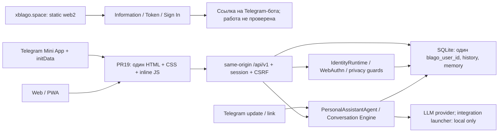

# BLAGO — Interface Audit 01

Статус: Draft, 2026-11-05. Документационный аудит, не разрешение на запуск пилота.

## Вывод

В PR #19 есть общий Web/Mini App shell, чат, собственные записи потребностей и ресурсов, профиль, память и управление доступом. Это проверяемая интеграционная реализация для синтетических испытаний, а не доказательство доступности этих функций в production. На публичном домене доступен отдельный информационный сайт с инвестиционными текстами; его `/app` возвращает 404. Публичный путь входа приводит к ссылке на Telegram-бота, а не к Web-сессии.

Основные препятствия единому интерфейсу: разные продуктовые обещания сайта и приложения; отсутствие полного межличностного цикла помощи в #19; смешение счётчиков записей с общественными результатами; непроверенная работа на физических устройствах и в Telegram WebView. Найден также отдельный разрыв минимизации данных в старом API аналитики. Изменения интерфейса не устраняют инфраструктурные и LLM-блокеры PR #19.

## Проверенная база и границы доказательств

| Объект | Зафиксированное состояние | Что это доказывает |
|---|---|---|
| `space/main` | `3c218dc5757879c26b3aec520af3636b2d702715` | Старая CLI/Telegram-основа; Web-стек #19 ещё не включён |
| [PR #19](https://github.com/xBLAGO/space/pull/19) | Open Draft; HEAD `837b2bfd5d3db4842530d30ccf0f417bfe718737`; base `main` | Объект аудита; не merged и не production-attestation |
| Runtime candidate #19 | `d7f619a1e6a7f15564facb5e8e84b184a3f24658` | До HEAD изменены только отчёт и evidence; runtime совпадает |
| [CI #19](https://github.com/xBLAGO/space/actions/runs/41902654438) | `completed/success` на HEAD #19 | Историческая synthetic CI-проверка, включая Docker; не новая проверка production |
| [PR #20](https://github.com/xBLAGO/space/pull/20) | Open Draft; HEAD `417e12be82e0b381d5251e12191a25d1c10921f4`; base #19 | Help 01 существует отдельно, в #19 его нет |
| Публичный сайт | 8 EN/RU страниц: GET 200; `/app`: 404 | Анонимно наблюдаемое поведение домена на дату проверки |
| Production Bot / Mini App / иной Web host | UNKNOWN | Не выполнялись вход, сообщения, BotFather-запросы или чтение пользовательских данных |

База этого документационного PR — exact HEAD #19. `git diff d7f619a..837b2bf --name-only` содержит только `docs/BLAGO_FOUNDATION_INTEGRATION_01.md` и три файла `docs/integration01/`. Мы не переносим Help, Sovereign Identity, Genesis или federation в Integration 01.

Доказательства: [каталог проверки](ui_audit01/README.md), [публичные GET](ui_audit01/public-fetch.json), [RU и /app](ui_audit01/ru-fetch.json), [Chrome public](ui_audit01/public-browser.json), [Chrome synthetic Web](ui_audit01/local-browser.json). HTTP-ошибки и ограничения не переклассифицированы в PASS.

## Архитектура и компоненты

Production-связь сайта с этим runtime не установлена. Диаграмма показывает реализуемые пути #19, а не единую реально развёрнутую систему.

Кодовые опоры на immutable HEAD #19:

- [Shell и стили](https://github.com/xBLAGO/space/blob/837b2bfd5d3db4842530d30ccf0f417bfe718737/src/xblago/integrations/static/index.html#L54): Foundation 06 dark overrides поверх прежних стилей; `aside` — закрытый drawer, мобильная панель остаётся в DOM, но отключена CSS на L85. Это один файл, а не библиотека переиспользуемых UI-компонентов.
- [HTML экранов](https://github.com/xBLAGO/space/blob/837b2bfd5d3db4842530d30ccf0f417bfe718737/src/xblago/integrations/static/index.html#L103): auth, chat, needs, resources, analytics, profile; [JS](https://github.com/xBLAGO/space/blob/837b2bfd5d3db4842530d30ccf0f417bfe718737/src/xblago/integrations/static/index.html#L161) переключает экраны без отдельных browser routes.
- [HTTP router](https://github.com/xBLAGO/space/blob/837b2bfd5d3db4842530d30ccf0f417bfe718737/src/xblago/integrations/web.py#L1265), [Telegram controller](https://github.com/xBLAGO/space/blob/837b2bfd5d3db4842530d30ccf0f417bfe718737/src/xblago/integrations/telegram.py#L130), [ограниченный integration launcher](https://github.com/xBLAGO/space/blob/837b2bfd5d3db4842530d30ccf0f417bfe718737/src/xblago/core/integration.py#L1).
- [Agent](../src/xblago/agents/personal_assistant.py), [Conversation Engine](../src/xblago/core/conversation.py), [semantic memory](../src/xblago/core/semantic_memory.py), [SQLite](../src/xblago/core/storage.py). Память и история привязаны к внутреннему пользователю; мини-приложение не создаёт отдельную память по browser/device ID.

## UI: реализовано, проверено, отсутствует

| Функция | Реализация #19 | Проверка и граница | Production |
|---|---|---|---|
| Диалог как стартовый экран | Чат, textarea, отправка, индикатор ожидания, история | Chrome: пустой диалог без приветствия; экран после reload | UNKNOWN |
| История между каналами | SQLite + общий `blago_user_id`; Web читает историю, Telegram пишет exchange | `test_natural_conversation.py`: общий контекст/restart; `test_web.py`: linking/history | UNKNOWN |
| Пароль / приглашение | Register/login, cookie-session; конфигурация invitation | 11 Web/API-тестов PASS, Chrome login/reload PASS | UNKNOWN |
| Telegram Mini App | Shell читает initData, получает challenge и обменивает на session | Статический код + identity tests; реальный WebView НЕ проверен | UNKNOWN |
| WebAuthn и сессии | Passkey login/register; список методов/сессий и отзыв в профиле | Исторический #19 Chrome virtual CTAP2 PASS; физические устройства UNKNOWN | UNKNOWN |
| Память | Список `memory.facts`, удаление; семантические records доступны API; команды исправления в чате | `test_web.py`, memory suites; в текущем Chrome показан пустой список | UNKNOWN |
| Свои потребности | Список + форма title/description/private/community, статус open | Chrome create PASS; API owner-scoped | UNKNOWN |
| Свои ресурсы | Список + форма, private/community | Chrome create PASS; API owner-scoped | UNKNOWN |
| Общая лента / подбор / принятие помощи / результат | В #19 отсутствуют | #20 реализует отдельный Help lifecycle; здесь не перенесён и не переаттестован | Не подтверждено |
| Аналитика | Числа собственных записей/памяти и общие счётчики | UI/API есть; это НЕ степень удовлетворения потребностей | UNKNOWN |
| Приватность | Export, delete preview/account deletion; fresh-auth и guards | Существующие privacy tests; код не менялся | UNKNOWN |
| PWA | Manifest, icon, service worker | HTTP tests PASS; SW кэширует icon/manifest, не chat/API/navigation | Offline-чат не реализован |
| Sovereign Identity / Genesis / federation | Отдельные экспериментальные ветки | Не функции #19; runtime запрещает соответствующие experimental flags/routes | Не включать |

`community` в старых needs/resources означает участие в общей статистике. `rows()` выбирает только записи владельца. Нельзя называть эту настройку публикацией открытого текста или обещать, что другой участник увидит запрос.

## Карта маршрутов

Все API ниже — под `/api/v1`. Доступность означает наличие handler в #19, не доступ к production. Политики auth/fresh-auth сохраняются.

| Группа | Маршруты | Экран / назначение |
|---|---|---|
| Shell | `GET /`, `/app`, `/app/manifest.webmanifest`, `/app/icon.svg`, `/app/sw.js` | Один shell, tabs не URL-страницы |
| Вход | `GET auth/capabilities`; `POST auth/register`, `auth/login`, `auth/telegram/challenge`, `auth/telegram` | Auth / Mini App exchange |
| Passkeys | `POST auth/passkeys/authenticate/options`, `authenticate/verify`, `register/options`, `register/verify` | Вход и настройки доступа |
| Сессии / методы | `GET auth/sessions`, `auth/methods`; `POST auth/sessions/revoke`, `auth/reauthenticate`, `auth/password`, `auth/link-code`, `auth/logout`; `DELETE auth/methods` | Профиль, доступ и устройства |
| Профиль / чат | `GET/PATCH me`; `GET/POST chat/messages` | История и беседа |
| Память | `GET/DELETE memory` | Профиль / команды в чате |
| Записи | `GET/POST needs`, `resources` | Только собственные списки; без полного lifecycle |
| Аналитика | `GET analytics/me`, `analytics/community`, `privacy/analytics` | Экран аналитики использует первые два; кнопка минимальной аналитики в профиле — третий, с иной политикой агрегирования |
| Данные | `POST privacy/export`, `privacy/delete-preview`; `DELETE privacy/account` | Дополнительные действия профиля |
| Legacy economy | `/economy/assets`, resource/payment routes присутствуют в коде | Integration synthetic блокирует `/api/v1/economy*` до dispatch; не часть UI MVP |

Handler: [L1272–1418](https://github.com/xBLAGO/space/blob/837b2bfd5d3db4842530d30ccf0f417bfe718737/src/xblago/integrations/web.py#L1272). Финансовые handlers начинаются на [L1419](https://github.com/xBLAGO/space/blob/837b2bfd5d3db4842530d30ccf0f417bfe718737/src/xblago/integrations/web.py#L1419), route guard — [integration.py L27](https://github.com/xBLAGO/space/blob/837b2bfd5d3db4842530d30ccf0f417bfe718737/src/xblago/core/integration.py#L27).

## Выявленные разрывы

| ID / приоритет | Наблюдение и доказательство | Необходимое изменение в отдельной задаче |
|---|---|---|
| UI01 P0 | Сайт обещает инвестиции/NFT/автономное управление активами; #19 nonfinancial/synthetic-only | Согласовать публичные обещания с release gates; подробности в [site audit](BLAGO_PUBLIC_SITE_AUDIT.md) |
| UI02 P0 | `WebApp.analytics`, [web.py L608](https://github.com/xBLAGO/space/blob/837b2bfd5d3db4842530d30ccf0f417bfe718737/src/xblago/integrations/web.py#L608), возвращает community финансовые суммы/состояния, хотя UI их не рисует; `/analytics/community` не входит в blocked prefixes | Отдельный API allowlist для nonfinancial scope и тест отсутствия legacy financial fields; скрытие UI недостаточно |
| UI03 P0 | Тот же endpoint отдаёт точные счётчики малых групп. [privacy.analytics L147](https://github.com/xBLAGO/space/blob/837b2bfd5d3db4842530d30ccf0f417bfe718737/src/xblago/integrations/privacy.py#L147) использует minimum cohort 5, но UI вызывает другой маршрут | Единая политика разрешённых агрегатов, suppression и защита от differencing. Здесь зафиксирован риск, не доказана эксплуатация на реальных данных |
| UI04 P1 | `chat-form`, index L186: поле очищается до POST, нет client operation ID и восстановления неопределённого результата после lost response | Явные sent/pending/unknown/error состояния; сверка с сервером перед повтором; временный draft без скрытой постоянной записи личного текста |
| UI05 P1 | index L8: внешний Telegram SDK загружается синхронно и Web тоже зависит от загрузки script | Отдельный тест unavailable SDK и Web-only progressive loading; не ослаблять проверку initData |
| UI06 P1 | Drawer скрывает все вторичные инструменты; дубли навигации и layered CSS усложняют изменение | Одна доступная навигация с подписью, keyboard/focus/Escape, единые tokens; не возвращать навязчивое меню |
| UI07 P1 | Profile рисует raw memory keys и `facts`, не объясняет источник/подтверждение semantic records | Человеческие названия и состояния; безопасное исправление/удаление с существующими recovery guarantees |
| UI08 P1 | Статистика числа записей не свидетельствует о помощи; endpoint считает accounts, не уникальных людей | Словарь метрик и источников; не строить рейтинг человека; wellbeing только добровольный/агрегированный |
| UI09 P1 | В #19 нет сценария A→B и разрешённого audience feed | Интеграция Help #20 отдельным решением с regression/recovery, не обещать её в #19 |
| UI10 P2 | PWA shell не обеспечивает offline history/chat; tabs не имеют deep links | Честный offline status; восстановление навигации без токенов/персональных данных в URL |

## Реально выполненные проверки

1. Анонимные HTTPS GET: 4 EN + 4 RU страницы получили 200; `/app` — 404. Четыре EN HTML побайтно совпадают с Git blobs `xBLAGO/web2` на pinned commit. RU тексты проверены прямым GET; Hindi не проверен.
2. Отдельный Chrome 150.0.7871.125: 4 EN страницы × desktop 1360×1000 и mobile viewport 390×844; нет JS page errors и горизонтального overflow в этих viewport. Tracking domains заблокированы в контексте аудитора; это НЕ проверка production consent или доставки telemetry. Кошельки и бот не открывались.
3. Synthetic Web #19: 12/12 checks PASS, новая временная SQLite, journal/witness guards сохранены, provider local. Telegram SDK заменён пустым script исключительно в тестовом browser context — НЕ Mini App acceptance.
4. `PYTHONPATH=/tmp/blago-sqlite-driver-3541:.:src /tmp/blago08-venv/bin/python -m unittest tests.test_web tests.test_browser_e2e -v`: 11/11 PASS, 9.808 s. Первый sandbox-запуск имел 4 bind PermissionError; после разрешения localhost повтор выполнен без изменения кода. `test_browser_e2e.py` использует HTTP client, а не настоящий browser; Chrome-проверка отдельно.
5. Исторический CI #19 success сверён по API на exact HEAD. Полный 315-test suite/Docker здесь повторно не запускались: runtime, dependencies, workflows не меняются. CI на docs-ветку / PR в integration base существующим workflow не настроен; отсутствие run не означает PASS.

Не проверены: production image/SHA/config, реальные сессии и участники, работающий Telegram bot menu, настоящий initData через Telegram, iOS/Android WebView, Safari/Firefox, физический passkey, экранная клавиатура, screen reader, live HF, независимый witness failure domain. Полный security audit/penetration test не заявляется.

## Решение

**GO для обсуждения концепции и отдельной synthetic UI-разработки. NO-GO для объявления реального пилота или включения финансовых/экспериментальных функций.** Gates #19 остаются исходными: G00/G01 synthetic PASS, остальные ограничения не снимаются. Обнаруженные UI02/UI03 требуют отдельного исправления до работы с реальными данными. План: [поэтапная разработка](BLAGO_INTERFACE_DEVELOPMENT_PLAN.md); концепция: [единый интерфейс](BLAGO_UNIFIED_INTERFACE_CONCEPT.md).
