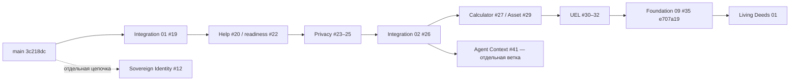
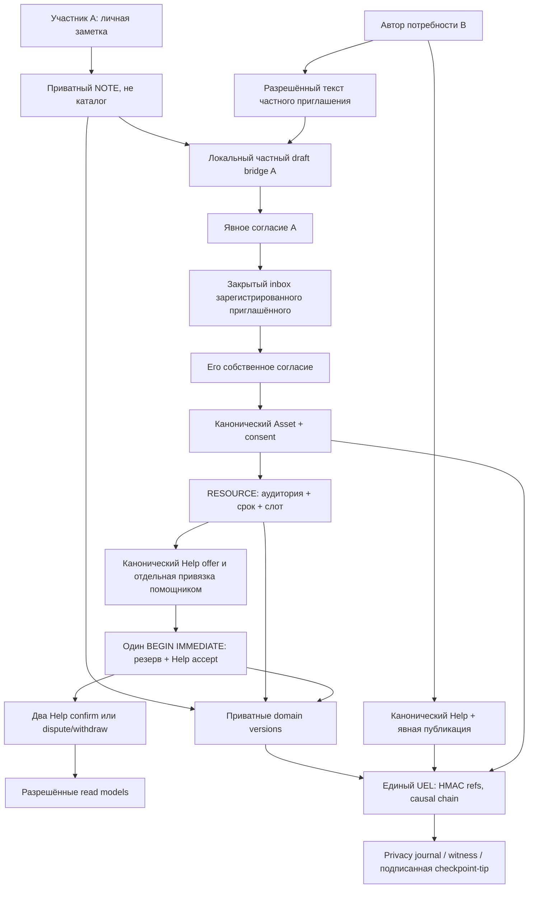

# BLAGO Living Deeds 01 — изолированный локальный контур

Статус: Draft. Только синтетические участники и локальные испытания. Feature flag
`XBLAGO_LIVING_DEEDS_ENABLED` по умолчанию OFF. Никакого merge/deploy, платежей,
токенов, mainnet, новых production endpoints или подключений к LLM.

## База и аудит

Exact base PR #35: `e707a19b0b98324ffd914a28b08601237cd6aea2`.
Прочитаны `AGENTS.md`, `BLAGO_VISION.md`, `BLAGO_ECONOMIC_CONSTITUTION.md` этого
коммита. Исходный полный synthetic regression: **684/684 PASS, 914.533 s**;
[baseline evidence](living-deeds01/BASELINE.json). Прогон выполнялся в отдельной
неизменённой рабочей копии; реализация велась в другой.

Наблюдение GitHub при начале работы: main =
`3c218dc5757879c26b3aec520af3636b2d702715`. Основная цепочка Draft:

Help, Asset и UEL действительно присутствуют в выбранной базе. PR #12
`b79cb603a58adbab1e8a5313a06393a2feb5532f` и PR #41
`3596fc67da794b8f5e550bd2ef5de08e2c64538e` не являются её ancestors.
Sovereign Identity не включается. Авторизацию определяет действующий
`IdentityRuntime`, активный `blago_user_id` и свежая сессия; это не доказательство
уникальности физического человека. Исправления C07/C12 из #41 не объявляются
интегрированными в эту отдельную ветку. Новое расширение не добавляет данные
Living Deeds в контекст LLM или долговременную семантическую память.

| Область | Существующий источник истины | Что добавляется |
|---|---|---|
| Участник / авторизация | `integrations/identity.py`, существующие users/sessions | Ничего: переданный в тексте UID не выдаёт прав |
| Потребность, предложения, выполнение, спор | `domain/help_service.py`, `help_requests/offers/events` | Проверка привязки ресурса и участие в одной транзакции |
| Вещь, навык/время как заявленный ресурс | `domain/asset_registry.py`, `blago_assets`, `assetreg_versions` | Согласованная ограниченная аудитория и временной слот |
| Универсальный индекс | `core/uel_local.py`, `uel_events` | Версионированный source kind LIVING; второго универсального журнала нет |
| Приватность / recovery | `privacy_control`, `context_schema`, journal/witness, UEL checkpoint | Новые источники/отзывы проходят прежние границы |
| Публикация | Существующие отдельные confirmations Help/Asset | Для notes/referrals/slots — sealed preview + свежая сессия + одноразовый commit |

## Архитектура

`LivingDeeds.prepare/commit` — доменный API для изолированного стенда. HTTP,
Telegram delivery и чат-инструменты не расширяются. Человек подтверждает
конкретный preview. `suggest` лишь переиспользует существующие Help/Asset draft
helpers либо предлагает частную заметку; не записывает и не публикует её.

### Разделение состояний

* NOTE принадлежит автору: упоминание «Лена умеет…» не создаёт профиль, навык,
  предложение или доступность Лены. Тексты не индексируются глобальным поиском.
* NEED_PERMISSION — только версия разрешённого автором текста приглашения и
  метаданных к существующему Help ID. Это не второй NEED. Контекст, срочность,
  критерий закрытия допускаются как явно заданные author facets, не угадываются.
* BRIDGE: PROPOSED → INVITED → CONSENTED/DECLINED. Это lifecycle согласия на
  контакт, не lifecycle выполнения помощи. B не получает записи о bridge.
* RESOURCE — разрешённая выбранной аудитории доступность существующего private
  canonical singleton asset. SELF_DECLARED отдельно от подтверждённого согласия.
* ATTACHMENT — собственное разрешение помощника связать ресурс с его Help offer.
* RESERVATION — проекция слота существующего ресурса и канонического Help.
  COMPLETED/WITHDRAWN/DISPUTED не выбираются здесь независимо: их источник Help.

Перед приглашением B явно разрешает ограниченный текст задачи. A должен иметь
текущий доступ к потребности и отдельно подтвердить приглашение. Лене доступен
разрешённый текст задачи и код рекомендателя A, без исходной дневниковой заметки.
Пока Лена не предложила ресурс по собственному согласию, B не получает ни её
данных, ни статистики приглашений. Для участия в Help B затем отдельно
подтверждает точную новую аудиторию Help. Приглашение не обходит эту проверку.

Отказ не создаёт общего негативного ярлыка: B видит `NO_AVAILABLE_MATCHES`.
Retained HMAC-запрет блокирует повтор A → тот же участник / та же тема даже после
старого backup. Автоматического снятия запрета или административного override
нет; повторное разрешение требует отдельного будущего контракта, не имитируется.

## Транзакции, события и проекции

[Модель данных и миграция](living-deeds01/MIGRATION.md).
Новые `living_versions` — приватные версии конкретных новых notes/consents,
аналогично `assetreg_versions`, а не новый универсальный реестр. Каждое событие
имеет event ID, format, type, occurred_at, snapshot/version и causation_id.
Универсальные HMAC source refs и causal refs хранит существующий UEL.

Для атомарного резервирования используется внутренний callback Help acceptance
после проверки его одноразового challenge. Он работает на той же SQLite
connection и внутри внешнего BEGIN IMMEDIATE. Прямой Help accept привязанного
ресурса без слота запрещён. Проверка пересечения интервалов и запись слота
сериализованы между процессами; quantity > 1 и частичные резервы в этой версии
сознательно не поддерживаются. Регистрация ресурса не увеличивает stock.

Отзыв/изменение canonical asset version делает старое предложение недействующим.
Спор сохраняет занятый слот. Закрытое дело не освобождает тот же уже использованный
интервал для повторного исполнения. Подтверждение прошлого результата может
прийти после календарного expiry, но не после явного отзыва согласия. Физическое
исполнение не доказано само по себе двумя успешными session confirmations.

Read models строятся заново из проверенных текущих canonical sources и приватных
событий. Личный список — владельцу, inbox — конкретному приглашённому, ресурсы —
только действующей аудитории, потребности — через Help ACL. Закрытые дела и споры
считаются по Help единожды. Общая выдача — **authorized partial view**, не полный
баланс сообщества. UNKNOWN не заменяется нулём. Рейтинга людей и прав голоса нет.

## Приватность и восстановление

Тексты notes/контакты/чат не попадают в UEL headers, journal или публичный слой.
Их private payload находится в защищённом ACL SQLite; шифрование всей SQLite
at rest этим PR не реализовано. У оператора с файловым доступом остаётся доступ
к plaintext; это часть threat model, не обещание суверенной конфиденциальности.

Previews имеют TTL 120 s. После commit их текст удаляется, остаётся sealed
content-free receipt. Новые подтверждения связаны с G09 revision/epoch, session,
действием и версиями источников. Удаление источника отменяет зависимые bridge /
resource records и неподтверждённые previews. Исходные private versions можно
удалить, сохранив HMAC retirement и допустимую контрольную историю.

Notes/grants ограничены сроком не более 7 дней на стенде; read отказывает после
expiry независимо от очистки. `expire` выполняет явную очистку; автоматическое
подключение к production scheduler отсутствует. Это техническая lab-политика,
не юридическая политика владельца проекта и не закрытие G04.

Актуальный backup с приватными источниками даёт ту же проекцию; испорченный UEL
index перестраивается из прежнего независимого журнала с теми же headers.
**Только из UEL hashes нельзя восстановить утраченные notes или полный Help.**
Если утрачены положительные consent/occupancy доказательства, возвращается
UNKNOWN_RECOVERY. Удаление занятых слотов может потребовать ручного review и
блокирует новые Living действия, а не угадывает освобождение ресурса.

## Границы готовности

[Threat model](living-deeds01/THREAT_MODEL.md), [runbook](living-deeds01/RUNBOOK.md),
[test matrix](living-deeds01/SCENARIOS.md). Результаты добавляются по фактическим
прогонам; зелёный CI не является independent audit или разрешением production.

Нет live LLM, физического WebView, внешней доставки приглашений, федерации,
блокчейн-якорей, паспортной проверки, реальных участников и денежных операций.
Sovereign Identity #12 и Agent Context #41 требуют будущей отдельной интеграции.
Post-dispute settlement не добавлен поверх Help; `RecordCorrected` исправляет
частную заметку, не фабрикует новое подтверждение спорного дела.

**GO возможно только для дальнейших синтетических локальных испытаний.
NO-GO для реального пилота, production и финансовых операций.**
