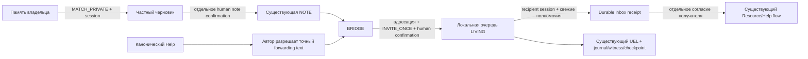

# BLAGO Living Deeds 02 — память, мандаты и локальная доставка

Статус: Draft, synthetic-only. Реальные люди, внешняя доставка, финансы и production — **NO-GO**. Релизные gates предшественников не повышаются.

## Проверенная база и аудит

- Точный base PR #42: `117e90095baaf3fbae3fc7533ca10a3540c5c7ff`, ветка `feat/living-deeds-01`.
- Проверенный источник памяти PR #41: `3596fc67da794b8f5e550bd2ef5de08e2c64538e`, ветка `fix/agent-context-reliability`. Общий предок — `34ed8a6c47eb7c90f7eaa5a6807bb1eee78f97a8`. PR #41 не является предком #42: перенесены конкретные source/test изменения, а не весь стек ветки.
- На базе прочитаны `AGENTS.md`, `BLAGO_VISION.md`, `BLAGO_ECONOMIC_CONSTITUTION.md`. Их текст не меняется. Добровольность означает отдельное согласие владельца и приглашённого; память не становится каталогом.
- Исходный полный локальный прогон exact base: **720/720 PASS**, 951.374 s. SHA256 исходного лога и сведения среды — [BASELINE.json](living-deeds02/BASELINE.json).
- PR #12 `b79cb603a58adbab1e8a5313a06393a2feb5532f` содержит отдельный экспериментальный `core/sovereign.py`: session authentication и key authorization различаются. В этой цепочке его нет; он не импортируется и не включается. Использован существующий IdentityRuntime, а не новый реестр людей. Нельзя считать local challenge подписью суверенного ключа или доказательством уникальности человека.

Аудированные контракты: `domain/help_service.py` (единственный Help lifecycle), `domain/asset_registry.py` (канонические активы), `domain/living_deeds.py` (приватные NOTE, BRIDGE, ресурсные слоты), `core/uel_local.py`/`uel_checkpoint.py` (индекс и retained frontier), `core/privacy_control.py`, `context_fencing.py`, `agent_context.py`, `storage.py`. Старые Help/Asset hooks проверяются `tools.living_contract_check`. Экспериментальные Capital/Federation ветки не переносятся.

## Реализованная граница памяти

`AgentLivingDeeds.candidates(session, mandate_id, query, model_label=..., agent_id=...)` читает только память и NOTE текущего владельца внутри существующего защищённого transaction boundary. Другой UID не принимается из аргументов. MATCH_PRIVATE мандат проверяется по владельцу, назначенному agent ID, разрешённому need permission, его версии, активному состоянию и сроку. Превью явно сообщает, что чтение охватывает частную память владельца. Это широкий owner-private read scope, не право раскрытия.

Результат — частный черновик с `published=false`, `sent=false`. Для memory claim возвращается HMAC `source_tag`, связанный с текущими value и revision/epoch. Исправленная или удалённая память не находится после нового запроса/перезапуска. Candidate/inactive semantic record не превращается в подтверждённый факт. Self-declared запись не считается независимо проверенной.

Память не копируется автоматически в NOTE и не включается в обычный LLM-контекст другого участника. Перенос частной зацепки в отдельную NOTE требует уже существующего человеческого `note` prepare/commit и является отдельным осознанным сохранением. Автоматическое копирование memory payload намеренно не реализовано: иначе удалённый факт мог бы остаться в незаметной копии. Модель и `model_label` не выдают полномочий. Выбор модели не меняет ACL или мандат.

Перенесены точные контекстные механизмы #41: current participant snapshot, отделение известного значения от UNKNOWN происхождения, ссылки на user turn, явно несохранённая поправка C07, барьеры истории и G09. Включение адаптера требует установленной и явно включённой `agent_context_001`. Реальный LLM в этой работе не вызывался.

## Мандаты и доставка

Новые root kinds `AGENT_MANDATE` и `INVITATION_DELIVERY` используют существующие `living_records`, `living_versions`, `living_commands` и source kind `LIVING` UEL. Второго журнала/Help lifecycle/реестра людей нет.

Мандат имеет owner, agent, scope (`MATCH_PRIVATE` / `INVITE_ONCE`), expiry, active, permission ID/version и для доставки bridge ID/version. Выдача и отзыв проходят `prepare` → точное превью → `ПОДТВЕРЖДАЮ` → `commit`, с session binding, одноразовым challenge, CAS source versions и context revision/epoch. Агент не получает commit capability. Это локальный session/HMAC authority contract; автономный криптографически аутентифицированный агент пока не реализован.

Превью INVITE_ONCE показывает точный одобренный текст задачи, код получателя и раскрываемую рекомендацию владельца. Оно не включает личную заметку. Автор потребности ранее разрешает конкретный текст посредством NEED_PERMISSION, владелец заметки отдельно подтверждает адресацию и раскрытие рекомендации. Согласие получателя на контакт всё ещё не публикует его ресурс.

События расширения: `AgentMandateGranted`, `AgentMandateRevoked`, `InvitationQueued`, `InvitationAcceptedByInbox`, `InvitationDeliveryCancelled`. История сохраняет предыдущий event ID как causation_id. Очередь: QUEUED → ACKED либо CANCELLED. Один мандат ставится в очередь один раз, включая разные idempotency keys. Повтор исходного commit не создаёт новую запись.

`LocalPullAdapter.deliver(recipient_session, opaque_delivery_id)` — единственный реализованный транспорт. Это аутентифицированное локальное получение, **не** Telegram/email push и **не** независимая федерация. Приём повторно проверяет текущий BRIDGE, получателя, NOTE, разрешение на forwarding, версии Help, мандат, сроки и contact holds. Запись ACKED/квитанции, UEL и journal/witness завершаются до возврата результата. Никакого сетевого вызова внутри write transaction нет. Внешний транспорт отсутствует; включение флага не создаёт его автоматически.

Квитанция связывает delivery ID, bridge ID/version и mandate ID локальным HMAC. Она доказывает только локальное принятие, не чтение человеком, согласие на помощь или право следующего действия. Живой повтор возвращает ту же квитанцию; после отзыва/отказа/истечения срока повтор блокируется и старый payload повторно не раскрывается.

Получатель видит только approved task, referrer member code, local receipt и `contact_only=true`, `resource_available=false`. Автор потребности не видит NOTE, BRIDGE, очередь, мандат, личность приглашённого или статус отказа: его read model остаётся прежним. Не утверждается отсутствие метаданных у оператора SQLite: он находится внутри доверенной локальной границы.

Отказ сохраняет прежний retained no-contact hold. Молчание после expiry уже запрещает доставку; отдельный явный `close_silent_invitation` фиксирует нейтральное закрытие и retained suppression. Проверка предыдущих unanswered expired BRIDGE запрещает обход через новый мандат до sweep. Снятие запрета/повторный контакт с новым согласием получателя — будущий контракт, в этой версии fail-closed.

## Удаление, миграции и восстановление

Новых таблиц доставки и новой living migration нет. Добавляется ранее проверенная `agent_context_001` из #41 с неизменными DDL/VERSION/CHECKSUM. Её offline compatibility check расширен только проверенными Asset/UEL/Living объектами. [MIGRATION_PARITY.json](living-deeds02/MIGRATION_PARITY.json) сравнивает 11 модулей с exact исходниками, включая `living_deeds_001`. Старые контрольные суммы не редактировались.

Очистка unanswered приглашения сохраняет no-contact control до удаления permission/NOTE, чтобы retention не снимал suppression. Retire cascade расширен ссылками `bridge_id`/`mandate_id`: удаление NOTE/permission/участника удаляет зависимые delivery/mandate payload и оставляет существующие retirement controls. Положительные записи не восстанавливаются из UEL hashes. При journal-ahead SQL/crash, старом backup или недоказанной source frontier остаётся **UNKNOWN_RECOVERY**, операция/доставка запрещены. Оператор не должен восстанавливать permissive backup поверх retained denial state.

Порядок и rollback — [RUNBOOK.md](living-deeds02/RUNBOOK.md). Новых HTTP endpoints, Telegram handlers, scheduler, внешних подключений и production migrations нет.

## Проверки и решение

Сценарии, фактические результаты и точная идентификация runtime — [RESULTS.json](living-deeds02/RESULTS.json), [READINESS.json](living-deeds02/READINESS.json). Threat model — [THREAT_MODEL.md](living-deeds02/THREAT_MODEL.md). Команды не требуют LLM токена.

GO может относиться только к воспроизводимому изолированному **локальному** стенду после полного CI. Физические Android/iPhone, живой провайдер, настоящие Telegram приглашения, независимые операторы и реальный пилот — NOT EXECUTED / NO-GO. Шифрование SQLite at rest и автономные агентские ключи не реализованы. Общие G04 и прочие release gates не закрываются результатом этих synthetic tests.
