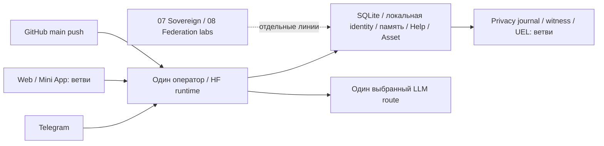
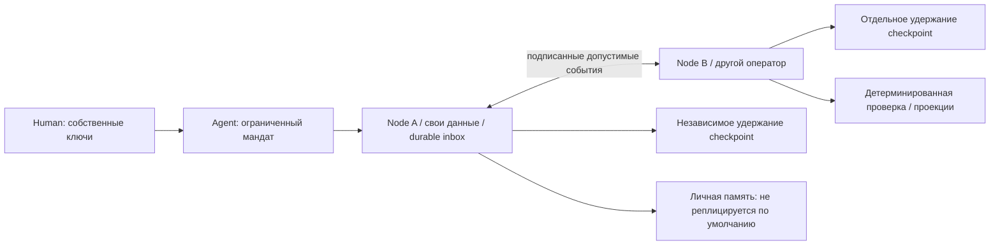

# BLAGO Master Integration Plan

Дата проверки: 18 ноября 2026. Статус: Draft, audit / architecture / planning only.
База этой документации: `3c218dc5757879c26b3aec520af3636b2d702715` (`main`). Проверенный исследовательский runtime: PR #37 `4706a60e7ec675ed1ae16b9c9cd551cde291cfd3`. Данные — только синтетические. Код, схемы, production и release gates не изменены.

Доказательства различаются: **CODE** — прочитанный код, **LOCAL** — исполненный в этом аудите тест, **CI** — проверенный существующий запуск Actions, **DESIGN** — предложение, **UNKNOWN / NOT EXECUTED** — доказательства отсутствуют. Проверка выполнена повторным анализом исходников и GitHub; независимый внешний аудитор и независимые операторы не участвовали.

## Решение

**GO: документация и изолированная разработка. NO-GO: реальные участники, реальный коллективный капитал, production federation.** Сегодня BLAGO — централизованное приложение и несколько проверяемых экспериментальных линий, а не действующая сеть независимых агентов. Ни число тестов, ни подпись сервера не доказывают наличие имущества, согласие реального человека или независимость оператора.

**P0: даже этот документационный PR нельзя сливать до отдельного устранения автоматического деплоя в main.** В [workflow main](https://github.com/xBLAGO/space/blob/3c218dc5757879c26b3aec520af3636b2d702715/.github/workflows/huggingface-space.yml#L3) push в main запускает upload в HF. Наличие защищённого workflow в #19–37 не меняет main и настройки GitHub Environment. В этом аудите workflow намеренно не изменён.

## Фактические три состояния

| Область | Проверенное состояние | Чего это не доказывает |
|---|---|---|
| GitHub main | `3c218dc5757879c26b3aec520af3636b2d702715`; CLI, Telegram, SQLite, базовая память; 27 локальных тестов PASS | Web, Help, G09, UEL и новые identity-механизмы отсутствуют в main |
| Интеграционная линия | #19 → #20 → #22–27 → #29–32 → #35–37; последние HEAD перечислены в матрице | Ничего из этой линии ещё не выпущено через main |
| Sovereign/Federation | #11–14 и #15–17 — отдельные ветви | Автоматической совместимости с современными privacy/UEL нет |
| HF Space | публичная metadata RUNNING, repo и running SHA `b95c630eb69ec4a505e2008a15a4417b12a74553` | Данные, env, секреты, SQLite-библиотека, фактические разрешения и гарантия fsync не проверялись |
| Публичные HF исходники | Web и Telegram побайтово равны #2; Docker совпадает с несколькими старыми HEAD и запускает `xblago-telegram` | По четырём файлам нельзя назначить всему образу GitHub SHA или подтвердить доступность каждого маршрута |
| xblago.space | публичная страница описывает финансовое пространство, TOKEN и уже действующую децентрализацию | Это маркетинговая страница, не доказательство развёрнутого протокола; сборка сайта в этой проверке недоступна |

Полная инвентаризация: [GitHub snapshot](master_audit/github_snapshot.json), [коммиты и изменённые файлы каждого PR](master_audit/git_inventory.json), [CI](master_audit/ci_snapshot.json), [ancestry](master_audit/ancestry.json), [HF public evidence](master_audit/hf_public.json). Срез включает 38 веток и 35 PR: 34 открытых, из них 33 Draft, и закрытый несмерженный #8. Ни один из этих PR не включён в main. Нумерация пропускает #33; это не доказательство потерянной разработки.

## Текущая и целевая системы

Вторая схема — DESIGN. Участник без своего сервера может выбрать оператора; смена оператора требует переносимой идентичности и проверенного актуального frontier, а не копирования сессии.

## Кратчайший безопасный маршрут

1. От main `3c218dc5757879c26b3aec520af3636b2d702715` отдельный минимальный PR **Release Guard & Baseline Provenance**: убрать push-deploy, запретить миграции при импорте/старте, добавить CI без секретов и отдельное ручное продвижение exact SHA. Защиту Environment/branch проверяет уполномоченный владелец. Этот аудит не выполняет эти изменения.
2. На отдельном candidate последовательно проверить #19, #20, #22–26. #19 HEAD `837b2bfd5d3db4842530d30ccf0f417bfe718737` отличается от runtime source `d7f619a1e6a7f15564facb5e8e84b184a3f24658`: сохранить оба в manifest. #10 — реальный предок #19 (0/2 commits), повторно накладывать #10 не нужно. Не применять новые миграции к production.
3. Закрыть причины контекстных ошибок: профиль/обращение, происхождение фактов, отбор памяти, границы окна и понятное поведение при G09 conflict. Сделать отдельный **Agent Context Reliability** PR поверх проверенного candidate; не менять identity-полномочия и Help.
4. Для первого межузлового сообщения использовать #16/#17 как отдельную лабораторию: два оператора, разные hosts/volumes/ключи, OOB pinning и свежие receiver nonce/authority status. Начать с синтетического сообщения без памяти, имущества и денег. Зафиксировать S12 только после реального эксперимента. Для этого не требуются капитал #35–37, mesh или blockchain.
5. #27/#29 и UEL #30–32 проверять как опциональную учётную линию после MVP. #35 → #36 → #37 оставить синтетическим капиталом. Sovereign #11–13 переносить отдельными совместимыми контрактами после нового review deletion/merge/recovery. #14 Genesis не является зависимостью MVP.

Ни один шаг не разрешает merge. После каждого будущего merge/rebase — новый exact candidate SHA, checksum manifest и regression; CI старого head не переносится на новый автоматически.

## Фазы и условия перехода

| Phase / проверенная исходная точка | Критерий приёмки и обязательные испытания | Риск / rollback | Решение сейчас |
|---|---|---|---|
| 0 Integration Audit, main `3c218dc5757879c26b3aec520af3636b2d702715` | Инвентаризация, release guard, воспроизводимый manifest; PR без секретов не может деплоить | P0 auto-deploy; хранить исходный commit, rollback workflow только через review, не возвращать push-deploy | Аудит GO; merge NO-GO до guard |
| 1 Context and Identity, #26 `34ed8a6c47eb7c90f7eaa5a6807bb1eee78f97a8` | Сценарии C01–C14; одно blago_user_id во всех каналах; G09 2+ процессов; migration/recovery + account merge | Смешение профиля/памяти; отключить новый selector, сохранить fencing и denial frontier | Разработка GO; real users NO-GO |
| 2 Economic Ledger Integrity, #37 `4706a60e7ec675ed1ae16b9c9cd551cde291cfd3` | Полный regression, независимый replay проверенных событий, двойной резерв/расход/отзыв/restore | Тестовый капитал принят за настоящий; flags OFF, restore только с актуальными retained controls | Только synthetic GO |
| 3 Independent A↔B, #17 `44a5d52a4ac8022478a247f4e1bbd2eaea551142` | S01–S12, второй оператор, OOB pins, durable ACK/revoke, partition и rollback, отрицательные подписи | Общий rollback domain; остановить transport, не сбрасывать nonce/frontier | S12 NOT EXECUTED, NO-GO |
| 4 Local-First / Replication, будущий child проверенных Phase1+3 | Offline private drafts; sync без resurrection, key history/export/import, redaction, multi-device conflicts | Копии личных данных; selective sync OFF, не импортировать cookies/secrets | DESIGN / NO-GO |
| 5 P2P / Mesh, будущий child Phase3+4 | NAT/relay/USB store-forward; authenticated peers; mobile battery/permissions/device tests | Transport не даёт consensus; отключить adapter, сохранить протокол и inbox | DESIGN / NOT EXECUTED |
| 6 Multi-Operator / Resilience, будущий child Phase2+4+5 | Потеря HF/GitHub/Telegram/DNS, fork/equivocation, независимые checkpoint и custody drills | Захват кворума/цензура; quarantine fork и write hold, никакого сброса на старый snapshot | DESIGN / NO-GO |
| 7 Limited Real-World Pilot, SHA ещё не существует | G00–G11 + отдельный допуск; 3–5 добровольцев, физические устройства, тестовый approved LLM, stop/delete drill | Реальная утечка; остановить записи/публикацию, сохранить отрицательные разрешения, проверенный forward recovery | NO-GO |

Будущие SHA намеренно не придуманы: каждый новый PR должен зафиксировать base/head до исполнения. Phase3 можно вести параллельно Phase1/2 в отдельном lab; production MVP не должен тянуть экспериментальную федерацию.

Два разных допуска: ограниченный **hosted нефинансовый MVP** может дойти до Phase7 после Phase0/1 и закрытия G00–G11, без капитала, mesh и обещания децентрализации. **Сетевой пилот Foundation10** дополнительно требует Phase3/4/6 и доказанной независимости операторов. Phase5 mesh — опциональный transport experiment, не обязательная предпосылка обычного независимого интернет-обмена. Это не сокращает privacy/recovery/security gates ни для одного варианта.

## Что мешает MVP

Главные препятствия — автоматический деплой из устаревшего main; отсутствие аттестованного runtime/image и storage; независимое хранение checkpoint/journal; фактическая retention/deletion внешних копий; непроверенные физические устройства и live LLM; отсутствие независимого security review и эксплуатационного допуска. Проблемы федерации добавляют перенос идентичности, свежесть отзыва, конфликтующие права и независимых операторов. Они не заменяют старые блокеры 05.4/06.1.

[Матрица компонентов и всех PR](BLAGO_DEPENDENCY_MATRIX.md), [контекст](BLAGO_AGENT_CONTEXT_AUDIT.md), [Foundation10](BLAGO_FOUNDATION_10_ARCHITECTURE.md), [release gates](BLAGO_RELEASE_GATES.md).

## Доказательства и границы

Существующий [CI #37](https://github.com/xBLAGO/space/actions/runs/44314309823) проверен по exact head и jobs/logs: 773 теста дважды (331.405/342.079 s), Docker и synthetic browser steps PASS. Это CI предыдущего runtime, а не CI документационной ветки. Подробности повторных локальных проверок — [local_checks.json](master_audit/local_checks.json). На main отсутствует тестовый PR-workflow; новый документационный PR не добавляет workflow и не запускает deployment.

Публичный сайт прочитан через [read-only страницу](https://xblago.space/), ответ поискового инструмента помечен cached last week: это ограничение свежести. Не подтверждены авторизация SIGN IN, финансовые функции и содержание браузерных хранилищ. Тексты о состоявшейся децентрализации следует отдельно согласовать и исправить после определения реального release, не меняя сайт этим PR.

## Ответы на координационные вопросы

1. **Децентрализация сегодня:** частичная на уровне экспериментов и проектируемых криптографических границ; эксплуатационно приложение зависит от одного HF backend, оператора и внешних каналов. Независимая федерация не доказана.
2. **Наиболее уязвимы:** текущий release path, серверные ключи/данные, независимость recovery custody, внешние копии и LLM route; на сетевом уровне — свежесть полномочий и конфликтующие расходы.
3. **Блокеры людей:** G02–G06/G08/G10 UNKNOWN и G11 FAIL, плюс неприменённый release guard main; синтетический капитал не повод допускать реальные ресурсы.
4. **Минимальный независимый узел:** отдельный оператор/ключи/storage/trust pins, bounded protocol verifier, durable inbox/replay/frontier, независимый checkpoint, приватный vault и fail-closed recovery. LLM/Telegram/HF не обязательны для первого подписанного обмена.
5. **Агент до федерации:** связать participant profile с контекстом, сохранять источник факта и уровень доказательности, корректно обрабатывать длинную историю и удаление производных данных, подтвердить continuity каналов и живую модель.
6. **Порядок PR:** отдельный release guard → #19 (уже содержит #10) → #20 → #22–26; отдельно учёт #27/#29/#30–32, затем только synthetic #35→36→37. #11–13 forward-port после privacy review; #16/#17 остаются отдельным lab. Не нужно тащить #14, closed #8, mesh или капитал в нефинансовый MVP.
7. **Следующий результат:** минимальный Release Guard & Baseline Provenance PR от main, затем Context Reliability от проверенного integration candidate. Это быстрее снижает реальный риск, чем новый глобальный реестр или новый финансовый модуль.

## Локальные результаты этого аудита

- Main exact3c218dc: **27/27 PASS**,0.477s.
- Runtime exact4706a60: **60/60 PASS**,44.514s — memory_pilot, semantic_memory, context_fencing с разрешённым localhost.
- Runtime exact4706a60: **773/773 PASS**,1283.643s — полный regression с synthetic stores/workers. Это отдельный локальный запуск, не пересказ CI.
- Контекстный probe: PASS воспроизведения заявленных ограничений; обнаруженные GAP остаются GAP, а не закрытыми требованиями.
- JSON, локальные ссылки,17 точных file/line anchors и docs-only diff: PASS.
- Начальный sandbox: context1 error; full87 failures/33 errors с запретом socket bind и незапустившимся synthetic custodian. Разрешённые повторы выше прошли; исходные неуспехи сохранены в local_checks.json, а не переименованы в PASS.
- Docker не пересобирался в этом docs-only аудите: проверены успешные Docker jobs exact #35/#36/#37. Физические устройства, live HF модель и независимый второй оператор — NOT EXECUTED.
- CI этой ветки: отсутствует PR test workflow на унаследованной main-базе; существующий CI #37 — отдельное доказательство runtime. Автоматический deployment не запускался.
