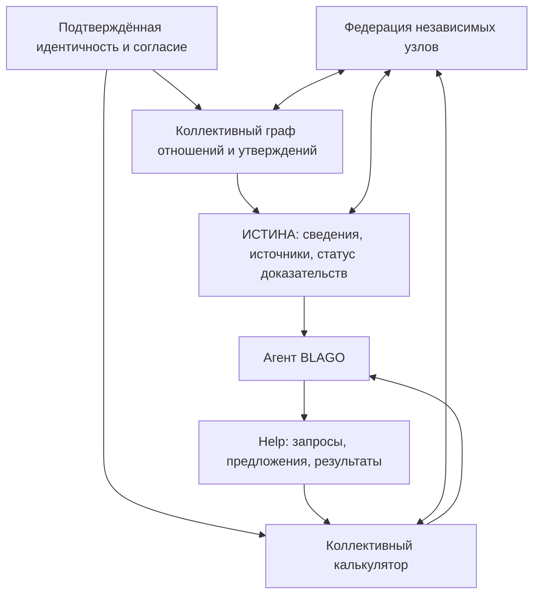

# BLAGO — дорожная карта развития
> Версия 0.1 · 9 ноября 2026 · стратегический рабочий документ, не обещание сроков релиза.

## Миссия
BLAGO — добровольное децентрализованное сообщество людей и ИИ-агентов, которое помогает учитывать знания, возможности, ресурсы и потребности, проверять факты и координировать взаимопомощь. Цель — общее благополучие, а не накопление денежных единиц или установление иерархии участников.

**Принципы:** равное человеческое достоинство; добровольность и согласие; проверяемость вместо безусловного доверия; право исправить, отозвать и удалить данные в рамках проверяемых ограничений; прозрачность правил при ограниченном доступе к личным сведениям; отсутствие автоматической передачи имущества при его учёте; независимость узлов и переносимость личности.

## Где мы находимся (на 2026-11-09)
- **Foundation 01–07**: базовые чат/память/идентичность и защитные механизмы разработаны в отдельных ветках/PR; их интеграция и работа на реальных устройствах не равнозначны успешным синтетическим тестам.
- **Foundation 08**: независимая федерация спроектирована и локально продемонстрирована A↔B; испытание с отдельным оператором не подтверждено.
- **Help 01**: реализован цикл нефинансовой помощи с предложениями, взаимным подтверждением, спором и отзывом; эксплуатационные ограничения остаются.
- **Foundation 09 / [PR #27](https://github.com/xBLAGO/space/pull/27)**: изолированное ядро коллективного калькулятора: Decimal/BTC offline оценки, история и переоценка, синтетические активы/доступные ресурсы, read-only Help projection; **516/516 тестов и Docker PASS**. Новый реестр **in-memory**, без production identity-backed persistence, количественных взаимных подтверждений помощи и HTTP/UI. **GO только для isolated development, NO-GO для реального коллективного учёта и пилота**.
- PR #27 открыт как Draft поверх exact #26, **не merged/deployed**. G04 UNKNOWN; G09 — лишь inherited scoped PASS; G11 FAIL. Публичный сайт/production не считаются подтверждённо готовыми.

## Схема взаимосвязей

## Приоритетные этапы
| Этап | Результат | Зависимости | Критерий завершения |
|---|---|---|---|
| **09.1 — долговечный реестр** (следующий) | Связать asset/resource с действующей идентичностью и SQLite, review legacy mapping, migration dispatcher, согласия, аудит, retention/delete/recovery, fencing | Exact #27 + Foundation 07/Privacy | Тесты миграций/старых backup, concurrent writers, revoke/delete, no dual counting, fail-closed; не повышать пилотный gate без evidence |
| **09.2 — измеримый Help** | Согласованные quantity/unit и участниками подтверждённые объёмы выполненной помощи в существующем Help lifecycle | Help 01 + 09.1 | Частичное исполнение, спор, отмена и неизвестные величины корректны; нет второго Help автомата |
| **09.3 — агент и интерфейс** | Разговорные черновики, точные карточки согласия, read-only запросы и аудитория | 09.1–09.2 + auth | Без явного подтверждения никаких изменений/публикаций; работа на Web/Telegram/Mini App проверена |
| **09.4 — достоверность и аналитика** | Независимая проверка заявлений, provenance цен/прав, обнаружение вероятных дублей, privacy-preserving aggregates | 09.1–09.3 | Уровни SELF_DECLARED/CONFIRMED/CONTESTED различимы; нет публичного census или точного баланса из неполных данных |
| **10 — граф людей и приглашения** | Утверждения об отношениях, неподтверждённые упоминания (не «аккаунты»), приглашения по воле приглашаемого и приглашающего, claim/merge | Identity + privacy + consent | Упоминание третьего лица не создаёт автоматически публичную личность и не доказывает знакомство; anti-spam, ошибочные совпадения и удаление проверены |
| **11 — ИСТИНА** | Распределённые утверждения с источником, временем, контекстом, возражениями, исправлениями и репутацией доказательств, не людей | Граф + federation envelope | Конфликтующие версии сосуществуют, история исправлений и права доступа проверяются |
| **12 — федерация** | Реальные узлы разных операторов: обмен в пределах мандатов, отзыв, перенос личности, подписанные квитанции | Foundation 08 + 09–11 | Независимый оператор и fault-injection; нет ложного «децентрализовано» до демонстрации |
| **13 — ограниченный пилот** | Малый круг добровольных подтверждённых участников, нефинансовая помощь и добровольный учёт ресурсов | Release gates, storage, physical device/LLM/operator tests | Формальные GO от privacy/security/recovery/operator; доступность, удаление, бэкап и откат в реальности |
| **14 — коллективная координация** | Прозрачные рекомендации по закрытию потребностей и снижению дефицита; оспоримые критерии приоритета | Достоверный учёт + пилот + governance | Агент предлагает, люди подтверждают; решения проверяемы, нет дискриминационного социального ранга |
| **15 — масштабирование** | Многоузловое общество, стандарты, независимые аудиты, открытые протоколы | Подтверждённый пилот и федерация | Общественный контроль и воспроизводимые метрики благополучия |

Этапы могут вестись параллельно в исследовании, но **зависимости блокируют выпуск**. Номера после Foundation 09 — планируемые направления, а не уже существующие реализации/одобренные релизы. Даты намеренно не обещаются.

## Семантика калькулятора
- **ASSET**: единица имущества и правовых притязаний (заявление, не доказательство собственности).
- **RESOURCE**: доступная с согласия часть ASSET; **не отдельный второй актив**.
- **NEED**: потребность, с областью видимости и обоснованием.
- **OBLIGATION**: добровольно принятое обязательство помочь, не оценка «долга человека».
- **FULFILLMENT**: фактическое исполнение в подтверждённом объёме, с возможностью оспаривания.
- **VALUATION**: историческая оценка с provenance и отдельной переоценкой. BTC — **только расчётная размерность**, без обещания обеспеченности, обмена или хранения.
- Стоимость запасов, потребности и потоки помощи **не суммируются в единое богатство**. Недостающие сведения маркируются UNKNOWN, не превращаются в 0.
- Полезность следует оценивать в контексте срочности, альтернатив, доступа и эффекта для благополучия; правила должны быть объяснимы и оспоримы. Полезность **не** является стоимостью или достоинством человека.

## Правила для коллективного графа
1. Упоминание человека в личном дневнике создаёт только ограниченное **утверждение рассказчика** с provenance и областью видимости; не аккаунт, не подтверждённую личность, не согласие на обработку/публикацию.
2. Связи «знаю», «родственник», «коллега» имеют самостоятельные статусы: со слов одного лица / подтверждено сторонами / оспорено / отозвано.
3. Слияние совпадающих упоминаний допускается только по строгой процедуре; одинаковое имя не означает одного человека.
4. Инвайт — добровольная операция с защитой от нежелательных контактов; третьему лицу нельзя раскрыть содержание чужого дневника.
5. Глобально согласованный публичный граф личных отношений **не** является предпосылкой работы BLAGO; минимизация сведений и локальная автономия важнее полноты.

## Релизные ворота (обязательны на каждом этапе)
- **Security/identity:** корректная авторизация, anti-replay, защита от конкурентных и межузловых конфликтов.
- **Privacy/consent:** раздельное согласие на хранение, видимость и предоставление; отзыв, удаление, минимизация, отсутствие самовольного обогащения графа.
- **Data/recovery:** миграции со старой базы, rollback, резервные копии, запрет восстановления удалённых данных.
- **Verifiability:** независимые источники, уровни свидетельств; неопределённость и конфликты не скрываются.
- **Operations:** реальные устройства, LLM/provider availability, отдельный оператор, мониторинг и откат.
- **Governance:** прозрачность критериев распределения; добровольность; право обжаловать; отсутствие скрытых привилегий.
- **CI green ≠ production ready.** Публикация документа не означает разрешение merge/deploy.

## Ближайшее действие
**Foundation 09.1 — Durable Collective Registry**: отдельный небольшой Draft PR поверх exact #27. Сначала audit legacy asset/resource mapping, затем миграции в существующую SQLite, identity-backed joins, сохранение согласий, deletion/recovery/context-fencing, тесты конкурентности и документация. Production, секреты, webhook, сайт и платежи не менять. Формальная оценка **GO/NO-GO** — после проверок.

## Как поддерживать дорожную карту
Для каждого следующего этапа вести: ссылку на PR, exact base/head SHA, тесты и реальный scope, открытые риски, release gates и статус (PROPOSED / IN DEVELOPMENT / VERIFIED ISOLATED / PILOT GO / RELEASED). Обновлять документ только по фактическим доказательствам; критерии и порядок этапов могут изменяться по итогам коллективного обсуждения.
