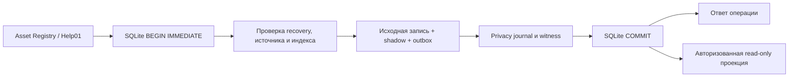

# BLAGO UEL 0.2 — изолированный локальный журнал

Draft. База [PR #30](https://github.com/xBLAGO/space/pull/30), `40167137904f0eeb2e04288c2256865740dbffa3`. Реализация [PR #31](https://github.com/xBLAGO/space/pull/31). Только синтетический стенд с локальным провайдером. `XBLAGO_UEL_LOCAL_ENABLED` по умолчанию выключен.

## Модель

Asset Registry и Help01 сохраняют исходные таблицы, подтверждения, CAS, аудиторию, правила удаления и переходы состояний. Shadow-индекс фиксирует версии управляемых записей в существующем SQLite. Он не исполняет команды и не выдаёт полномочия. Для NEED, OBLIGATION и FULFILLMENT используются текущие состояния Help01.

| Поле | Назначение |
|---|---|
| `source_kind`, `source_ref` | Тип и уникальная HMAC-ссылка на каноническую исходную версию |
| `object_ref`, `source_version`, `phase` | Защищённая связь с объектом, версия источника, наблюдение или подтверждённое прекращение доступа |
| `payload_ref`, `source_state` | HMAC-связь с защищённой исходной строкой и контрольным состоянием; прекращение доступа не содержит ссылки на payload |
| `sequence`, `previous`, `causal_ref`, `record_ref` | Локальный порядок, предыдущая запись, предыдущая запись того же объекта, аутентифицированная запись |
| `coverage` | Наблюдение от начала или явно принятая текущая версия; полнота старой истории неизвестна |

SQL-ограничения запрещают UPDATE, DELETE и конфликтующий INSERT OR REPLACE. При чтении сравниваются цепочка SQLite, оригинальный privacy journal с witness, очередь той же транзакции и контрольные точки источников. Отсутствие исходной записи без подтверждённого hold, повреждение, пробел версий и неиндексированная положительная операция блокируют проекцию. Подтверждённое удаление допускает запись `RETIRED` без копирования содержимого. На нормальном пути существующее удаление очищает исходное содержимое и прекращает выдачу сведений. Заголовки остаются псевдонимными, с риском связывания при доступе к приватному журналу и его ключам.

Проверка, исходная запись и shadow разделяют одну SQLite-транзакцию. До её фиксации ответ об успехе не выдаётся. Crash до записи в независимый журнал оставляет обе SQLite-записи незафиксированными. Crash после журнала и до SQLite commit может оставить аутентифицированный заголовок наблюдения; recovery воспроизводит только заголовок, применяет исходные запреты и требует проверяемый живой источник для любой выдачи. Повтор после commit использует существующую квитанцию источника. G09 продолжает проверять версию контекста при фиксации ответа; LLM не получает данные UEL.

## Проекция

`LocalLedger.balance(token)` и `observations(token)` используют действующую проверку сессии и область видимости Asset/Help. Это Python API без нового маршрута, публикации, импорта или доступа агента. Неподтверждённое заявление участника остаётся `SELF_DECLARED`. Подтверждение Help по сессиям имеет статус `SERVICE_OBSERVED_SESSIONS`. Подписи человека для переноса в другой узел здесь отсутствуют.

Запас группируется по категории и единице измерения. Доступный ресурс представляет долю исходного актива. Подтверждённое исполнение считается один раз по текущему Help-объекту после двух подтверждений. Спор исключает его из счётчика подтверждённых исполнений. Доля относится к видимым обращениям, охват `PARTIAL`. Неизвестные количества и оценки представлены `null`. BTC, измеренный дефицит, накопленная стоимость и общее благосостояние остаются неизвестными. При конфликте `UNKNOWN_RECOVERY` возвращается без численного баланса. В выдаче отсутствуют общая последовательность, идентификаторы пользователей, исходные тексты и контрольные MAC.

## Угрозы и границы

| Угроза | Контроль и остаточный риск |
|---|---|
| Повтор запроса и конкурентные версии | Существующие receipts/CAS и одна SQLite-транзакция. Уникальные ссылки и версии исключают повторный учёт |
| Старый backup или потеря witness | Сравнение с сохранёнными журналом и witness. Потеря доказательства блокирует операции. Совместный откат всех копий в одном домене остаётся внешним риском |
| Неавторизованный просмотр и повторная идентификация | Текущая сессия и ACL на каждое чтение. Ссылки привязаны к зрителю. Частые запросы малой группы могут раскрыть изменения по разности результатов; публичная аналитика выключена |
| Повреждение индекса или источника | Отказ guarded-операций, включая удаление, до проверенного восстановления. Нет автоматического обхода, сброса или положительного backfill |
| Доступ к журналу и ключам | Локальные HMAC и исходные границы хранения 05.4. Не доказана устойчивость к совместной компрометации ключей и контрольных копий. Логическое удаление не гарантирует физическую очистку носителей |
| Рост журнала и деградация | Лимит 8192 наблюдений, с возможностью фиксации прекращения доступа. Индекс сверяется синхронно. Эксплуатационная ёмкость и SLO неизвестны |

[Runbook миграции и восстановления](uel02/RUNBOOK.md) · [Матрица проверок](uel02/TEST_MATRIX.md)

**GO только для изолированного локального эксперимента при успешной проверке конфигурации и тестов.** NO-GO для production, реальных участников, независимой федерации, блокчейн-якорей и финансовых действий. G04/G09 и прочие release gates этой работой не повышаются.
