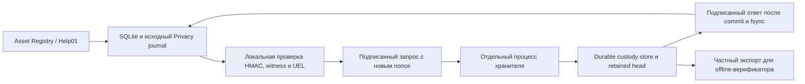

# BLAGO UEL 0.3 — Signed Custody and Recovery

Draft. Синтетический локальный runtime. Exact base PR #31 — `aa92d96bca0ae8a07e27f8efa724131afb32ad57`. [Draft PR #32](https://github.com/xBLAGO/space/pull/32).

UEL 0.3 добавляет проверку локальной истории у отдельного хранителя контрольных точек и восстанавливает производный индекс из исходного защищённого журнала. Доступ пользователя после ремонта проверяется обычными механизмами Identity/Privacy. Допуск реальных людей остаётся NO-GO до независимой проверки и закрытия прежних release gates.

## Почему завершился ошибками локальный прогон 0.2

Исходный `/tmp/blago-uel02-full.log` завершился 600 тестами с двумя ошибками 401 в `test_forged_help_hold_cannot_hide_unscrubbed_payload` и `test_g09_owner_generation_fenced_by_existing_source_change`. Исключения возникли при создании исходных записей, в `IdentityRuntime.session_row`, до проверяемых действий.

Тесты читали реальные `time.time()`. Сессия имеет idle TTL 1800 секунд и fresh TTL 300 секунд. Остановка процесса между регистрацией и следующим запросом делает сессию просроченной. Системный журнал ноутбука подтверждает clamshell sleep во время того прогона и возобновление перед его завершением. `caffeinate -i` предотвращает idle sleep, но закрытие крышки сохраняет возможность длительной приостановки.

Новый тест воспроизводит оба исключения сдвигом часов на 1801 секунду. После возврата часов обе операции проходят. Отдельный тест подтверждает штатный отказ 403 после 301 секунды. Fixture UEL теперь фиксирует время каждого сценария и передаёт его spawned workers. Проверки реального runtime продолжают использовать штатные часы. Полный набор выполняется дважды через `tools.uel03_lab_check --full --repeat 2`, с раздельными wall/elapsed измерениями и исходами тестов.

## Контрольные точки

Профиль `uel-checkpoint-0.3-lab.1`. Используется Ed25519 из существующей библиотеки `cryptography`. У приложения есть отдельный синтетический ключ отправителя. Ключ подписи хранителя находится в его хранилище. Human signing key не используется.

Хранитель получает только доменно-разделённые SHA-256 commitments исходных аутентифицированных записей и заголовков UEL. В запросе нет текстов чата, памяти, ключей HMAC, идентификаторов участников или содержимого активов. Случайный `stream` связывает историю с заранее закреплёнными ключами отправителя и хранителя.

Checkpoint содержит `profile`, `stream`, `generation`, `previous`, `journal_seq`, `journal_root`, `uel_seq` и `uel_root`. `previous` — SHA-256 предыдущей подписанной квитанции. Корень каждой последовательности начинается с 32 нулевых байтов и вычисляется последовательным SHA-256 от домена, предыдущего корня и очередного commitment. Локальные версии и source references UEL 0.2 сохраняются.

JSON имеет UTF-8 кодировку, ASCII escaping, сортировку ключей и компактные разделители. На wire принимается только точное каноническое представление. Hex — в нижнем регистре. Подпись вычисляется по отдельному домену request/checkpoint/reply и canonical body. Лимит запроса — 10 MiB, последовательности — 65536 элементов. Примеры подписи находятся в [checkpoint-vectors.json](uel03/checkpoint-vectors.json).

## Порядок фиксации

1. Исходная транзакция удерживает действующие блокировки SQLite и privacy journal.
2. Исходный journal проверяет локальную HMAC-цепочку и witness, затем запрашивает хранителя.
3. Хранитель проверяет подпись отправителя, stream и точное продолжение обоих сохранённых префиксов.
4. Межпроцессный file lock сериализует проверку, SQLite commit, публикацию retained head и ответ. `synchronous=FULL`, fsync файла и каталога завершаются до подписи ответа.
5. Клиент сверяет pinned key, домен, nonce, hash конкретного запроса, оба счётчика и корня.
6. После append исходный journal повторно получает подтверждение хранителя. Лишь затем исходная операция может завершить локальный SQLite commit и вернуть успех.

Запрос ниже frontier или с конфликтующим префиксом отклоняется. Повтор идентичного состояния получает ту же checkpoint-квитанцию и новый ответ, связанный с nonce. Потеря ответа сохраняет записанный frontier. После сбоя между custody commit и fsync head повтор проверяет подписанную историю и восстанавливает публикацию головы до ответа.

Checkpoint фиксирует долговечное намерение исходного журнала. При сбое до source SQLite commit действуют прежние правила консервативного recovery. Наличие checkpoint не восстанавливает положительные полномочия и не доказывает экономическую достоверность заявления.

## Восстановление индекса и удаления

`python -m xblago.core.uel_recovery DATABASE` — явная offline-операция для синтетического стенда. Требуются исходный journal, witness, pinned config и доступный хранитель. В одной SQLite-транзакции проверяются сохранённые схемы и binding, восстанавливаются известные отсутствующие append-only triggers, индекс перестраивается из аутентифицированных заголовков, применяются исходные denial/recovery правила и сверяются живые источники.

Поддержаны повреждения содержимого `uel_events`, головы `uel_state` и потеря известных append-only triggers. Неизвестная структурная порча, повреждение source state, потеря binding или контрольных свидетельств оставляют отказ. Исходные payload и разрешения не создаются. В privacy journal остаётся `uel_index_repair` с защищёнными отпечатками индекса до и после ремонта. Crash после записи этого аудита допускает повторный проверенный ремонт.

Тест проходит путь «повреждение → отказ проекции → ремонт → обычная авторизация → удаление аккаунта → восстановление старого backup → удалённый доступ остаётся запрещён». Сохранность G09, контекстных epoch, Help и Asset проверяется общей регрессией.

## Граница доказательства

Откат SQLite, journal и локального witness обнаруживается, когда хранитель сохранил более новую контрольную точку. Исчезновение custody DB, ключа, retained head, исходного witness или config не считается успешной проверкой. Совместный откат всех копий хранителя вместе с доверенной конфигурацией выходит за модель доказанной защиты. Его предотвращение требует независимого оператора и действительно раздельного rollback domain.

Реализованный транспорт — Unix socket. Процессы и каталоги разделены на одном компьютере. Доказательства независимого администрирования, защиты при компрометации того же OS account и отдельного физического отказа отсутствуют. Подпись хранителя подтверждает сохранённый префикс. Подлинность source HMAC и доменных решений опирается на исходный runtime. Компрометация ключа отправителя позволяет заявлять ложные продолжения; компрометация ключа хранителя разрушает его доверительную роль.

Standalone `tools/uel_checkpoint_verify.py` проверяет подписи и цепочку без импорта приложения, приватных ключей или доступа к SQLite. Для обнаружения отсечения требует отдельно закреплённый tip. Его вывод `OFFLINE_INTEGRITY_ONLY` не подтверждает текущую свежесть или права пользователя. Оба валидатора написаны одним автором. Независимый аудит — NOT EXECUTED.

[Threat model](uel03/THREAT_MODEL.md) · [Runbook](uel03/RUNBOOK.md) · [Матрица и результаты](uel03/TEST_MATRIX.md).

## Связь с концепцией White Paper 0.1

Предоставленная инициатором концептуальная редакция от 10 ноября 2026 года задаёт три уровня истории, добровольность раскрытия и исправляемость утверждений. UEL 0.3 реализует частные контрольные доказательства локального журнала. Предмет текущего учёта — существующие управляемые Asset/Help объекты и их исходные privacy controls. События разговоров, федеративный обмен и общий консенсус требуют отдельных решений по раскрытию и жизненному циклу.

Подпись checkpoint подтверждает зафиксированный префикс. Статус достоверности исходного актива остаётся SELF_DECLARED. Подтверждённый Help описывает результат действующего цикла помощи. Резервирование и передача физического актива из примера E4–E5 относятся к будущему доменному функционалу. Архитектура должна сохранить право человека менять аудиторию и удалять приватную полезную нагрузку при проверяемой истории допустимых контрольных событий.

Раздел White Paper о состоянии разработки на 10 ноября сохраняет историческую дату. Результаты #30–#32 представлены в этом отчёте отдельно. Концептуальное описание открытого консенсуса не повышает readiness реализованной лаборатории.

## Результат и следующий шаг

Финальный runtime source — `8ed6131e4617e0b47b157e9625ceb8845de22306`. [CI](https://github.com/xBLAGO/space/actions/runs/43376632499) прошёл два полных прогона по 638 тестов, Docker и browser/synthetic Mini App проверки. Все 72 прежних offline-примера сохранены. Локальные полные повторы первого source и финальные 38 сценариев описаны с отдельными SHA в [evidence](uel03/evidence.json).

**GO для изолированных синтетических испытаний. NO-GO для реальных пользователей.** Независимый аудит и отдельный оператор не выполнены. Новый контроль не повышает G04 или другие gates. Для следующего этапа нужны независимое хранение и pinned config вне общего rollback domain, проверенный удалённый transport adapter, процедура восстановления самого хранителя по актуальному внешнему tip и согласованная retention/capacity политика. Ограничения размера и количества являются fail-closed пределами лаборатории. Достижение предела может блокировать новые операции, включая privacy intents; эксплуатационная ёмкость и SLO остаются неизвестными.
