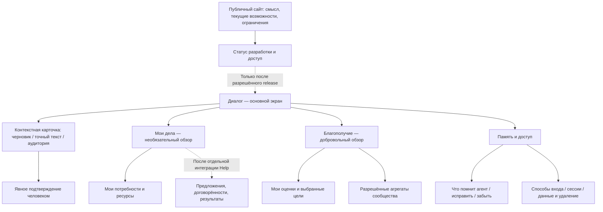

# BLAGO — концепция единого интерфейса

Draft для обсуждения. Это проектирование поверх ограничений PR #19, не реализованный интерфейс и не изменение полномочий агента.

## Человек начинает с мысли

Основной экран — продолжение личного разговора. Человек может размышлять, задавать вопросы, говорить о трудностях или предлагать помощь. Приложение не требует выбрать тип обращения до разговора, не вставляет приветствие при каждом открытии и не завершает каждую реплику вопросом. Для простого ответа не появляются панели задач, рейтинги или предложения оформить заявку.

Контекстные карточки появляются тогда, когда человек действительно хочет сохранить или выполнить действие. Текст карточки, аудитория, версия и последствия видны до подтверждения. Фраза «мне трудно починить велосипед» сама по себе не публикует потребность. Фраза «я могу помочь» не создаёт обязательство и не передаёт ресурс.

## Информационная структура

| Раздел | Первый уровень | Необязательное раскрытие | Доступность сейчас |
|---|---|---|---|
| Диалог | История, поле ввода, понятное состояние ответа | Карточка конкретного подтверждаемого действия | Базовый чат есть #19; карточки Help — отдельно |
| Мои дела | Свои записи, статус, следующий разрешённый шаг | История изменений и разрешённые предложения | Свои списки есть #19; исполнение не входит в #19 |
| Благополучие | Выбранные человеком ориентиры и подтверждённые результаты | Определения, период, источник, приватность | Новое проектирование; счётчики #19 не подменяют эти данные |
| Память и доступ | Память; способы продолжить доступ | Устройства/сессии, export/delete, технические параметры | Основные механизмы есть #19; нужна ясная подача |

На мобильном — диалог и подписанная кнопка дополнительных разделов; навигация не закрывает поле ввода при открытии клавиатуры. На desktop — тот же порядок и те же полномочия; ширина не превращает вторичные инструменты в обязательный dashboard. Реализация общего компонента навигации заменяет дубли только после accessibility regression.

## Диалог и действия

Пример будущего Help-сценария:

1. Человек: «Не получается настроить велосипед». Агент обсуждает проблему и может предложить оформить просьбу, если это уместно.
2. По запросу человека появляется черновик: «Нужна помощь с настройкой велосипеда», версия 1, явно указанная аудитория. Действия: изменить, подтвердить публикацию, оставить личным черновиком.
3. Подтверждение относится к этому тексту и версии. Любое изменение текста/аудитории отменяет прежнее подтверждение. Сервер проверяет session, CSRF, ownership и допустимость перехода.
4. Предложение другого человека показывается как предложение, а не выполненная помощь. Принятие, отзыв, отказ, подтверждение результата и спор — отдельные действия. Экран не обещает невозможность конфликта.

Это требования следующей интеграции, а не возможности существующих `blago_needs`/`blago_resources`. Нельзя связывать новую кнопку с неподходящим legacy endpoint ради внешне работающей демонстрации.

## Минимум настроек, сохранение контроля

- Не запрашивать биографию, интересы, паспорт или кошелёк при первом открытии. Уточнять только то, что нужно для текущего действия.
- Профиль не обязан содержать технический BLAGO ID на первом плане. Внутренняя идентичность остаётся прежней; скрытие ID в визуальной подаче не меняет модель авторизации.
- Память: понятное название факта, источник/дата, статус подтверждения, исправить, забыть. Предположение не отображается как установленный факт. Не выводить персональную память в общественные карточки.
- Доступ: понятные способы входа и собственные сессии. Сохранять запрет удаления последнего метода и существующие fresh-auth процедуры. Telegram username не является доказательством личности.
- Данные: export, preview удаления и явное подтверждение с описанием границ retention/recovery. Не обещать физическое стирание всех резервных копий, если политика предусматривает защищённое повторное применение удаления.
- Приватность и выход доступны без обращения к LLM. Минимализм не должен прятать значимые последствия или создавать зависимость от ответа модели.

## Благополучие без рейтинга человека

Вместо одного «индекса ценности» — два различимых слоя: добровольное самоописание и проверенные результаты взаимодействий. Отсутствие ответа — «нет данных», а не ноль. Показатель не определяет приоритет доступа к помощи и не является доказательством уникальности человека.

| Показатель | Источник и смысл | Визуальное представление | Приватность / состояние |
|---|---|---|---|
| «Как я себя чувствую в выбранной области» | Только добровольная оценка человека; области он выбирает сам | Небольшая шкала/линия с датой, пропусками и текстовым эквивалентом | Новая функция; private default, пропуск/удаление доступны; без диагноза |
| Мои потребности / возможности | Собственные записи и их реальные состояния | Карточки, фильтры active/draft/withdrawn | #19 даёт только списки/open; другие состояния после интеграции |
| Подтверждённая помощь | Согласованный outcome, не факт отправки сообщения | Число результатов за период и доступная личная история | После Help acceptance; спорные/ожидающие отдельно |
| Потребности сообщества | Только разрешённые агрегаты, определённый период и denominator | Столбцы «обращения / подтверждённые результаты / ещё открыто» | Future; проверка аудитории, suppression и защита от differencing |
| Активные аккаунты | Определение существующей privacy analytics | Подпись «аккаунты за период», не «уникальные люди» | Минимальная группа; не выдавать пропущенные значения как 0 |

Нельзя вывести благополучие из числа сохранённых фактов, сообщений, денег, ресурсов или продолжительности сессии. Модель не оценивает личность по одной реплике и не вычисляет эмоциональный профиль для dashboard. Исключены streaks, сравнение людей, социальный рейтинг и побуждение возвращаться ради показателя.

Для общественного слоя недостаточно просто применить `>=5`: нужны согласованные правила аудитории, окон времени, пересечений групп, частоты запросов и удаления. Проверка фильтров должна исключать получение индивидуального значения разностью двух разрешённых агрегатов. Значения имеют источник, дату обновления и объяснение, что именно считается.

## Состояния и доступность

Компоненты для последующих PR: `ConversationStream`, `Composer`, `DeliveryState`, `ActionPreview`, `AudienceSummary`, `OwnRecordCard`, `MemoryFactCard`, `OutcomeSummary`, `MetricWithDefinition`, `AccessPanel`. Это предлагаемые границы ответственности, не требование нового frontend framework.

| Ситуация | Поведение |
|---|---|
| Timeout / ответ мог сохраниться | «Результат отправки пока неизвестен»; сверка истории; не автоматический повтор публикации |
| Истекла сессия | Понятное повторное подтверждение доступа; сохранение несохранённого текста только по согласованной device-privacy политике |
| HF недоступен | Спокойное сообщение без stack trace; служебные команды памяти/доступа не зависят от LLM |
| Offline | Отсутствие соединения обозначено; не заявлять доставку и не показывать кэш как актуальное разрешение |
| Недостаточная группа | «Недостаточно данных для безопасного отображения»; без выводов о конкретных людях |
| Нет актуальных данных | Дата и unknown; не рисовать здоровое/неблагополучное состояние по умолчанию |

Требования приёмки: keyboard-only, видимый focus, Escape/focus return drawer, label для icon buttons, screen reader status без повторного чтения всей истории, масштаб 200%, reduced motion, светлая/тёмная читаемость, маленький экран и клавиатура, safe-area Telegram, отсутствие горизонтальной прокрутки. Viewport-скриншот не доказывает прохождение этих требований.

## Связь сайта и приложения

Общие названия, спокойная типографика, зелёный акцент как ориентир, а не оценка человека. Сайт объясняет смысл, фактический статус и правила приватности. Кнопка перехода в приложение появляется только для проверенного release URL; версия и статус не создают ложного впечатления production GO. Telegram и Web — способы доступа к одному аккаунту, а не разные продукты с отдельными обещаниями.

Подробные site changes — [публичный аудит](BLAGO_PUBLIC_SITE_AUDIT.md). Порядок реализации и gates — [план](BLAGO_INTERFACE_DEVELOPMENT_PLAN.md).
