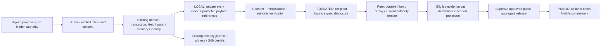

# BLAGO Universal Event Ledger 0.1

**Draft for discussion.** Proposal revision `uel-design-0.1-draft.1`; executable **offline wire example** profile `uel-0.1-lab.1`. GO for specification review and new isolated experiments only. NO-GO for activation, real users, independent federation, public anchors or production. No runtime/SQLite/API/identity/deployment changes in this PR.

Universal means common event vocabulary, provenance and verification boundaries. It does **not** mean a public log of everyone's life, a single global database, total ordering of humanity, a second economic executor or proof of truth from a signature.

## 1. Verified baseline and dependencies

Base: exact current [PR29](https://github.com/xBLAGO/space/pull/29), `c3b4c5b4fd37a5e16e09b19cdbcf494183963bf5`; its parent [PR27](https://github.com/xBLAGO/space/pull/27), `00c665b369acb6465f9afa795a6046c43f4107ce`. #29 runtime source remains `34fb475455678dc024cf39f8fa27d2cd0c5af7dd`. Both are Draft, not merged. #29 has565 passing synthetic tests and Docker; that is baseline evidence, not execution of a UEL runtime. [Pinned audit](ledger01/baseline.json) identifies inspected code and ancestry.

| Existing component | Actual implementation | UEL treatment |
|---|---|---|
| #27 Calculator01 | `domain/collective_calculator.py`: Decimal/BTC fixtures, memory-only registry, read-only Help view | Reuse valuation algorithm, stock/flow separation and UNKNOWN; no real BTC assets/transfers |
| #29 registry09.1 | `core/asset_registry_schema.py`, `domain/asset_registry.py:emit/commit/check_frontiers` | Existing blago_assets canonical ID, versions/consent, session-bound seal and retained erase/holds stay authoritative |
| Help01 | `domain/help_service.py:prepare/commit/emit`, help_requests/offers/events | **Only Help lifecycle.** UEL observes committed transitions; never accepts Help commands or creates a parallel completion state |
| Privacy/G09 | `core/storage.py:_locked_transaction`, PrivacyControl, context_schema/lifecycle_schema | Original journal/witness denial protocol and CAS remain security-critical; general audit events cannot override them |
| #11/#12 Foundation07 | Architecture + isolated SovereignIdentity key proofs/rotation/revoke on separate branch | Not integrated into #29. Session/passkey login is not a portable Human signature or person-uniqueness proof |
| #13 Foundation07.2 | Isolated recovery design/tests, live recovery fail-closed | No administrative universal recovery key; remote authority continuity remains a blocker |
| #15/#16/#17 federation08 | `bop-0.1-lab.1` note.deliver only; 73 vectors/reference,35 local stateful tests, S12 NOT EXECUTED | Reuse principles of nonce/freshness/durable receipts/recovery; **do not add economic types to that frozen profile** |
| #14 Genesis08 | Separate genesis_events/stream chain and declarations/proposals | Not integrated. Do not merge its asset/need declarations as additional canonical stock/Help. Only a reviewed source adapter may later observe proposals |
| #28 roadmap | Strategic document, separate Draft | Context, not runtime: its09.1-future wording is superseded by actual #29 code, not by an automatic roadmap merge |

Sovereign/Genesis/federation flags remain OFF/excluded in integration. No branches are merged to obtain this document. Existing journals, migrations and golden08 corpora are not rewritten.

## 2. Three strictly separate planes



**L — personal protected ledger.** Domain events, audit metadata, privacy controls and content are not the same storage class. Original conversation/memory/asset payload remains in existing protected storage or a reviewed private vault; UEL stores a bounded reference, not another transcript. Local node HMAC seals attest local service observations and detect rollback under existing custody assumptions. They are not independently verifiable Human consent. General events use a new optional local index/outbox in a future migration; the original denial journal is not filled with all chat events.

**F — federation exchange.** Separate opt-in disclosure per exact payload/version/purpose/recipient set, authenticated transport, minimized pairwise references, signed assertions and independently checked current authority. Local PRIVATE or LAB_COMMUNITY consent from09.1 grants **no** federation/public permission. Every recipient re-verifies schema/signatures/authority/epoch/nonce/replay and persists before receipt. No global shared HMAC/server key, central founder lookup, self-certified incoming trust context or automatic agent reply mandate.

**P — public anchor.** Optional commitments to reviewed **public aggregate releases only**. No private journal root, raw event tree, transcript/memory/embedding, UID, wallet/person link, individual Help/asset reference or deterministic hash of a guessable private fact on-chain. Chain absence does not prevent local Help. No blockchain code, keys, wallet, token, financial transaction or network call is implemented here. [Privacy and anchoring rules](ledger01/PRIVACY_AND_ANCHORS.md).

## 3. Principals, authority and proof meaning

Human ≠ Identity ≠ Agent ≠ Node ≠ session ≠ Mandate ≠ Federation. A local blago_user_id maps privately to current identity; pairwise external handles are not universal person fingerprints. An agent key is restricted to its own actor role and reviewed capabilities; it never holds the Human signing key. Nodes sign observations/receipts, not human wishes.

Proof axes are independent:

1. **Integrity:** these bytes/signature match this key and linked history.
2. **Authorization:** current verified authority allowed this actor, exact operation and disclosure at this receiver.
3. **Observation provenance:** service observed a local confirmed action, owner made a statement, provider reported a rate, or observer submitted evidence.
4. **Factual status:** SELF_DECLARED / COUNTERPARTY_CONFIRMED / INDEPENDENTLY_VERIFIED plus active/disputed/retracted/deleted qualification. No scalar social reputation or automatic truth promotion.

Current Help two-session confirmation means the local service recorded confirmations from two canonical accounts. A node signature preserves that provenance, **not** proof that two independently controlled physical Humans cryptographically signed it. Independent verification needs signed predicate-specific evidence and a reviewed independence model; five keys may be one person. Foundation07 L1/L2 do not prove L3.

Portable high-impact authority requires Human-signed endorsement or scoped current mandate, separate from local session approval. Existing #29 HMAC confirmation is exported only as `service-observed`, never relabeled Human-signed. Until owner-controlled signing and disclosure policy are independently integrated, real cross-node publication/action is UNKNOWN/NO-GO.

## 4. Event semantics and schemas

[Event catalogue](ledger01/event-catalog.json) is normative design vocabulary; [wire schema](ledger01/event-envelope.schema.json) covers only the inert offline example. Local event record proposals are logical data contracts, **not** SQL migrations in this PR.

Required local record: format/schema version; random local event ID; domain namespace; canonical source object/event/revision; operation; source transaction/coverage reference; private subject reference; actor role; authority/confirmation provenance; protected payload reference and disclosure class; causal predecessor/parents; decision; local commit index; policy/projector version. Plain secret/token/biometric/chain-of-thought/provider error text is forbidden. Hash/ID metadata can still be personal: access and deletion apply.

Design-only full source payload contract is defined in [authority/event contracts](ledger01/AUTHORITY_AND_EVENTS.md). First wire example uses `blago.inert-observation-frame.v1` + text.utf8 payload and cannot supply eligible typed domain facts. `policy_ref = SHA256("BLAGO/UEL/0.1-lab.1/POLICY" || 0x00 || C(policy_document))`, independently pinned; header hash alone grants nothing.

Significant actions include durable memory correction/deletion, completed chat exchange metadata where necessary, exact consent, asset revision, Help source transition, identity/key/mandate changes, action request/result, dispute, evidence correction and privacy withdrawal. It is **not** permission to log every thought, keystroke, click, inference or model token. `agent.proposal` is ephemeral/private by default. No mandatory activity collection, fingerprint or hidden initiative.

Each source event has exactly one canonical occurrence. RESOURCE, OBLIGATION and FULFILLMENT are **projections of underlying source facts**, not extra positive accounting entries. A valuation is separate evidence, not another asset. Export/delivery/receipt/anchor are transport or proof events, not repeated economic effects.

Correction creates a new explicitly authorized version linked to the superseded assertion. Retraction terminates an assertion/grant reference; it does not erase unrelated valid facts or silently resurrect an older version. A new positive grant needs a new ID/current confirmation. Privacy erasure removes content/references/derived caches while retaining only approved minimum denial evidence; it is not a promise of immutable plaintext history.

Counter-evidence from a third party is their assertion. It does not impersonate the author or automatically mutate Help. Party-authorized Help dispute uses existing Help action/transition; unqualified external dispute cannot censor every asset by asserting a universal veto.

## 5. Wire identity, canonical bytes and signatures

New profile `uel-0.1-lab.1` is an **inert source-observation byte example**, not BOP08 compatibility or runtime activation. Exactly `alg`, `body`, `signature`; alg Ed25519. body fields exactly match [schema](ledger01/event-envelope.schema.json): profile/kind/network/policy_ref/event_id/type/schema/issuer/issuer_key/issuer_role/subject/object/object_version/previous/parents/authority_ref/authority_epoch/disclosure/created_at/payload_schema/payload_b64/payload_hash.

C(x): same narrow ASCII JSON rules as08 for headers: no BOM/trailing data/whitespace; sorted ASCII object keys; duplicate keys reject at any depth; printable ASCII strings; integer0..2^53−1 only; no float/negative-zero/exponent; true/false/null/arrays allowed; max16KiB, depth8,64 members,4096 string chars. parents sorted/unique/max8; object_version1 has null previous, later version requires exact predecessor ref. UTF-8 payload bytes max2048, base64url without padding, no normalization. NFC/NFD remain different bytes. Units/prices/quantities use bounded decimal strings, not JSON float.

This is **not full RFC8785/JCS**. A future JCS migration requires a new profile and vectors; don't silently normalize signed bytes. [RFC8785](https://www.rfc-editor.org/rfc/rfc8785) explains invariant canonical encoding; the frozen lab subset is explicitly specified here.

```
message = ASCII("BLAGO/UEL/0.1-lab.1/EVENT") || 0x00 || C(body)
sig     = Ed25519.Sign(role_key, message)
ref     = "sha256:" || hex(SHA256(
          ASCII("BLAGO/UEL/0.1-lab.1/OBJECT") || 0x00 || C(signed_object)))
key_id  = "sha256:" || hex(SHA256(raw_public_key))
```

Use reviewed libraries for [Ed25519/RFC8032](https://www.rfc-editor.org/rfc/rfc8032), strict key encoding/point validation and independent trust enrollment. Human endorsement, mandate, authority status, receipt, checkpoint, public release and anchor have **distinct** domain constants/kinds in their future schemas; EVENT signature cannot be reused for them. Passkey COSE/P-256 does not become Ed25519 ownership by conversion.

The executable inspector pins only a synthetic NODE observation key and returns **WIRE_OK_NOT_AUTHORIZED**. It does not implement payload semantics, full authority, strict new-key enrollment, durable inbox or Human consent. Valid injection-looking payload remains inert data; never execute it or treat it as approval. All other catalogue schemas require future semantic validators; unknown versions/types fail closed.

## 6. Order, versions and freshness

No global wall-clock order. Three independent orders: (a) source object's authorized revision/predecessor chain, (b) Node's local durable commit order, (c) issuer's authority epoch/sequence/frontier. created_at is provenance, not arbitration. Sorted hashes help deterministic serialization, never pick a winner of two conflicting grants.

Same event ID/ref → duplicate observation, no new effect. Same event ID/different bytes → conflict. Same object/version/two non-equivalent source facts → equivocation/quarantine until authorized resolution references both branches. Missing predecessor/history/equivalence → UNKNOWN, not last-write-wins. A declared single writer per source object is the initial local model; multi-controller distributed writes need a reviewed resolution protocol.

Publications/revisions execute only after current authorization, scope, audience, limits and immutable exact-content confirmation. Agent mandate binds subject key, purpose, operation, object, recipients, time window, max uses/quantity and delegation rules. First isolated exchange SHOULD disable delegation. Consent to read/disclose does not authorize transfer/payment/publication of another version.

Receiver owns fresh unpredictable status nonce bound to event ref/recipient/current authority epoch. Verify complete key/revoke ancestry against retained floor; stale/unknown clock/history/control state → UNKNOWN, no new action/disclosure. Reuse08 conservative time policy as a future profile input, not a Boolean supplied by sender. A signed stale event can remain historical evidence and still be unauthorized now.

Revoke and delivery serialize under one durable boundary. After B's signed durable revoke receipt, no new delivery/action at B under that old grant, including after app restore. Duplicate may return original historical receipt without effect. Lost ACK stays pending; late ACK does not rewind state. Before B sees revoke, bounded stale status can remain usable within its declared window. **No instantaneous global revoke under partition.** Byzantine peers/previously copied payloads cannot be forced to erase by a receipt. [Threat model](ledger01/THREAT_MODEL.md).

## 7. Source commit and durable receipt protocol

Existing source state machines stay authoritative. Proposed future L adapter stages `uel_event` + unique source mapping + export-outbox row **in the same source BEGIN IMMEDIATE** as permitted domain mutation and original privacy outbox; G09 comparison remains atomic. PrivacyControl external flush precedes SQL commit as today. General ledger does not grant access or override denial journal.

Exporter reads only committed outbox rows. It cannot sign/send a positive observation from an uncommitted preview. Crash before commit → no ordinary export; crash after commit → same event ID/ref retried; new receiver persists inbox/ref/replay/mandate-use/nonce/frontier/projection decision and retained checkpoint before signing ACK. A receipt binds exact event/ref, mandate/status nonce, source/authority frontier, receiver key, commit index and schema/policy; receipt is never Human permission.

If journal intent survives but domain SQL does not, preserve09.1 fail-closed erase/hold. Do not reconstruct a positive claim from fingerprint. Recovery must reconcile replay, denial, authority, source coverage, inbox and projection frontiers against independent retained state. Missing/older/forked/unprovable frontier → UNKNOWN_RECOVERY. Sharing all backup/checkpoint files in one rollback domain is not independence.

## 8. Collective balance and migration

[Deterministic projection](ledger01/PROJECTION.md) defines eligible event cuts, canonical dedup, dispute/revoke corrections and unknowns. Same cut/policy/source schema/consent frontier/projector/valuation algorithm must produce identical scoped result. Different audiences, cut histories or privacy retirements may legitimately produce different results; label them, don't advertise a universal census.

[Migration plan](ledger01/MIGRATION.md) is staged and contains **no applied SQL**: audit → shadow source adapters → parity and deletion/recovery tests → reviewed new local migration → owner-controlled authority → independent A↔B experiment → optional privacy-reviewed public release/anchor. No automatic import, merge of branches, activation of experimental identity/federation, or second Help reducer. #29 source with claims still refuses ambiguous merge; earlier incomplete backup baselines remain blocked.

## 9. Evidence and decision

[72 executable fixtures](ledger01/CONFORMANCE.md):38 wire/signature cases,20 eligible-snapshot arithmetic cases,8 existing-ValueEngine cases,6 Merkle/schema examples. Separately documented authority/privacy/crash design scenarios are **NOT EXECUTED**. Single same-author Python reference, not two independent validators/audit. [Test corpus/hash manifest](ledger01/vectors-manifest.json), [results](ledger01/results.json), [source/runtime invariants](ledger01/baseline.json). CI validates docs/vectors and absence of runtime drift; baseline565 tests/Docker are referenced as baseline only, not rerun UEL stateful proof.

GO: architecture discussion and additional synthetic conformance design. NO-GO: UEL runtime, independent federation, public anchoring, pilot/production. G04 UNKNOWN, G09 retains existing scoped synthetic proof, G11 FAIL; 05.4 storage/custody,06.1 live model quality, physical clients and independent operator blockers stay open. No production data, secrets, webhook, migrations, merge or deployment changed.
