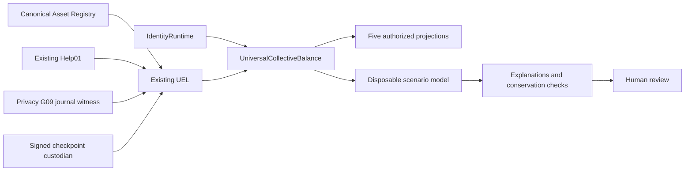

# Universal Collective Balance — спецификация первого ядра

## Граница реализации

UniversalCollectiveBalance — защищённый Python API чтения и моделирования. XBLAGO_UNIVERSAL_BALANCE_ENABLED выключен по умолчанию. Нужны synthetic integration, local provider, secure identity, original journal/witness, установленный UEL и доступный pinned custodian. Новых HTTP, payment или LLM tool endpoints нет.

inspect(token) получает действующую fresh session и роль VIEW. В одной существующей защищённой транзакции строятся пять представлений из LocalLedger._views. simulate(token, Scenario) проверяет тот же snapshot и рассчитывает одноразовую гипотезу. Жизненный цикл Help и Asset остаётся в исходных доменах.

## Модель данных

| Тип | Поля и смысл |
|---|---|
| RolePolicy | version, immutable unique grants по существующим UID. Только доверенная конфигурация синтетического стенда |
| Demand | ссылка на текущий viewer-scoped UEL observation, quantity Decimal string, unit, reusable |
| Option | code ID, существующая HELP observation, условное количество, цена RUB/unit, срочность, deadline, duration, horizon, demands и dependencies |
| Step | ограниченный code key, действие модели, option, существующий session token. Token исключён из repr и выдачи |
| Scenario | source_revision, условный капитал, evidence level, immutable options и steps |
| Projection | scope, PARTIAL coverage, source_revision, authorized items и пять представлений |
| Model output | явный DISPOSABLE_SYNTHETIC_FORECAST, денежная тождественность, прогноз количества, объяснения и состояния модели |

Личный баланс содержит собственные текущие asset observations. Коллективный — разрешённые shared observations. Возможности ссылаются на добровольно доступные части тех же объектов. Благополучие включает видимые Help и взаимно подтверждённые исполнения. Юридическая достоверность собственности, личные долги, реальные общие деньги, измеренный дефицит и человеческий рейтинг остаются UNKNOWN/null. Проекты присутствуют только как варианты сценария.

Достоверность имеет отдельные значения SELF_DECLARED, PARTICIPANT_CONFIRMED, INDEPENDENTLY_VERIFIED, CALCULATED, UNKNOWN, DISPUTED, REVOKED. Подтверждение публикации, достоверность утверждения, целостность истории и свежесть — разные оси. В капитале стенда level относится только к SYNTHETIC_FIXTURE, real_funds_verified всегда false.

## Полномочия

VIEW, PROPOSE, APPROVE и EXECUTE задаются отдельно. Actor определяется только действующей сессией. Для каждого шага проверяется доступ actor к тем же исходным observations. VIEW не расширяет аудиторию Help или приватного Asset.

Самосогласование запрещено моделью. Согласующий не исполняет собственное согласование. Повторный key связывается с actor/action/option. Совпадение не меняет результат, коллизия отклоняет расчёт.

Эти роли проверяют только доступ к симуляции. Ввод Step не является доказательством информированного согласия реального человека. Preview/challenge/nonce человеческого решения, подписанные мандаты, долговечные approvals и исполнения капитала не реализованы. Их отсутствие запрещает использование модели как финансового сервиса.

## Точность и инварианты

1. RUB представлен целым количеством копеек. Float, отрицательные значения и дробная копейка отклоняются.
2. Условный капитал равен свободной части плюс резервам плюс условно израсходованной части на каждом шаге.
3. Для каждого ресурса reserved + used не превышает исходную доступную величину. Неизвестное количество блокирует использование.
4. Unit Demand должен совпадать с источником. Неявных переводов единиц нет.
5. Альтернативы одной потребности согласуют одно условное количество. Совокупное выделение не превышает его.
6. Зависимость требует подтверждённого результата предыдущего шага модели. Нулевая цена требует явной исходной возможности.
7. Отмена и отзыв освобождают резерв до исполнения. Отмена исполненного расхода не создаёт возврат. Неудачный проект сохраняет расход и не создаёт прогнозируемое благо.
8. Reusable capacity возвращается в доступность модели после результата. Подсчёт исходных активов не меняется.
9. Переоценка ValueEngine сохраняет историческую оценку и не изменяет наличный остаток.
10. Прогнозируемые величины показываются отдельно по вариантам. Общая сумма разнородных потребностей остаётся UNKNOWN. Прогноз не создаёт Help/Fulfillment. Source writes равны нулю.

## Объяснимые решения

Порядок рекомендаций использует явную срочность, deadline и code tie-break. Показываются стоимость, продолжительность, зависимости, одноразовый или повторяемый эффект, частичное обеспечение и причины отказов. Это демонстрационная политика, а не доказанный глобальный оптимум. Распределение в текущем стенде задаётся последовательностью явных синтетических решений. Автопроценты фонда и единый welfare score отсутствуют.

Кодовый tie-break может быть управляем автором варианта. Эмпирическая справедливость, достоверность срочности и метод коллективного утверждения остаются вопросами следующего этапа.

## Контракт с UEL и будущие события

Текущий revision — HMAC от разрешённых observations, context revision/epoch viewer и точной политики. Изменение источника, контекста, аудитории или политики требует свежего расчёта. Сессия повторно проверяется даже при повторе шага. В ответе отсутствуют raw UID, labels, чаты, память и session tokens.

Долговечная следующая итерация должна определить доменные факты CapitalReceived, CapitalVerified, BudgetReserved, ApprovalGranted/Revoked, ExternalExecutionReported/Confirmed, RefundConfirmed, ProjectMilestone и RightsChanged. Каждый должен связываться с canonical source ID/version, валютой, minor units, доказательством, ограничениями, actor authority, сроком, CAS и idempotency key. Публикация частного payload и доказательства имеют разные аудитории.

Эти типы пока являются проектом контракта. Для их добавления требуется новая версия схемы существующего UEL с сохранением всех исходных заголовков и ранних checksums. Денежные события под ASSET/HELP не маскируются. Банковские интеграции, резервирование реального имущества и переносимые мандаты отложены.

## Проект долговечного домена следующего этапа

| Проектируемая сущность | Минимальные поля | Основной инвариант |
|---|---|---|
| Capital lot | ID, currency, minor amount, источник, evidence/status, ограничения назначения, срок, authority-policy version, source version | Сумма подтверждённых доступных lots определяет допустимый денежный остаток |
| Reservation | ID, lot references, project/need reference, amount, expiry, state, expected source version, idempotency key | Один резерв атомарно уменьшает свободную часть конкретных lots |
| Approval | ID, action digest, amount/currency, destination commitment, purpose, policy version, signer/mandate reference, expiry/revoke | Согласование потребляется только точным действием текущей версии |
| Project | ID, цели, ссылки на текущие Help needs, milestones, ответственные мандаты, dependencies, оценки и evidence | Результат требует отдельных доказательств и не закрывает Help автоматически |
| External execution observation | ID, reservation/approval reference, минимальная receipt commitment, claimed/confirmed amount, verification status | Сообщение об оплате отдельно от подтверждённого исполнения, повтор не расходует резерв |
| Rights statement | canonical Asset ID, тип права, источник полномочия, получатель, условия, срок/отзыв, версия | Доступность вещи и титул не меняются из-за планового решения |
| Correction/denial | target event reference, основание, версия, минимальное evidence | Исправление создаёт следующее допустимое событие. Отзыв доминирует над старым backup |

Названия и SQL ещё требуют review. Физические данные участника остаются в приватном домене. UEL содержит только защищённые ссылки и допустимые заголовки. Первичным источником каждого факта служит его доменная запись, атомарно связанная с единственным учётным событием UEL.

Политика капитала должна определять допустимые назначения, набор компетенций, quorum, конфликт интересов, пределы и отзыв. Эти параметры должны утверждаться и версионироваться отдельно. Единственный fixture-approver текущего стенда не устанавливает универсальный quorum BLAGO.

## Открытые вопросы благополучия

Модель показывает несколько измерений вместо одного рейтинга. Необходимы проверяемые критерии удовлетворения, срочность с возможностью оспаривания, минимальные базовые гарантии, доступность для людей с разными возможностями и оценка распределительных последствий. Улучшение жизни не выводится автоматически из расхода RUB, BTC-оценки или числа выполненных задач. Требуется наблюдение результатов с согласиями и независимая проверка.
